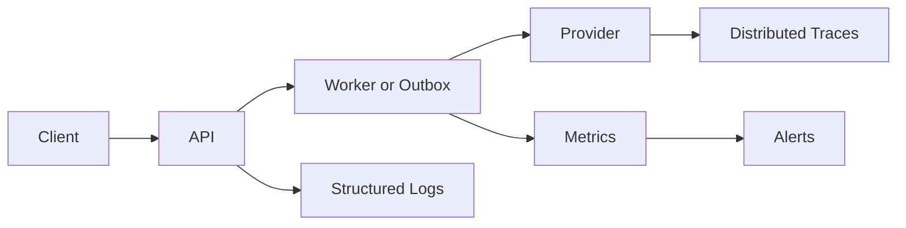
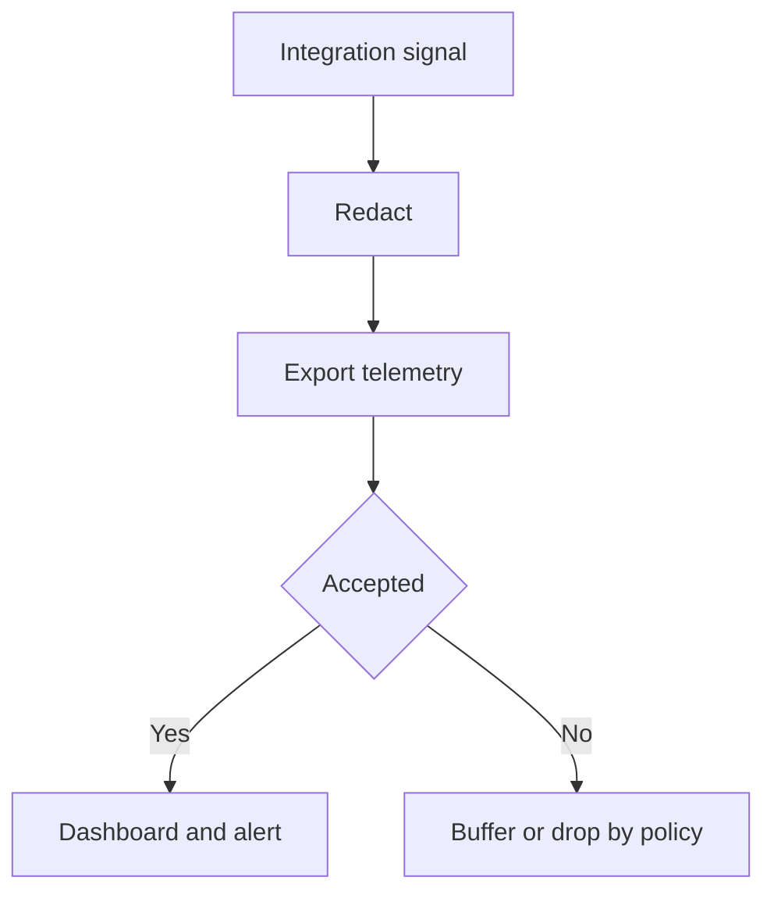

# IC-13 Integration Observability Contract

**Document ID:** IC-13  
**Document Name:** Integration Observability Contract  
**Company:** OreeOn Technologies Pvt. Ltd.  
**Product:** Digitize  
**Document Type:** Integration Contract  
**Backend Technology:** FastAPI  
**Database Engine:** PostgreSQL  
**Client Technology:** Flutter  
**Authentication:** JWT  
**Version:** 0.1  
**Status:** Design Draft  
**Owner:** Integration Architecture  
**Reviewer:** Solution Architecture / Security Architecture / API Architecture / Engineering  
**Dependencies:** IC-00, IC-09, IC-11, IC-12, TA-07, API-13  
**Last Updated:** July 2026

---

# 1. Document Metadata

| Attribute | Value |
|---|---|
| Integration ID | IC-13 |
| Producer | All integration components |
| Consumer | Observability platform and operations teams |
| Classification | Cross-cutting Integration Observability |
| System of Record | Logs, metrics, traces, audit, and execution records |

---

# 2. Purpose

This document defines logs, metrics, tracing, dashboards, alert thresholds, runbook references, and sensitive-data redaction for Digitize integrations.

---

# 3. Scope

In scope: correlation ID, trace ID, span propagation, structured logging, metrics, success rate, failure rate, latency, timeout, retry count, dead-letter count, provider availability, queue depth, outbox backlog, callback delay, reconciliation mismatch, dashboards, alerts, runbook references, and redaction.

Out of scope: observability vendor selection.

---

# 4. Business Context

Integration observability enables support, release readiness, incident response, provider management, and tenant-safe operations.

---

# 5. Integration Objectives

- Make every integration diagnosable by correlation ID.
- Detect provider, callback, retry, queue, and reconciliation problems early.
- Protect sensitive data while preserving operational evidence.

---

# 6. Architecture Context

---

# 7. Actors and Systems

Application services, clients, workers, providers, logging platform, metrics platform, tracing platform, alerting system, operations, support, and security.

---

# 8. Integration Classification

Cross-cutting Integration Observability.

---

# 9. Trust Boundaries

Observability shall cross trust boundaries only with redacted, safe, and approved metadata.

---

# 10. Data Ownership

Operations owns dashboards and alerts. Domain owners own business metrics. Security owns redaction and sensitive-data handling.

---

# 11. Authentication

Observability ingestion and dashboard access require authenticated service or user identity.

---

# 12. Authorization

Dashboard, trace, and log access shall follow least privilege and tenant/data classification controls.

---

# 13. Tenant Context

Tenant context may be logged as opaque IDs where safe and authorized. Sensitive tenant data shall not be logged.

---

# 14. Transport Standards

Telemetry transport shall be encrypted and authenticated.

---

# 15. Payload Standards

Log events shall include timestamp, severity, service, operation, correlation ID, request ID where applicable, integration ID, tenant reference where safe, outcome, and error classification.

---

# 16. Response and Acknowledgement Standards

Telemetry submission failure shall not break core business workflows unless security or audit policy requires fail-closed behavior.

---

# 17. Validation

Telemetry payloads shall be validated for required fields, redaction, allowed labels, and cardinality constraints.

---

# 18. Idempotency

Metrics may be aggregated; audit and execution events requiring exactly-once semantics shall use event IDs.

---

# 19. Ordering

Telemetry ordering is best effort. Correlation and timestamps shall support reconstruction.

---

# 20. Timeout

Telemetry exporters shall use short timeouts and buffering where appropriate.

---

# 21. Retry

Telemetry retry shall be bounded and shall not create retry storms or block user workflows.

---

# 22. Circuit Breaker

Telemetry exporter failure may open a circuit and buffer or drop non-critical telemetry according to policy.

---

# 23. Failure Handling

Loss of critical audit telemetry shall alert. Loss of non-critical metrics may degrade dashboards.

---

# 24. Dead-Letter Handling

Critical telemetry that cannot be exported may be queued for later delivery where supported.

---

# 25. Reconciliation

Operations shall reconcile outbox backlog, dead-letter counts, callback delays, provider availability, and support incidents.

---

# 26. Compensation

Compensation includes replaying telemetry, backfilling metrics, correcting dashboards, and updating runbooks.

---

# 27. Audit

Audit access to observability data and changes to dashboards, alerts, and redaction policy.

---

# 28. Logging

Structured logging is required. Secrets, tokens, signatures, OTPs, raw payment data, and sensitive payloads are prohibited.

---

# 29. Metrics

Required metrics: request count, success count, failure count, latency, timeout count, retry count, circuit state, queue depth, outbox backlog, dead-letter count, callback delay, provider availability, and reconciliation mismatch.

---

# 30. Tracing

Trace propagation shall use correlation ID, request ID where applicable, and trace/span IDs across client, API, worker, provider call, callback, and webhook delivery.

---

# 31. Alerts

Alerts shall define threshold, severity, owner, runbook, escalation, and expected response time.

---

# 32. Security

Telemetry shall be redacted and access-controlled.

---

# 33. Performance and Capacity

Telemetry cardinality, sampling, retention, and storage volume shall be controlled.

---

# 34. Versioning

Metric names, log fields, dashboard definitions, and alert rules shall be version controlled.

---

# 35. Integration Contracts

IC-13 is required by IC-04 through IC-12 and IC-17.

---

# 36. Sequence Diagrams

See section 6.

---

# 37. Failure Flow Diagrams

---

# 38. Traceability

Traceability maps to TA-07, API-13, IC-11, IC-14, and IC-15.

---

# 39. Test Coverage

Log redaction, correlation propagation, metric emission, trace continuity, alert threshold, dashboard availability, telemetry outage, and runbook link tests are required.

---

# 40. Assumptions and Constraints

Integration observability shall align with OpenTelemetry, Prometheus, Grafana, Loki, and Tempo per `DR-013_OpenTelemetry_Prometheus_Grafana_Observability_Baseline.md`.

---

# 41. Dependencies

IC-00, IC-09, IC-11, IC-12, TA-07, API-13.

---

# 42. Future Enhancements

SLO dashboards, synthetic probes, anomaly detection, and provider scorecards may be added later.

---

# 43. Acceptance Criteria

- Required logs, metrics, traces, dashboards, alerts, and runbook references are defined.
- Sensitive data redaction is explicit.
- Provider and async health are observable.

---

# 44. Summary

IC-13 defines integration observability expectations for Digitize.
