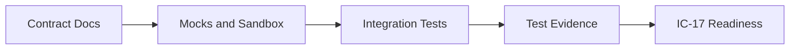
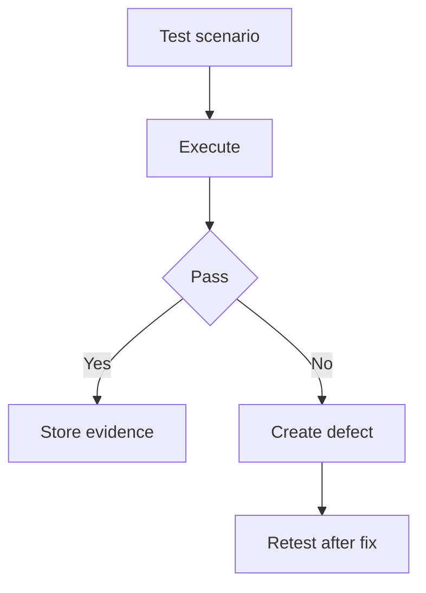

# IC-14 Integration Testing Strategy

**Document ID:** IC-14  
**Document Name:** Integration Testing Strategy  
**Company:** OreeOn Technologies Pvt. Ltd.  
**Product:** Digitize  
**Document Type:** Integration Contract  
**Backend Technology:** FastAPI  
**Database Engine:** PostgreSQL  
**Client Technology:** Flutter  
**Authentication:** JWT  
**Version:** 0.1  
**Status:** Design Draft  
**Owner:** Integration Architecture  
**Reviewer:** Solution Architecture / Security Architecture / API Architecture / Engineering  
**Dependencies:** IC-00 to IC-13, API-16, API_Test_Cases.md, Postman_Collection.md  
**Last Updated:** July 2026

---

# 1. Document Metadata

| Attribute | Value |
|---|---|
| Integration ID | IC-14 |
| Producer | QA / Automation |
| Consumer | Engineering / Release / Operations |
| Classification | Integration Testing |
| System of Record | Test management and evidence repository |

---

# 2. Purpose

This document defines integration, contract, sandbox, callback, resilience, tenant-isolation, security, performance, and end-to-end testing for Digitize integrations.

---

# 3. Scope

In scope: contract testing, consumer-driven contract testing, provider simulation, sandbox testing, callback testing, retry testing, timeout testing, duplicate testing, idempotency testing, tenant-isolation testing, security testing, failure-injection testing, resilience testing, reconciliation testing, performance testing, end-to-end testing, certification, evidence, entry criteria, and exit criteria.

Out of scope: UI visual regression and unit test implementation.

---

# 4. Business Context

Integrations affect customer onboarding, payments, communication, reports, files, support, operations, and partner readiness.

---

# 5. Integration Objectives

- Validate contract behavior before release.
- Prove tenant isolation and security controls.
- Exercise failure and recovery flows.
- Produce release-ready evidence.

---

# 6. Architecture Context

---

# 7. Actors and Systems

QA, automation, backend, frontend, DevOps, security, provider engineers, support, and release owners.

---

# 8. Integration Classification

Integration Testing.

---

# 9. Trust Boundaries

Tests shall include every integration trust boundary: client/API, API/provider, provider/callback, event/consumer, file/storage, report/export, and admin/support.

---

# 10. Data Ownership

Test data shall be synthetic and owned by QA. Production data shall not be used unless formally approved and masked.

---

# 11. Authentication

Tests shall use approved test identities and secret references.

---

# 12. Authorization

Tests shall cover allowed, denied, cross-role, and support/admin access paths.

---

# 13. Tenant Context

Tenant tests shall include valid context, missing context, wrong hierarchy, unauthorized tenant, and multi-organization switching.

---

# 14. Transport Standards

Tests shall run against local, development, test, QA, staging, sandbox, and production-validation environments as allowed by IC-16.

---

# 15. Payload Standards

Test payloads shall include success, empty, invalid, boundary, oversized, duplicate, and unsupported-version cases.

---

# 16. Response and Acknowledgement Standards

Tests shall assert response envelopes, callback acknowledgements, async statuses, webhook delivery states, and user-safe error codes.

---

# 17. Validation

Validation tests shall cover schema, business rule, tenant, permission, state, idempotency, and provider payload validation.

---

# 18. Idempotency

Duplicate and replay tests are mandatory for payment, refund, file, report, callback, webhook, and event contracts.

---

# 19. Ordering

Tests shall cover out-of-order callbacks and events where ordering is not guaranteed.

---

# 20. Timeout

Timeout tests shall cover client timeout, provider timeout, worker timeout, callback timeout, and polling timeout.

---

# 21. Retry

Retry tests shall assert retry count, backoff, jitter behavior where observable, retry exclusions, and retry exhaustion.

---

# 22. Circuit Breaker

Circuit-breaker tests shall cover open, fail-fast, half-open, recovery, and alert behavior.

---

# 23. Failure Handling

Failure-injection tests shall cover temporary failure, permanent failure, partial success, unknown outcome, and manual correction.

---

# 24. Dead-Letter Handling

Dead-letter tests shall cover retry exhaustion, evidence capture, replay eligibility, replay success, and replay denial.

---

# 25. Reconciliation

Reconciliation tests shall cover missing records, duplicate records, delayed callback, provider mismatch, and settlement/export mismatch.

---

# 26. Compensation

Compensation tests shall cover refund, reversal, cancellation, resend, replay, cleanup, and administrative correction where applicable.

---

# 27. Audit

Tests shall verify audit event creation for security, financial, lifecycle, integration, and administrative actions.

---

# 28. Logging

Tests shall verify sensitive data is redacted from logs.

---

# 29. Metrics

Tests shall verify required metrics are emitted for core integration paths.

---

# 30. Tracing

Tests shall verify correlation ID propagation across integration boundaries and request ID uniqueness per HTTP request or retry attempt.

---

# 31. Alerts

Tests shall verify alert rules in non-production environments where safe.

---

# 32. Security

Security tests shall cover signatures, replay, secrets redaction, tenant isolation, least privilege, and administrative access.

---

# 33. Performance and Capacity

Performance tests shall cover expected rate, burst, payload size, queue depth, callback rate, and report export size.

---

# 34. Versioning

Contract tests shall detect breaking schema and event changes.

---

# 35. Integration Contracts

IC-14 validates IC-01 through IC-13 and feeds IC-17 readiness.

---

# 36. Sequence Diagrams

See section 6.

---

# 37. Failure Flow Diagrams

---

# 38. Traceability

Traceability is maintained in IC-15 and shall link tests to API-16, API_Test_Cases.md, Postman_Collection.md, and IC contracts.

---

# 39. Test Coverage

| Coverage Area | Required |
|---|---|
| Contract | Yes |
| Sandbox | Yes |
| Callback | Yes |
| Retry and timeout | Yes |
| Idempotency | Yes |
| Tenant isolation | Yes |
| Security | Yes |
| Reconciliation | Yes |
| E2E | Yes |

---

# 40. Assumptions and Constraints

Provider certification requirements are `[TBD — Source mapping pending — see BE traceability mappings](docs/10_Backend_Engineering/BE-TRACEABILITY_MAPPINGS.md)` until providers are selected.

---

# 41. Dependencies

IC-00 through IC-13, API-16, API_Test_Cases.md, Postman_Collection.md.

---

# 42. Future Enhancements

Consumer-driven contract tooling, chaos testing, synthetic provider simulation, and automated certification evidence may be added later.

---

# 43. Acceptance Criteria

- Integration test categories are defined.
- Entry, exit, evidence, and readiness connections are defined.
- Failure and resilience tests are explicit.
- Correlation ID and request ID observability checks are included.

---

# 44. Summary

IC-14 defines the integration testing strategy for Digitize.
