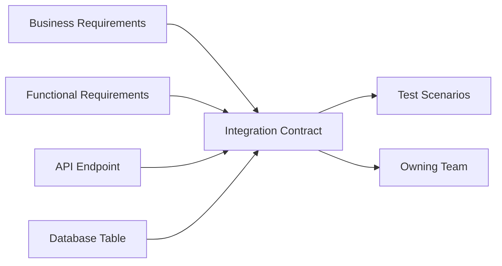

# IC-15 Integration Traceability Matrix

**Document ID:** IC-15  
**Document Name:** Integration Traceability Matrix  
**Company:** OreeOn Technologies Pvt. Ltd.  
**Product:** Digitize  
**Document Type:** Integration Contract  
**Backend Technology:** FastAPI  
**Database Engine:** PostgreSQL  
**Client Technology:** Flutter  
**Authentication:** JWT  
**Version:** 0.1  
**Status:** Design Draft  
**Owner:** Integration Architecture  
**Reviewer:** Solution Architecture / Security Architecture / API Architecture / Engineering  
**Dependencies:** IC-00 to IC-17, API-17  
**Last Updated:** July 2026

---

# 1. Document Metadata

| Attribute | Value |
|---|---|
| Integration ID | IC-15 |
| Producer | Integration Architecture |
| Consumer | Product, Engineering, QA, Release, Support |
| Classification | Traceability Governance |
| System of Record | Approved documentation sources |

---

# 2. Purpose

This document defines the matrix used to map integrations to business requirements, functional requirements, API endpoints, database tables, domain events, audit events, UI workflows, test scenarios, and owning teams.

---

# 3. Scope

In scope: traceability matrix format, required columns, source mapping rules, integration coverage, ownership, status, review state, and readiness dependency.

Out of scope: inventing missing source references.

---

# 4. Business Context

Traceability proves that each integration exists for an approved business reason and is testable, supportable, and release-ready.

---

# 5. Integration Objectives

- Avoid undocumented integration behavior.
- Link contracts to source requirements and tests.
- Identify unresolved source mappings before Frozen status.

---

# 6. Architecture Context

---

# 7. Actors and Systems

Product, BA, Architecture, API, Database, Frontend, QA, DevOps, Support, Operations, and external partner owners.

---

# 8. Integration Classification

Traceability Governance.

---

# 9. Trust Boundaries

Traceability shall identify all trust boundaries crossed by an integration.

---

# 10. Data Ownership

Each row shall identify system of record and data owner where applicable.

---

# 11. Authentication

Each row shall identify authentication method or state `Not Applicable — no authenticated boundary`.

---

# 12. Authorization

Each row shall identify authorization control or state `Not Applicable — no authorization boundary`.

---

# 13. Tenant Context

Each tenant-scoped row shall identify Organization, Facility, Site, and resource ownership mapping.

---

# 14. Transport Standards

Each row shall identify transport type.

---

# 15. Payload Standards

Each row shall identify payload or event schema reference.

---

# 16. Response and Acknowledgement Standards

Each row shall identify acknowledgement behavior.

---

# 17. Validation

Each row shall identify validation owners and source references.

---

# 18. Idempotency

Each retry-prone row shall identify idempotency rule.

---

# 19. Ordering

Each async row shall identify ordering expectation.

---

# 20. Timeout

Each external or async row shall identify timeout policy.

---

# 21. Retry

Each row shall identify retry eligibility and retry policy.

---

# 22. Circuit Breaker

Provider-backed rows shall identify circuit-breaker behavior.

---

# 23. Failure Handling

Each row shall identify failure states and owner.

---

# 24. Dead-Letter Handling

Async rows shall identify dead-letter behavior or explicit non-applicability.

---

# 25. Reconciliation

Rows with provider, financial, file, report, or event risk shall identify reconciliation behavior.

---

# 26. Compensation

Rows with irreversible or external effects shall identify compensation behavior.

---

# 27. Audit

Each security, financial, tenant, lifecycle, administrative, and external row shall map audit events.

---

# 28. Logging

Each row shall identify safe logging requirements.

---

# 29. Metrics

Each row shall identify required operational metrics.

---

# 30. Tracing

Each row shall identify correlation and trace propagation.

---

# 31. Alerts

Each row shall identify alert owner and severity where applicable.

---

# 32. Security

Each row shall identify data classification and security controls.

---

# 33. Performance and Capacity

Each row shall identify expected rate, size, burst, and limits where applicable.

---

# 34. Versioning

Each row shall identify version and compatibility expectations.

---

# 35. Integration Contracts

| Integration | Business Requirement | Functional Requirement | API Endpoint | Database Table | Domain Event | Audit Event | UI Workflow | Test Scenario | Owning Team | Status |
|---|---|---|---|---|---|---|---|---|---|---|
| IC-01 Frontend Backend | BA-06 | FR-02 to FR-21 | API-01 to API-26 | DB-01 to DB-22 | OrganizationCreated, FacilityCreated, SiteCreated, UserCreated, WalkInVisitCreated, TicketCreated (see DB-10 Database Traceability) | API-13 | 09_UI_UX_Design | IC-14 | Frontend / API | Design Draft |
| IC-02 Authentication Session | BA-05 | FR-06 | API-03 | identity.*, security.* | security.session.* | API-13 | 09_UI_UX_Design | IC-14 | Identity / Security | Design Draft |
| IC-03 Tenant Context | BA-01 | FR-03 to FR-06 | API-02, API-03 | tenant.* | tenant.context.* | API-13 | 09_UI_UX_Design | IC-14 | Tenant / Security | Design Draft |
| IC-04 Payment Gateway | Commercial Strategy | FR-14 to FR-16 | API-08, API-09, API-18 | commercial.* | payment.* | API-13 | 09_UI_UX_Design | IC-14 | Commercial / Integration | Design Draft |
| IC-05 Notification Provider | BA-03 | FR-17, FR-18 | API-10, API-18 | communication.* | notification.* | API-13 | 09_UI_UX_Design | IC-14 | Communication | Design Draft |
| IC-06 File Storage | BA-03 | FR-03, FR-07, FR-20 | API-02, API-04, API-12 | tenant.organization_document, tenant.site_document, customer.customer_document, support.ticket_attachment, data_export_record | file.* | API-13 | 09_UI_UX_Design | IC-14 | Platform / Support | Design Draft |
| IC-07 Report Export | BA-03 | FR-19 | API-11 | reporting.* | report.* | API-13 | 09_UI_UX_Design | IC-14 | Reporting | Design Draft |
| IC-08 Webhook Callback | TA-04 | FR-14, FR-18 | API-18 | DB-22 | webhook.* | API-13 | Not Applicable — backend/external integration | IC-14 | Integration | Design Draft |
| IC-09 Event Outbox | TA-04 | FR-02 to FR-21 | API-18 | DB-22 | domain.* | API-13 | Not Applicable — async backend integration | IC-14 | Platform / Integration | Design Draft |
| IC-10 External System | [TBD — Source mapping pending — see BE traceability mappings](docs/10_Backend_Engineering/BE-TRACEABILITY_MAPPINGS.md) | [TBD — Source mapping pending — see BE traceability mappings](docs/10_Backend_Engineering/BE-TRACEABILITY_MAPPINGS.md) | [TBD — Source mapping pending — see BE traceability mappings](docs/10_Backend_Engineering/BE-TRACEABILITY_MAPPINGS.md) | [TBD — Source mapping pending — see BE traceability mappings](docs/10_Backend_Engineering/BE-TRACEABILITY_MAPPINGS.md) | [TBD — Source mapping pending — see BE traceability mappings](docs/10_Backend_Engineering/BE-TRACEABILITY_MAPPINGS.md) | API-13 | [TBD — Source mapping pending — see BE traceability mappings](docs/10_Backend_Engineering/BE-TRACEABILITY_MAPPINGS.md) | IC-14 | Integration | Design Draft |
| IC-11 Integration Error Retry | TA-04, TA-07 | FR-02 to FR-21 | API-19, API-20 | Integration execution records | Not Applicable — governance contract | API-13 | 09_UI_UX_Design error states | IC-14 | Integration / DevOps / Support | Design Draft |
| IC-12 Integration Security | TA-05 | FR-06, FR-21 | API-13, API-23 | security.*, audit.* | security.* | API-13 | 09_UI_UX_Design secure states | IC-14 | Security / Architecture | Design Draft |
| IC-13 Integration Observability | TA-07 | Non-functional requirements | API-13 | Logs, metrics, traces, audit records | integration.observed | API-13 | Not Applicable — operational governance | IC-14 | DevOps / Operations | Design Draft |
| IC-14 Integration Testing Strategy | Testing | API-16, API_Test_Cases.md | Postman_Collection.md | Test evidence repository | Not Applicable — testing governance | API-13 where auditable | Not Applicable — testing strategy | IC-14 | QA / Automation | Design Draft |
| IC-15 Integration Traceability Matrix | BA-08 | API-17 | API-01 to API-26 | Approved documentation sources | Not Applicable — traceability governance | API-13 where auditable | 09_UI_UX_Design | IC-14 | Integration Architecture | Design Draft |
| IC-16 Integration Environment Configuration | TA-06 | Deployment readiness | API-15, API-25 | Environment configuration registry | Not Applicable — environment governance | API-13 where auditable | Not Applicable — environment governance | IC-14 | DevOps / Security | Design Draft |
| IC-17 Integration Release Readiness Checklist | Release readiness | API-26 | API-26 | Release evidence repository | Not Applicable — readiness governance | API-13 where auditable | Not Applicable — release governance | IC-14 | Release / Operations | Design Draft |

---

# 36. Sequence Diagrams

Not Applicable — this document defines traceability rows rather than runtime behavior.

---

# 37. Failure Flow Diagrams

Not Applicable — this document defines traceability rows rather than runtime behavior.

---

# 38. Traceability

This document is the primary Integration Contract traceability matrix.

---

# 39. Test Coverage

Each row shall map to IC-14 and downstream executable test evidence before Frozen status.

---

# 40. Assumptions and Constraints

Rows using `[TBD — Source mapping pending — see BE traceability mappings](docs/10_Backend_Engineering/BE-TRACEABILITY_MAPPINGS.md)` require source review before Frozen status.

---

# 41. Dependencies

IC-00 through IC-17, API-17, API_Test_Cases.md.

---

# 42. Future Enhancements

The matrix may later be exported to a spreadsheet or traceability system without changing authoritative Markdown ownership.

---

# 43. Acceptance Criteria

- Required traceability columns are defined.
- Baseline rows exist for IC-01 through IC-10.
- Missing source mappings are clearly marked.
- Frozen status is blocked by unresolved required mappings.

---

# 44. Summary

IC-15 defines the Integration Contract traceability matrix for Digitize.
