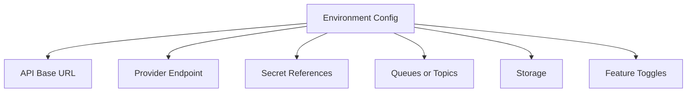
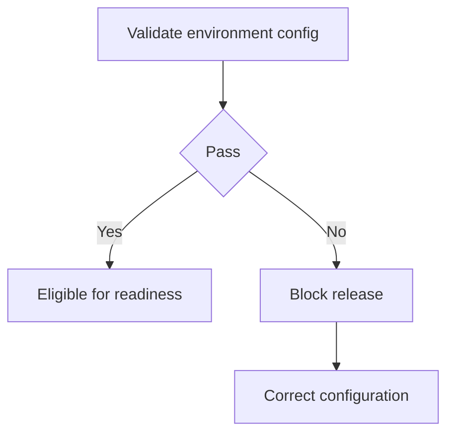

# IC-16 Integration Environment Configuration

**Document ID:** IC-16  
**Document Name:** Integration Environment Configuration  
**Company:** OreeOn Technologies Pvt. Ltd.  
**Product:** Digitize  
**Document Type:** Integration Contract  
**Backend Technology:** FastAPI  
**Database Engine:** PostgreSQL  
**Client Technology:** Flutter  
**Authentication:** JWT  
**Version:** 0.1  
**Status:** Design Draft  
**Owner:** Integration Architecture  
**Reviewer:** Solution Architecture / Security Architecture / API Architecture / Engineering  
**Dependencies:** IC-00 to IC-15, API-15, API-25  
**Last Updated:** July 2026

---

# 1. Document Metadata

| Attribute | Value |
|---|---|
| Integration ID | IC-16 |
| Producer | DevOps / Integration Architecture |
| Consumer | Engineering / QA / Release / Operations |
| Classification | Environment Configuration |
| System of Record | Environment configuration registry and secret references |

---

# 2. Purpose

This document defines environment-specific integration endpoints, callback URLs, credential references, secret references, queue or topic names, storage settings, timeouts, retry settings, feature toggles, tenant isolation, and production protection.

---

# 3. Scope

In scope: local, development, test, QA, staging, sandbox, production, base URLs, provider endpoints, callback URLs, webhook URLs, client IDs, secret references, certificate references, queue/topic names, storage configuration, timeouts, retry settings, feature toggles, environment isolation, test tenants, and production protection.

Out of scope: real credentials and infrastructure provisioning scripts.

---

# 4. Business Context

Consistent environment configuration allows frontend, backend, QA, providers, support, and release teams to test safely without leaking secrets or polluting production data.

---

# 5. Integration Objectives

- Separate non-production and production configuration.
- Avoid real secrets in documentation.
- Support sandbox and mock readiness.
- Define callback and webhook URL ownership.

---

# 6. Architecture Context

---

# 7. Actors and Systems

DevOps, backend, frontend, QA, security, provider engineers, support, and release owners.

---

# 8. Integration Classification

Environment Configuration.

---

# 9. Trust Boundaries

Production is a protected boundary. Sandbox and QA shall not use production credentials, tenants, callback URLs, storage buckets, queues, topics, or provider accounts unless formally approved.

---

# 10. Data Ownership

DevOps owns runtime configuration. Security owns secrets. Integration owners own provider endpoint mappings.

---

# 11. Authentication

Authentication configuration uses secret references only.

---

# 12. Authorization

Access to environment configuration shall follow least privilege.

---

# 13. Tenant Context

Test tenants shall be clearly marked and isolated from production tenants.

---

# 14. Transport Standards

All external endpoints shall use HTTPS unless a formally approved internal transport is documented.

---

# 15. Payload Standards

Configuration records shall not include real secret values.

---

# 16. Response and Acknowledgement Standards

Configuration validation shall produce pass, fail, warning, or waiver status.

---

# 17. Validation

Validate required base URLs, callback URLs, webhook URLs, secret references, certificate references, timeout values, retry values, toggles, storage targets, and environment isolation.

---

# 18. Idempotency

Configuration deployment shall be repeatable and auditable.

---

# 19. Ordering

Secret creation, provider registration, callback validation, and feature toggle activation shall follow release order.

---

# 20. Timeout

Timeout values shall be environment-specific and lower in test environments where appropriate.

---

# 21. Retry

Retry settings shall follow IC-11 and may differ by environment.

---

# 22. Circuit Breaker

Circuit-breaker thresholds shall be configurable by environment.

---

# 23. Failure Handling

Invalid configuration shall block release readiness for the affected integration.

---

# 24. Dead-Letter Handling

Dead-letter storage shall be configured for async integrations in non-production and production where applicable.

---

# 25. Reconciliation

Environment configuration shall be reconciled against deployed configuration and provider dashboards before release.

---

# 26. Compensation

Compensation includes rollback, toggle disablement, credential revocation, callback deregistration, and endpoint correction.

---

# 27. Audit

Configuration changes, secret reference changes, callback registration, webhook registration, and production enablement shall be audited.

---

# 28. Logging

Configuration logs shall redact secret values and sensitive endpoints where required.

---

# 29. Metrics

Track configuration validation status, callback validation status, secret expiry, toggle status, and environment health.

---

# 30. Tracing

Configuration changes shall be traceable to change request, release, owner, and approval.

---

# 31. Alerts

Alert on secret expiry, callback validation failure, production/sandbox mismatch, queue backlog, and storage permission failure.

---

# 32. Security

Secrets shall be stored only in approved secret stores and referenced by name or identifier.

---

# 33. Performance and Capacity

Environment-specific rate limits, quotas, worker concurrency, and queue limits shall be defined.

---

# 34. Versioning

Environment configuration changes shall be version controlled and release-linked.

---

# 35. Integration Contracts

| Environment | Purpose | Production Data Allowed |
|---|---|---|
| Local | Developer validation | No |
| Development | Shared engineering | No |
| Test | Automated tests | No |
| QA | QA validation | No |
| Staging | Release rehearsal | Controlled only by approval |
| Sandbox | Provider and consumer testing | No |
| Production | Live operations | Yes |

---

# 36. Sequence Diagrams

Not Applicable — this document governs configuration rather than a runtime business flow.

---

# 37. Failure Flow Diagrams

---

# 38. Traceability

Traceability maps to API-15, API-25, IC-14, IC-15, and IC-17.

---

# 39. Test Coverage

Configuration validation, secret reference, callback URL, webhook URL, provider endpoint, queue/topic, storage, timeout, retry, toggle, sandbox, and production protection tests are required.

---

# 40. Assumptions and Constraints

Real credentials shall never be documented. Exact endpoint values are `[TBD — Source mapping pending — see BE traceability mappings](docs/10_Backend_Engineering/BE-TRACEABILITY_MAPPINGS.md)` until environment provisioning is approved.

---

# 41. Dependencies

IC-00 through IC-15, API-15, API-25.

---

# 42. Future Enhancements

Automated configuration drift detection and environment promotion reports may be added later.

---

# 43. Acceptance Criteria

- Environments and configuration categories are defined.
- No real credentials are included.
- Production protection and sandbox behavior are explicit.
- Release readiness can consume this document.

---

# 44. Summary

IC-16 defines environment configuration standards for Digitize integrations.
