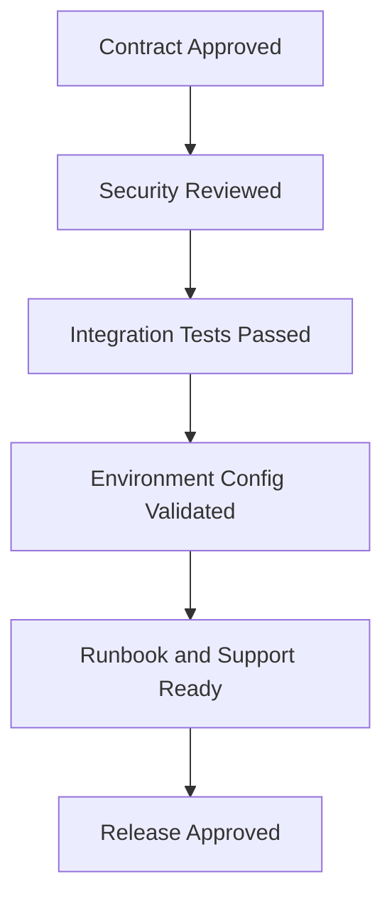
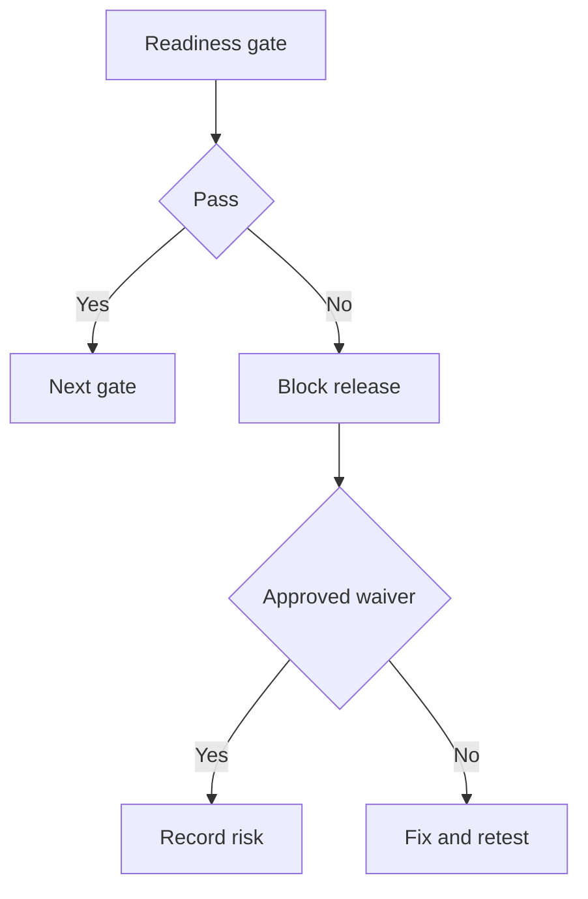

# IC-17 Integration Release Readiness Checklist

**Document ID:** IC-17  
**Document Name:** Integration Release Readiness Checklist  
**Company:** OreeOn Technologies Pvt. Ltd.  
**Product:** Digitize  
**Document Type:** Integration Contract  
**Backend Technology:** FastAPI  
**Database Engine:** PostgreSQL  
**Client Technology:** Flutter  
**Authentication:** JWT  
**Version:** 0.1  
**Status:** Design Draft  
**Owner:** Integration Architecture  
**Reviewer:** Solution Architecture / Security Architecture / API Architecture / Engineering  
**Dependencies:** IC-00 to IC-16, API-26  
**Last Updated:** July 2026

---

# 1. Document Metadata

| Attribute | Value |
|---|---|
| Integration ID | IC-17 |
| Producer | Release / Integration Architecture |
| Consumer | Engineering / QA / DevOps / Support / Operations |
| Classification | Release Readiness |
| System of Record | Release evidence and approval records |

---

# 2. Purpose

This document defines readiness criteria before an integration is released.

---

# 3. Scope

In scope: contract approval, security review, provider approval, sandbox validation, credentials, secrets, callback registration, idempotency, retry, timeout, circuit breaker, tenant isolation, audit, metrics, alerts, runbook, reconciliation, rollback, support ownership, and production validation.

Out of scope: application deployment procedure details covered by Deployment documentation.

---

# 4. Business Context

Release readiness prevents untested integrations from impacting tenants, customers, payments, notifications, reports, files, or external partners.

---

# 5. Integration Objectives

- Define release gates.
- Capture evidence.
- Assign support ownership.
- Align integration release with API and deployment readiness.

---

# 6. Architecture Context

---

# 7. Actors and Systems

Release manager, integration owner, security owner, QA owner, DevOps owner, support owner, operations owner, provider owner, and product owner.

---

# 8. Integration Classification

Release Readiness.

---

# 9. Trust Boundaries

Readiness shall verify every trust boundary defined in the target integration contract.

---

# 10. Data Ownership

Readiness evidence is owned by release governance. Integration data ownership remains with each contract.

---

# 11. Authentication

Authentication method, credential provisioning, and secret references shall be validated.

---

# 12. Authorization

Least-privilege permissions and tenant scopes shall be validated.

---

# 13. Tenant Context

Tenant isolation and context validation tests shall pass.

---

# 14. Transport Standards

Transport endpoint, TLS, callback, webhook, queue/topic, storage, and provider connectivity shall be validated.

---

# 15. Payload Standards

Payload schemas, event versions, file metadata, report formats, and provider mappings shall be approved.

---

# 16. Response and Acknowledgement Standards

Success, accepted, failure, retry, timeout, dead-letter, and reconciliation outcomes shall be tested.

---

# 17. Validation

All required validation controls from the source contract shall pass.

---

# 18. Idempotency

Idempotency shall be verified for retry-prone commands, callbacks, webhooks, events, reports, files, payments, and refunds.

---

# 19. Ordering

Ordering behavior shall be verified where required.

---

# 20. Timeout

Timeout values shall be configured and tested.

---

# 21. Retry

Retry policy, retry exclusions, retry exhaustion, and retry evidence shall be verified.

---

# 22. Circuit Breaker

Circuit-breaker behavior shall be configured and tested where applicable.

---

# 23. Failure Handling

Failure states and support actions shall be documented and tested.

---

# 24. Dead-Letter Handling

Dead-letter path, retention, owner, replay eligibility, and evidence shall be verified.

---

# 25. Reconciliation

Reconciliation process, cadence, owner, and mismatch handling shall be validated.

---

# 26. Compensation

Rollback, reversal, refund, cancellation, replay, or manual correction procedures shall be documented.

---

# 27. Audit

Audit events shall be verified for security, financial, tenant, lifecycle, and administrative flows.

---

# 28. Logging

Logs shall be present and redacted.

---

# 29. Metrics

Metrics shall be emitted and visible.

---

# 30. Tracing

Correlation IDs, request IDs, and traces shall be verifiable across integration boundaries.

---

# 31. Alerts

Alerts shall have thresholds, owners, and runbook references.

---

# 32. Security

Security review, secrets, signatures, encryption, least privilege, replay protection, and incident response shall be approved.

---

# 33. Performance and Capacity

Expected load, burst, size, concurrency, quotas, and degradation behavior shall be validated.

---

# 34. Versioning

Contract version, migration, deprecation, and compatibility controls shall be approved.

---

# 35. Integration Contracts

| Readiness Gate | Required Status |
|---|---|
| Contract approved | Pass |
| Security reviewed | Pass |
| Provider approved | Pass or Not Applicable |
| Sandbox validated | Pass |
| Credentials provisioned | Pass |
| Secrets stored | Pass |
| Callback registered | Pass or Not Applicable |
| Idempotency verified | Pass |
| Retry verified | Pass |
| Timeout verified | Pass |
| Circuit breaker verified | Pass or waiver |
| Tenant isolation verified | Pass |
| Audit verified | Pass |
| Metrics verified | Pass |
| Request and correlation identifiers verified | Pass |
| Alerts verified | Pass |
| Runbook completed | Pass |
| Reconciliation completed | Pass or Not Applicable |
| Rollback prepared | Pass |
| Support ownership assigned | Pass |
| Production validation completed | Pass |

---

# 36. Sequence Diagrams

See section 6.

---

# 37. Failure Flow Diagrams

---

# 38. Traceability

Readiness shall map to IC-15 rows and API-26 readiness criteria.

---

# 39. Test Coverage

Readiness evidence shall include IC-14 test results for every in-scope integration.

---

# 40. Assumptions and Constraints

Any waiver must have owner, expiry, risk statement, mitigation, and approval.

---

# 41. Dependencies

IC-00 through IC-16, API-26.

---

# 42. Future Enhancements

Automated readiness dashboards and release gate automation may be added later.

---

# 43. Acceptance Criteria

- All readiness gates are defined.
- Required evidence is explicit.
- Waiver governance is defined.
- Release can be blocked by failed critical controls.

---

# 44. Summary

IC-17 defines the release readiness checklist for Digitize integrations.
