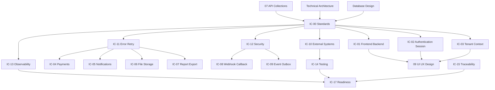

# Integration Contracts

This folder contains the controlled Integration Contract documentation set for Digitize, the enterprise multi-tenant SaaS platform developed by OreeOn Technologies Pvt. Ltd.

The Integration Contract documentation defines how frontend applications, backend services, payment gateways, notification providers, storage systems, reporting services, event processors, and future external partners interact with Digitize across controlled trust boundaries.

---

# 1. Purpose

The purpose of this folder is to provide the contract and integration bridge between the API Collections and UI/UX Design documentation.

These documents translate approved API, architecture, database, commercial, and functional requirements into implementation-ready integration behavior without duplicating endpoint catalogs or generating application source code.

---

# 2. Integration Documentation Objectives

The Integration Contract documentation shall:

- Define integration ownership, producer and consumer responsibilities.
- Separate authentication, authorization, tenant validation, and business validation.
- Standardize synchronous, asynchronous, callback, webhook, file, report, and event integration behavior.
- Define timeout, retry, circuit-breaker, idempotency, dead-letter, reconciliation, and compensation behavior.
- Preserve Organization, Facility, and Site tenant isolation across every integration boundary.
- Define security, secrets, signatures, encryption, audit, observability, and operational support expectations.
- Provide frontend/backend behavior needed before UI/UX workflows are finalized.
- Support QA, contract testing, sandbox testing, release readiness, and partner onboarding.

---

# 3. Intended Audience

This documentation is intended for:

- Solution Architects
- Integration Architects
- API Architects
- Backend Engineers
- Frontend Engineers
- Mobile Engineers
- DevOps Engineers
- Security Engineers
- QA Engineers
- Automation Engineers
- Database Engineers
- Support Engineers
- Operations Teams
- Implementation Partners
- External Integration Partners

---

# 4. Out of Scope

This folder does not define:

- REST endpoint specifications
- Database schema definitions
- UI screen layouts
- Infrastructure deployment
- Kubernetes configuration
- Source code
- OpenAPI implementation
- Flutter implementation
- Backend implementation
- Provider-specific SDK implementation

Those artifacts are owned by their respective documentation areas.

---

# 5. Integration Principles

All Integration Contracts follow these principles:

- Contract First
- Secure by Default
- Multi-Tenant Isolation
- Idempotent Operations
- Event-Driven Where Appropriate
- Provider Neutral
- Failure Isolation
- Backward Compatibility
- Observable by Default

---

# 6. Relationship with API Collections

API Collections define what APIs exist and how they behave.

Integration Contracts define how systems consume those APIs, exchange data, recover from failures, authenticate, authorize, retry, reconcile, and operate across trust boundaries.

The Integration Contracts do not duplicate API endpoint catalogs. They extend approved API specifications with interaction behavior required for frontend applications, external providers, internal services, event processors, file storage, reporting, testing, deployment, and operations.

---

# 7. Folder Position in the Documentation Hierarchy

```text
01_Product_Foundation/
02_Commercial_Strategy/
03_Business_Analysis/
04_Functional_Requirements/
05_Technical_Architecture/
06_Database_Design/
07_API_Collections/
08_Integration_Contracts/
09_UI_UX_Design/
10_Backend_Engineering/
11_Deployment/
12_Testing/
13_Operations/
14_Release_Management/
15_Release_Notes/
16_Development_Readiness/
99_Decision_Records/
```

Integration Contracts sit after API Collections and before UI/UX Design.

Backend Engineering consumes the approved Integration Contracts during implementation and shall not redefine the common integration behavior governed by `IC-00`.

---

# 8. Source Documents

| Source Area | Source Documents | Usage |
|---|---|---|
| Product Foundation | Product Vision, Glossary, Domain Model | Terminology and platform hierarchy |
| Business Analysis | BA-01 to BA-10 | Journeys, actors, rules, assumptions, and constraints |
| Functional Requirements | FR-01 to FR-21 | Functional behavior, validations, notifications, and audit expectations |
| Technical Architecture | TA-00 to TA-10 | Boundaries, integration, security, deployment, and observability |
| Commercial Strategy | Subscription, licensing, billing, payment, discount, and renewal policies | Commercial integration behavior |
| Database Design | DB-00 to DB-22 | Tables, outbox, audit, reporting, and persistence ownership |
| API Collections | API-00 to API-26, approved API test artifacts, and approved Postman collections | API behavior, errors, access, state, mocks, and consumer readiness |
| UI/UX Design | UI navigation and screen specifications where available | Client workflow mapping |
| Testing | Test strategy and test cases | Validation and acceptance coverage |

When an approved identifier is unavailable, documents shall use `[TBD — Source mapping pending — see BE traceability mappings](docs/10_Backend_Engineering/BE-TRACEABILITY_MAPPINGS.md)`.

---

# 9. Folder Structure

```text
08_Integration_Contracts/

README.md

IC-00_Integration_Contract_Standards.md
IC-01_Frontend_Backend_Integration_Contract.md
IC-02_Authentication_Session_Integration_Contract.md
IC-03_Tenant_Context_Integration_Contract.md
IC-04_Payment_Gateway_Integration_Contract.md
IC-05_Notification_Provider_Integration_Contract.md
IC-06_File_Storage_Integration_Contract.md
IC-07_Report_Export_Integration_Contract.md
IC-08_Webhook_Callback_Integration_Contract.md
IC-09_Event_Outbox_Integration_Contract.md
IC-10_External_System_Integration_Contract.md
IC-11_Integration_Error_Retry_Contract.md
IC-12_Integration_Security_Contract.md
IC-13_Integration_Observability_Contract.md
IC-14_Integration_Testing_Strategy.md
IC-15_Integration_Traceability_Matrix.md
IC-16_Integration_Environment_Configuration.md
IC-17_Integration_Release_Readiness_Checklist.md
```

This folder structure is frozen. New files, removed files, renamed files, merged files, split files, reordered documents, or changed numbering require Architecture Review.

---

# 10. Document Register

| Document | Name | Status | Purpose |
|---|---|---|---|
| IC-00 | Integration Contract Standards | Review Draft | Establishes common integration standards for IC-01 through IC-17 |
| IC-01 | Frontend Backend Integration Contract | Design Draft | Defines Flutter/web interaction with FastAPI APIs |
| IC-02 | Authentication Session Integration Contract | Design Draft | Defines login, token, refresh, logout, session, revocation, and recovery flows |
| IC-03 | Tenant Context Integration Contract | Design Draft | Defines Organization, Facility, Site context propagation and validation |
| IC-04 | Payment Gateway Integration Contract | Design Draft | Defines provider-neutral payment, callback, verification, refund, settlement, and reconciliation behavior |
| IC-05 | Notification Provider Integration Contract | Design Draft | Defines email, SMS, push, WhatsApp-ready, consent, delivery, retry, and provider abstraction behavior |
| IC-06 | File Storage Integration Contract | Design Draft | Defines upload, scan, metadata, download authorization, retention, deletion, and file audit behavior |
| IC-07 | Report Export Integration Contract | Design Draft | Defines asynchronous report execution, export storage, temporary download, expiry, and cleanup behavior |
| IC-08 | Webhook Callback Integration Contract | Design Draft | Defines inbound callbacks and outbound Digitize webhooks |
| IC-09 | Event Outbox Integration Contract | Design Draft | Defines domain events, transactional outbox, publishers, consumers, retries, and dead-letter handling |
| IC-10 | External System Integration Contract | Design Draft | Defines future ERP, CRM, accounting, access-device, partner, and external-platform integration standards |
| IC-11 | Integration Error Retry Contract | Design Draft | Defines error classification, timeout, retry, backoff, circuit breaker, dead-letter, and escalation behavior |
| IC-12 | Integration Security Contract | Design Draft | Defines trust boundaries, service identity, secrets, signatures, encryption, least privilege, and incident controls |
| IC-13 | Integration Observability Contract | Design Draft | Defines logs, metrics, tracing, dashboards, alerts, and redaction |
| IC-14 | Integration Testing Strategy | Design Draft | Defines contract, sandbox, callback, retry, idempotency, tenant, security, resilience, and E2E testing |
| IC-15 | Integration Traceability Matrix | Design Draft | Maps integrations to requirements, APIs, DB tables, events, UI workflows, tests, and owners |
| IC-16 | Integration Environment Configuration | Design Draft | Defines local through production endpoints, callback URLs, secret references, toggles, and environment isolation |
| IC-17 | Integration Release Readiness Checklist | Design Draft | Defines readiness gates before integration release |

---

# 11. Document Dependencies



---

# 12. Recommended Generation Order

| Order | Document | Reason |
|---|---|---|
| 1 | README.md | Establishes folder purpose and governance |
| 2 | IC-00 | Establishes common standards |
| 3 | IC-01 | Establishes frontend/backend client behavior |
| 4 | IC-02 | Establishes authentication and session behavior |
| 5 | IC-03 | Establishes tenant context behavior |
| 6 | IC-11 | Establishes error, retry, timeout, and resilience behavior |
| 7 | IC-12 | Establishes integration security behavior |
| 8 | IC-09 | Establishes event and outbox behavior |
| 9 | IC-04 | Establishes payment gateway behavior |
| 10 | IC-05 | Establishes notification provider behavior |
| 11 | IC-06 | Establishes file storage behavior |
| 12 | IC-07 | Establishes report export behavior |
| 13 | IC-08 | Establishes webhook and callback behavior |
| 14 | IC-10 | Establishes future external system behavior |
| 15 | IC-13 | Establishes observability behavior |
| 16 | IC-14 | Establishes integration testing behavior |
| 17 | IC-15 | Establishes integration traceability |
| 18 | IC-16 | Establishes environment configuration |
| 19 | IC-17 | Establishes release readiness gates |

---

# 13. Ownership and Review

Integration Architecture owns this folder in collaboration with Solution Architecture, Security Architecture, API Architecture, Backend Engineering, Frontend Engineering, DevOps, QA, Database Engineering, Support, Operations, and provider-specific engineering teams.

---

# 14. Status Definitions

| Status | Meaning |
|---|---|
| Planned | Content not yet generated |
| Design Draft | Initial architecture content generated |
| Review Draft | Architecture corrections incorporated |
| Frozen | Approved implementation baseline |
| Deprecated | No longer authoritative |

---

# 15. Governance

- IC-00 governs IC-01 through IC-17.
- Integration documents shall not contain real credentials, provider secrets, or production tokens.
- Provider-specific assumptions shall not be introduced without approved source material.
- Source mappings shall not be invented.
- Missing mappings shall be recorded as `[TBD — Source mapping pending — see BE traceability mappings](docs/10_Backend_Engineering/BE-TRACEABILITY_MAPPINGS.md)`.
- Frozen documents shall not contain unresolved integration behavior.

---

# 16. Freeze Rule

IC-00 shall be finalized before IC-01 through IC-17 are frozen.

The minimum documents to complete before detailed UI/UX design are IC-00, IC-01, IC-02, IC-03, IC-11, and IC-12.

---

# 17. Summary

The Integration Contract documentation set defines how Digitize systems, clients, providers, event processors, and external consumers interact safely and predictably. It forms the contract bridge from API architecture into UI/UX, QA, deployment, operations, and future partner integrations.
