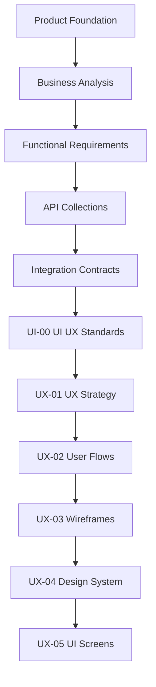

# UI/UX Design

This folder contains the controlled UI/UX Design documentation set for Digitize, the enterprise multi-tenant SaaS platform developed by OreeOn Technologies Pvt. Ltd.

The UI/UX documentation defines how approved product decisions become usable, accessible, secure, traceable, and implementation-ready mobile and web experiences.

---

# 1. Purpose

The purpose of this folder is to provide the governed user experience and interface-design baseline for Digitize.

It translates approved requirements, APIs, integration behavior, roles, permissions, lifecycle states, and tenant scope into user journeys, wireframes, design-system rules, and implementation-ready screen specifications.

---

# 2. UI/UX Documentation Objectives

The UI/UX documentation shall define and govern:

- User journeys.
- Navigation.
- Screen flows.
- Wireframes.
- Screen specifications.
- Design-system consistency.
- Role-aware UI behavior.
- Permission-aware UI behavior.
- Tenant-aware UI behavior.
- Flutter mobile and responsive web behavior.
- Forms.
- Tables.
- Dashboards.
- Calendars.
- Dialogs.
- Notifications.
- Validation states.
- Loading states.
- Empty states.
- Error states.
- Offline states.
- Retry states.
- Conflict states.
- Asynchronous operations.
- Accessibility.
- Localization readiness.
- Usability.
- QA readiness.
- Frontend implementation readiness.
- Traceability.

---

# 3. Intended Audience

This documentation is intended for:

- Product Managers
- Business Analysts
- Product Designers
- UX Designers
- UI Designers
- UX Researchers
- Design System Owners
- Solution Architects
- Frontend Architects
- Flutter Developers
- Web Developers
- API Architects
- Integration Architects
- Backend Engineers
- QA Engineers
- Automation Engineers
- Security Engineers
- Support Teams
- Implementation Teams

---

# 4. Scope

This folder governs:

- UX strategy.
- Personas or role profiles.
- Experience principles.
- Information organization.
- Navigation behavior.
- User journeys.
- User flows.
- Low-fidelity wireframes.
- Design system.
- Design tokens.
- Reusable components.
- Interaction patterns.
- Responsive behavior.
- Accessibility.
- Screen inventory.
- Screen specifications.
- Field and action behavior.
- State behavior.
- Validation behavior.
- Role visibility.
- Permission-driven availability.
- Organization, Facility, and Site context.
- API and integration traceability.
- UI acceptance criteria.

---

# 5. Out of Scope

This folder does not define:

- Business requirements.
- Functional requirements.
- API endpoint catalogs.
- Database schemas.
- Backend source code.
- Flutter source code.
- Web source code.
- Infrastructure.
- Deployment configuration.
- Provider SDK implementation.
- Production credentials.
- Executable test automation.
- Operational runbooks.

UI/UX documentation may reference these areas, but it shall not duplicate them.

---

# 6. UI/UX Principles

| Principle | Meaning |
|---|---|
| User-Centered | Design decisions shall support approved user goals and business journeys |
| Task-Oriented | Screens shall prioritize completion of real operational tasks |
| Role-Aware | Navigation, fields, actions, and data visibility shall consider user role |
| Permission-Aware | Available actions shall align with approved permission behavior |
| Tenant-Aware | Organization, Facility, and Site context shall be visible and preserved where applicable |
| Accessible by Design | Accessibility expectations shall be included from the beginning |
| Mobile-First Where Appropriate | Mobile workflows shall be prioritized for mobile-heavy operational scenarios |
| Responsive by Design | Web and mobile experiences shall adapt predictably |
| Consistent | Common patterns shall be reused across modules |
| Predictable | Users shall be able to anticipate navigation, actions, validation, and feedback behavior |
| Error-Transparent | Error states shall explain what happened in user-safe language |
| Recovery-Oriented | Failures shall provide retry, correction, support, or exit paths |
| Secure by Default | Sensitive data and restricted actions shall be protected by design |
| Contract-Aligned | UI behavior shall align with approved API and Integration Contract documents |
| Progressive Disclosure | Complex details shall appear only when needed by the workflow |
| Minimal Cognitive Load | Screens shall avoid unnecessary choices, duplicate information, and unclear hierarchy |
| Localization-Ready | Text, labels, formats, and layouts shall support future localization |
| Implementation-Ready | Screen specifications shall be usable by frontend teams without ambiguity |
| Traceable | UI decisions shall map to approved source documents and owners |

---

# 7. Frozen Platform Hierarchy

The Digitize platform hierarchy is frozen as:

```text
Platform
└── Organization
    └── Facility
        └── Site
```

Platform represents the Digitize SaaS platform.

Organization represents the tenant or business account.

Facility represents the managed business or activity facility.

Site represents an operational location or unit under a Facility.

All tenant selectors, context switching, breadcrumbs, screen visibility, data loading, actions, and navigation must preserve this hierarchy.

---

# 8. Relationship with Product and Functional Documentation

Product Foundation, Business Analysis, and Functional Requirements define:

- Terminology.
- Users.
- Roles.
- Processes.
- Business rules.
- Validations.
- Lifecycle states.
- Acceptance criteria.

UI/UX documentation shall translate those approved sources into visible and interactive behavior without redefining them.

---

# 9. Relationship with API Collections

API Collections define available backend capabilities and API behavior.

UI/UX Design defines how users discover, trigger, complete, understand, and recover from workflows using those capabilities.

UI documents shall reference APIs where applicable and shall not duplicate endpoint catalogs.

UI visibility shall never replace backend authorization. Hiding or disabling a UI control is not a security boundary.

---

# 10. Relationship with Integration Contracts

UI/UX Design consumes Integration Contract behavior for:

- Authentication.
- Session expiry.
- Token refresh.
- Tenant switching.
- Payments.
- Refunds.
- Notifications.
- File uploads.
- File scanning.
- File downloads.
- Report generation.
- Async polling.
- Timeouts.
- Retries.
- Offline recovery.
- Conflicts.
- Provider failures.
- Correlation and request references.

---

# 11. Folder Position in the Documentation Hierarchy

```text
07_API_Collections/
08_Integration_Contracts/
09_UI_UX_Design/
```

UI/UX Design sits after Integration Contracts.

---

# 12. Source Documents

| Source Area | Source Documents | Usage |
|---|---|---|
| Product Foundation | PF-01 to PF-05 | Terminology, domain model, product vision, business model, and roadmap context |
| Business Analysis | BA-01 to BA-10 | Actors, journeys, processes, rules, assumptions, constraints, risks, and traceability |
| Functional Requirements | FR-01 to FR-21 | Functional behavior, validations, permissions, notifications, and acceptance criteria |
| Technical Architecture | TA-00 to TA-10 | Client architecture constraints, security, observability, and platform architecture |
| Commercial Strategy | Approved commercial strategy documents | Subscription, pricing, billing, discount, payment, and renewal UI behavior |
| Database Design | DB-00 to DB-22 | Data ownership, lifecycle states, reporting, audit, and integration persistence awareness |
| API Collections | API-00 to API-26, approved API test artifacts, approved Postman collections | API behavior, access, errors, states, mocks, and readiness |
| Integration Contracts | IC-00 to IC-17 | Frontend/backend behavior, authentication, tenant context, retry, security, observability, and readiness |

When an approved identifier is unavailable, documents shall use `[TBD — Source mapping pending — see BE traceability mappings](docs/10_Backend_Engineering/BE-TRACEABILITY_MAPPINGS.md)`.

---

# 13. Folder Structure

```text
09_UI_UX_Design/

README.md

UI-00_UI_UX_Standards.md
UX-01_UX_Strategy.md
UX-02_User_Flows.md
UX-03_Wireframes.md
UX-04_Design_System.md
UX-05_UI_Screens.md
```

This folder structure is frozen. New files, removed files, renamed files, merged files, split files, reordered documents, or changed numbering require Product and Architecture Review.

---

# 14. Document Register

| Document | Name | Status | Purpose |
|---|---|---|---|
| UI-00 | UI/UX Standards | Review Draft | Defines common UI/UX governance, terminology, layout, interaction, state, responsiveness, accessibility, security, documentation, traceability, and review standards for UX-01 through UX-05 |
| UX-01 | UX Strategy | Design Draft | Defines UX vision, UX goals, user groups, role profiles, experience principles, usability priorities, platform navigation strategy, mobile and web strategy, accessibility direction, localization direction, and measurement approach |
| UX-02 | User Flows | Design Draft | Defines role-aware flows, permission-aware flows, tenant-aware flows, entry conditions, decision points, alternate paths, failure paths, recovery paths, completion conditions, screen transitions, and API/integration dependencies |
| UX-03 | Wireframes | Design Draft | Defines low-fidelity, structure-only wireframes, layout, information hierarchy, content regions, primary actions, and workflow structure without final colors, branding, typography, or production styling |
| UX-04 | Design System | Design Draft | Defines design principles, design tokens, color system, typography, spacing, grid, elevation, icons, components, form controls, tables, cards, dialogs, drawers, navigation, notifications, state styles, responsive rules, accessibility, and usage governance |
| UX-05 | UI Screens | Design Draft | Defines implementation-ready screen inventory, screen IDs, purpose, roles, permissions, tenant scope, preconditions, entry points, exit paths, layout, sections, fields, controls, actions, data sources, API mappings, integration mappings, validations, states, feedback, confirmations, responsive behavior, accessibility, audit-triggering actions, acceptance criteria, and traceability |

---

# 15. Document Boundaries

| Area | Governing Artifact |
|---|---|
| Business intent | Product Foundation / Business Analysis |
| Functional behavior | Functional Requirements |
| Endpoint behavior | API Collections |
| Cross-system behavior | Integration Contracts |
| UX strategy and flow | UX-01 and UX-02 |
| Low-fidelity structure | UX-03 |
| Reusable visual system | UX-04 |
| Screen-level implementation contract | UX-05 |
| Common UI/UX governance | UI-00 |

Duplication must be avoided. UI/UX documents shall reference authoritative artifacts instead of restating their full content.

---

# 16. Document Dependencies



UX-03 creates low-fidelity structural wireframes.

UX-04 establishes the reusable design system.

UX-05 combines approved flow, structure, and design-system rules into implementation-ready screens.

---

# 17. Recommended Generation Order

| Order | Document | Reason |
|---|---|---|
| 1 | README.md | Establishes folder purpose, boundaries, structure, and governance |
| 2 | UI-00_UI_UX_Standards.md | Establishes common UI/UX standards for UX-01 through UX-05 |
| 3 | UX-01_UX_Strategy.md | Establishes UX vision, goals, role profiles, experience principles, and platform navigation strategy |
| 4 | UX-02_User_Flows.md | Establishes role-aware, permission-aware, and tenant-aware flows before screen structure |
| 5 | UX-03_Wireframes.md | Establishes low-fidelity layout and information hierarchy before visual system application |
| 6 | UX-04_Design_System.md | Establishes reusable visual, component, accessibility, and responsive rules |
| 7 | UX-05_UI_Screens.md | Establishes implementation-ready screen specifications using approved strategy, flows, wireframes, and design-system rules |

---

# 18. UI/UX Artifact Governance

- Markdown files are the controlled documentation baseline.
- Figma or equivalent files may supplement the Markdown documentation.
- Visual artifacts shall not replace controlled screen specifications.
- Every visual artifact shall reference the applicable document and screen ID.
- Wireframes shall use approved entities, roles, fields, states, and actions.
- Unapproved functionality shall not be introduced through visual design.
- Design changes affecting requirements, APIs, permissions, lifecycle states, or integrations require impact review.
- Screen IDs must remain stable once frozen.
- Deprecated screens must be marked rather than silently removed.

---

# 19. Ownership and Review

Product Design owns this folder.

Review is performed in collaboration with:

- Product Management.
- Business Analysis.
- Solution Architecture.
- Frontend Architecture.
- API Architecture.
- Integration Architecture.
- Security Architecture.
- QA.
- Support.
- Implementation teams.

Reviewers shall confirm source alignment, terminology consistency, role and permission behavior, tenant-context correctness, API and integration alignment, accessibility readiness, state completeness, testability, and implementation readiness.

---

# 20. Status Definitions

Only the following statuses shall be used:

| Status | Meaning |
|---|---|
| Planned | Content not yet generated |
| Design Draft | Initial design content generated |
| Review Draft | Product, UX, architecture, frontend, and QA corrections incorporated |
| Frozen | Approved implementation baseline |
| Deprecated | No longer authoritative |

The Document Register shall reflect actual document status. Uncreated documents shall remain `Planned`.

---

# 21. Governance

- UI-00 governs UX-01 through UX-05.
- Approved terminology must be preserved.
- The frozen Platform, Organization, Facility, Site hierarchy must be preserved.
- UI documents shall not invent roles, permissions, entities, actions, fields, states, or workflows.
- UI documents shall not duplicate API catalogs.
- UI behavior must align with approved API and Integration Contract documents.
- Role visibility and permission behavior must be explicit.
- Hidden or disabled controls do not replace backend authorization.
- Tenant selectors must show only authorized Organization, Facility, and Site contexts.
- Sensitive information must not be exposed through labels, errors, logs, screenshots, or examples.
- Missing mappings shall use `[TBD — Source mapping pending — see BE traceability mappings](docs/10_Backend_Engineering/BE-TRACEABILITY_MAPPINGS.md)`.
- Frozen documents shall contain no unresolved user-facing behavior.
- Figma artifacts shall remain traceable to controlled Markdown specifications.

---

# 22. Entry Criteria

UI/UX documentation may begin when:

- Product terminology is available.
- Applicable business journeys are approved.
- Functional behavior and business rules are available.
- Roles and permissions are defined.
- Relevant API contracts are available.
- Relevant Integration Contracts are available.
- Lifecycle states and validations are available.
- Tenant hierarchy and scope are frozen.

---

# 23. Exit Criteria

The UI/UX documentation phase is complete when:

- UI-00 is frozen.
- UX strategy is approved.
- MVP user flows are complete.
- MVP wireframes are complete.
- The design system is approved.
- All MVP screens have implementation-ready specifications.
- Role and permission visibility is defined.
- Organization, Facility, and Site context behavior is defined.
- Loading, empty, error, retry, offline, conflict, and async states are defined.
- Accessibility requirements are testable.
- Responsive behavior is defined.
- API and integration mappings are traceable.
- UI acceptance criteria are complete.
- Product, UX, architecture, frontend, and QA reviews are completed.

---

# 24. Freeze Rule

UI-00 must be reviewed before UX-01 through UX-05 move to Review Draft.

UI-00 must be frozen before UX-01 through UX-05 are frozen.

A document must not be frozen while any of the following is unresolved:

- User role.
- Permission behavior.
- Organization context.
- Facility context.
- Site context.
- Navigation destination.
- Entry or exit condition.
- Field.
- Validation.
- Lifecycle state.
- Allowed action.
- Loading state.
- Empty state.
- Error state.
- Retry state.
- Offline state.
- Conflict state.
- Accessibility behavior.
- Responsive behavior.
- API dependency.
- Integration dependency.
- Acceptance criteria.
- Traceability owner.

Changes to frozen journeys, screen IDs, navigation, wireframes, design-system rules, or screen contracts require Product and Architecture Review.

---

# 25. Summary

The UI/UX Design README is the governing index for the Digitize UI/UX documentation folder. It defines the approved scope, folder structure, document boundaries, generation order, artifact governance, entry criteria, exit criteria, and freeze rules for producing user-centered, role-aware, permission-aware, tenant-aware, accessible, responsive, contract-aligned, and implementation-ready UI/UX documentation.
