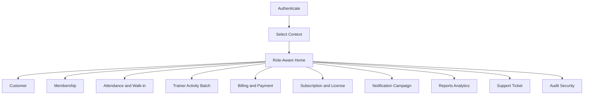
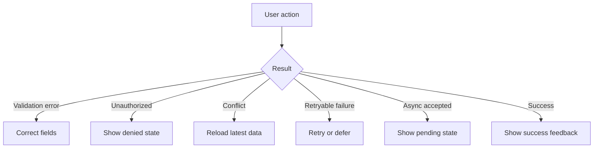

# UX-02 User Flows

**Document ID:** UX-02  
**Document Name:** User Flows  
**Company:** OreeOn Technologies Pvt. Ltd.  
**Product:** Digitize  
**Document Type:** UI/UX Design Documentation  
**Client Technology:** Flutter / Web  
**Backend Technology:** FastAPI  
**Database Engine:** PostgreSQL  
**Authentication:** JWT  
**Version:** 0.1  
**Status:** Design Draft  
**Owner:** Product Design / UI/UX Architecture  
**Reviewer:** Product Management / Business Analysis / Solution Architecture / Frontend Architecture / API Architecture / Integration Architecture / QA  
**Dependencies:** UI-00, UX-01, BA-03, BA-04, BA-06, FR-01 to FR-21, API-00 to API-26, IC-00 to IC-17  
**Last Updated:** July 2026

---

# 1. Document Metadata

| Attribute | Value |
|---|---|
| Document ID | UX-02 |
| Output File | UX-02_User_Flows.md |
| Status | Design Draft |
| Governing Standard | UI-00_UI_UX_Standards.md |

---

# 2. Purpose

This document defines the role-aware, permission-aware, and tenant-aware user flow baseline for Digitize.

It converts approved business journeys, functional requirements, API behavior, and integration behavior into navigable user flows, decision points, alternate paths, failure paths, recovery paths, completion conditions, screen transitions, and traceability.

---

# 3. Scope

In scope:

- Flow standards and naming.
- Role and permission flow behavior.
- Platform, Organization, Facility, and Site context behavior.
- MVP business flow inventory.
- Flow-level states, errors, retries, conflicts, and async behavior.
- API and Integration Contract dependencies.

Out of scope:

- Low-fidelity wireframe layouts.
- Visual design tokens.
- Final screen specifications.
- Application source code.

---

# 4. Source Documents

| Source Area | Documents | Usage |
|---|---|---|
| Business Analysis | BA-03, BA-04, BA-06, BA-08 | Processes, process flows, user journeys, and traceability |
| Functional Requirements | FR-01 to FR-21 | Functional behavior and validations |
| API Collections | API-01 to API-26 | User-triggered actions and states |
| Integration Contracts | IC-01 to IC-17 | Auth, tenant, payment, file, report, retry, security, and observability behavior |
| UI/UX Standards | UI-00, UX-01 | UI/UX governance and strategy |

---

# 5. Flow Documentation Standard

Each flow shall define:

- Flow ID.
- Flow name.
- Primary user.
- Supporting users.
- Tenant scope.
- Preconditions.
- Entry point.
- Main path.
- Decision points.
- Alternate paths.
- Failure paths.
- Recovery paths.
- Completion condition.
- Exit paths.
- API dependencies.
- Integration dependencies.
- Screen candidates.
- Acceptance criteria.

---

# 6. Flow ID Standard

Flow ID format:

```text
UX-FLOW-<DOMAIN>-<NUMBER>
```

Examples:

| Flow ID | Meaning |
|---|---|
| UX-FLOW-AUTH-001 | Authentication flow |
| UX-FLOW-TEN-001 | Tenant context flow |
| UX-FLOW-CUS-001 | Customer workflow |
| UX-FLOW-MEM-001 | Membership workflow |
| UX-FLOW-PAY-001 | Payment workflow |

---

# 7. Role and Permission Flow Standard

Flow documents shall distinguish:

- User can see the flow.
- User can start the flow.
- User can complete the flow.
- User can approve or override the flow.
- User can view restricted data.
- User is denied.

Hidden or disabled UI controls do not replace backend authorization.

---

# 8. Tenant Context Flow Standard

Every tenant-scoped flow shall preserve:

```text
Platform
└── Organization
    └── Facility
        └── Site
```

Tenant-scoped flows shall define Organization, Facility, and Site requirements, context switching behavior, invalid context behavior, and cross-tenant prevention behavior.

---

# 9. Global Flow Map



---

# 10. Authentication Flow

| Attribute | Value |
|---|---|
| Flow ID | UX-FLOW-AUTH-001 |
| Primary User | All authenticated users |
| Tenant Scope | Not selected at login |
| Source | API-03, IC-02 |

Main path:

1. User opens Digitize.
2. User enters credentials.
3. System validates credentials.
4. System creates session.
5. User is routed to context selection or role-aware home.

Alternate paths:

- Password reset.
- Account locked.
- Forced logout.
- Session expired.
- Refresh token failure.

Completion condition: authenticated session established or user-safe failure shown.

---

# 11. Tenant Context Selection Flow

| Attribute | Value |
|---|---|
| Flow ID | UX-FLOW-TEN-001 |
| Primary User | Multi-context users |
| Tenant Scope | Organization / Facility / Site |
| Source | API-02, API-03, API-23, IC-03 |

Main path:

1. User authenticates.
2. System loads authorized Organizations.
3. User selects Organization.
4. System loads authorized Facilities.
5. User selects Facility where required.
6. System loads authorized Sites where required.
7. User enters role-aware workspace.

Failure paths:

- No authorized Organization.
- Facility access revoked.
- Site suspended.
- Context validation timeout.

Recovery paths:

- Refresh context.
- Select another authorized context.
- Contact support.

---

# 12. Platform Administration Flow

| Attribute | Value |
|---|---|
| Flow ID | UX-FLOW-PLT-001 |
| Primary User | Platform Administrator |
| Tenant Scope | Platform |
| Source | API-01, API-13 |

Flow covers platform configuration, global master data, feature flags, maintenance notices, and platform-level governance.

Key decisions:

- User has platform permission.
- Action requires confirmation.
- Change impacts tenants.
- Audit event required.

---

# 13. Organization Facility Site Setup Flow

| Attribute | Value |
|---|---|
| Flow ID | UX-FLOW-TEN-002 |
| Primary User | Organization Owner / Facility Manager / Implementation User |
| Tenant Scope | Organization / Facility / Site |
| Source | API-02, IC-03 |

Flow covers creation, review, update, activation, suspension, settings, address, contact, and operational configuration behavior.

Completion condition: setup state reaches approved onboarding milestone.

---

# 14. User Role Permission Flow

| Attribute | Value |
|---|---|
| Flow ID | UX-FLOW-IAM-001 |
| Primary User | Organization Owner / Administrator |
| Tenant Scope | Organization / Facility / Site |
| Source | API-03, API-23, IC-02, IC-12 |

Flow covers user invitation, role assignment, permission review, access scope, lock/unlock, session invalidation, and access revocation.

Security rule: permission changes shall not rely on UI visibility alone.

---

# 15. Customer Management Flow

| Attribute | Value |
|---|---|
| Flow ID | UX-FLOW-CUS-001 |
| Primary User | Site Staff / Facility Manager |
| Tenant Scope | Organization / Facility / Site |
| Source | API-04 |

Main path:

1. Search or create customer.
2. Capture profile details.
3. Validate contact and required fields.
4. Capture consent and preferences.
5. Save customer.
6. Show customer profile and available next actions.

Alternate paths:

- Duplicate customer detected.
- Restricted data masked.
- Document upload required.
- Customer inactive.

---

# 16. Membership Management Flow

| Attribute | Value |
|---|---|
| Flow ID | UX-FLOW-MEM-001 |
| Primary User | Site Staff / Facility Manager |
| Tenant Scope | Organization / Facility / Site |
| Source | API-05, API-24 |

Flow covers plan selection, eligibility, purchase, activation, renewal, upgrade, downgrade, freeze, resume, cancellation, expiry, and entitlement visibility.

State transitions shall align with API-24.

---

# 17. Attendance and Walk-in Flow

| Attribute | Value |
|---|---|
| Flow ID | UX-FLOW-ATT-001 |
| Primary User | Site Staff |
| Tenant Scope | Site |
| Source | API-06 |

Flow covers eligibility check, check-in, check-out, correction, override, walk-in registration, payment association, capacity validation, and occupancy visibility.

Operational requirement: frequent attendance actions shall be fast, clear, and recoverable.

---

# 18. Trainer Activity Batch Flow

| Attribute | Value |
|---|---|
| Flow ID | UX-FLOW-TRN-001 |
| Primary User | Trainer / Facility Manager |
| Tenant Scope | Facility / Site |
| Source | API-07 |

Flow covers trainer availability, activity setup, batch scheduling, class sessions, enrollment, attendance association, notes, progress, cancellation, and capacity.

Calendar interactions shall be defined further in UX-03 and UX-05.

---

# 19. Billing Payment Flow

| Attribute | Value |
|---|---|
| Flow ID | UX-FLOW-PAY-001 |
| Primary User | Finance User / Site Staff / Customer where applicable |
| Tenant Scope | Organization / Facility / Site |
| Source | API-08, IC-04 |

Flow states:

- Invoice draft.
- Invoice finalized.
- Payment initiated.
- Provider pending.
- Payment successful.
- Payment failed.
- Refund initiated.
- Refund completed.
- Reconciliation required.

Financial actions shall use explicit confirmation and user-safe state messaging.

---

# 20. Subscription License Flow

| Attribute | Value |
|---|---|
| Flow ID | UX-FLOW-SUB-001 |
| Primary User | Organization Owner / Platform Administrator |
| Tenant Scope | Organization |
| Source | API-09 |

Flow covers subscription purchase, activation, renewal, cancellation, suspension, expiry, license assignment, entitlement, and paywall behavior.

---

# 21. Notification Campaign Flow

| Attribute | Value |
|---|---|
| Flow ID | UX-FLOW-NOT-001 |
| Primary User | Facility Manager / Campaign User |
| Tenant Scope | Organization / Facility / Site |
| Source | API-10, IC-05 |

Flow covers campaign creation, audience selection, template selection, consent validation, scheduling, activation, pause, cancellation, delivery status, retry, and failure visibility.

---

# 22. Report Export Flow

| Attribute | Value |
|---|---|
| Flow ID | UX-FLOW-RPT-001 |
| Primary User | Manager / Finance / Support / Platform Administrator |
| Tenant Scope | Role-dependent |
| Source | API-11, IC-07 |

Flow covers report selection, parameter entry, validation, async generation, status polling, download, expiry, cancellation, failure, retry, and masking.

---

# 23. Support Ticket Flow

| Attribute | Value |
|---|---|
| Flow ID | UX-FLOW-SUP-001 |
| Primary User | Customer / Staff / Support User |
| Tenant Scope | Organization / Facility / Site |
| Source | API-12 |

Flow covers ticket creation, category, priority, assignment, comments, attachments, escalation, SLA, internal notes, customer-visible notes, closure, and reopening.

---

# 24. Audit Security Flow

| Attribute | Value |
|---|---|
| Flow ID | UX-FLOW-AUD-001 |
| Primary User | Security / Platform Administrator / Support |
| Tenant Scope | Platform / Organization |
| Source | API-13, IC-12 |

Flow covers audit event search, investigation, sensitive access, export, security events, and administrative review.

Restricted data shall be masked or hidden according to permission.

---

# 25. Common Reference Flow

| Attribute | Value |
|---|---|
| Flow ID | UX-FLOW-REF-001 |
| Primary User | Administrator / Configuration User |
| Tenant Scope | Platform / Organization |
| Source | API-14 |

Flow covers lookup values, localization values, status references, activity types, payment methods, and communication channels.

---

# 26. Failure and Recovery Flow Standard



---

# 27. Offline and Retry Flow Standard

Offline and retry states shall be defined only where supported by approved API and Integration Contract behavior.

Each applicable flow shall define:

- Offline detection.
- Disabled actions.
- Queued action behavior where approved.
- Retry availability.
- Duplicate prevention.
- Recovery message.

---

# 28. Flow Traceability Matrix

| Flow Area | API Mapping | Integration Mapping | UI Follow-up |
|---|---|---|---|
| Authentication | API-03 | IC-02 | UX-03, UX-05 |
| Tenant Context | API-02, API-23 | IC-03 | UX-03, UX-05 |
| Customer | API-04 | IC-01 | UX-03, UX-05 |
| Membership | API-05, API-24 | IC-01 | UX-03, UX-05 |
| Attendance | API-06 | IC-01 | UX-03, UX-05 |
| Billing Payment | API-08 | IC-04, IC-11 | UX-03, UX-05 |
| Notification | API-10 | IC-05 | UX-03, UX-05 |
| Reports | API-11 | IC-07 | UX-03, UX-05 |
| Support | API-12 | IC-06 | UX-03, UX-05 |

---

# 29. Assumptions and Constraints

- Flow diagrams remain Design Draft until Product, Business Analysis, Architecture, Frontend, and QA review.
- Screen IDs may remain candidate IDs until UX-05 is generated.
- Missing UI source mappings shall use `[TBD — Source mapping pending — see BE traceability mappings](docs/10_Backend_Engineering/BE-TRACEABILITY_MAPPINGS.md)`.
- UI flows shall not introduce unapproved business behavior.

---

# 30. Acceptance Criteria

- Core MVP user flows are identified.
- Role, permission, and tenant context rules are represented.
- Failure, retry, async, offline, and conflict paths are defined at a flow level.
- API and Integration Contract dependencies are mapped.
- UX-03, UX-04, and UX-05 can consume this document without redefining flow behavior.

---

# 31. Summary

UX-02 defines the Digitize user flow baseline. It turns approved requirements, APIs, and integration behavior into role-aware, permission-aware, tenant-aware, and recoverable user journeys for later wireframes, design-system decisions, and implementation-ready screen specifications.
