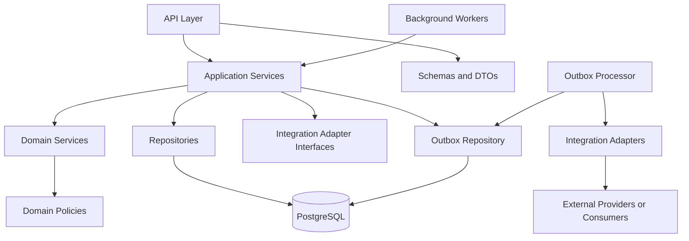
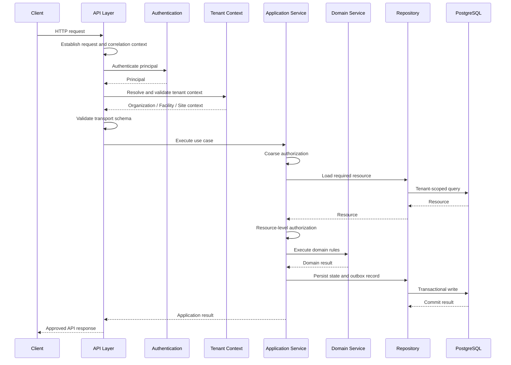

# BE-01 Backend Application Architecture

> Backend application layers, module boundaries, dependency rules, request flow, and runtime responsibilities for Digitize by OreeOn Technologies Pvt. Ltd.

---

# Document Control

| Field | Value |
|---|---|
| Document ID | BE-01 |
| Document Name | Backend Application Architecture |
| Folder | 10_Backend_Engineering |
| Product | Digitize by OreeOn Technologies Pvt. Ltd. |
| Status | Design Draft |
| Governing Standard | BE-00_Backend_Engineering_Standards.md |
| Owner | Backend Engineering |
| Reviewers | Architecture, API, Database, Security, QA, DevOps |
| Version | 1.0 |
| Last Updated | 2026-07-26 |

---

# 1. Purpose

This document defines the backend application architecture for Digitize.

It explains how backend layers, modules, dependencies, request handling, runtime responsibilities, and cross-cutting concerns shall be organized so implementation remains consistent across all backend modules.

---

# 2. BE-00 Inheritance

This document inherits all common backend standards from `BE-00`.

This document does not redefine:

- Authentication and authorization standards.
- Tenant context standards.
- API payload and error standards.
- Repository and transaction standards.
- Logging, audit, and observability standards.
- Testing and release readiness standards.

Where this document defines architecture-specific behavior, it shall remain consistent with `BE-00`.

---

# 3. Scope

This document covers:

- Backend application layers.
- Backend module boundaries.
- Dependency direction.
- Request processing flow.
- Runtime responsibility boundaries.
- Shared service ownership.
- Cross-cutting architectural concerns.
- Backend architecture acceptance criteria.

---

# 4. Out of Scope

This document does not define:

- FastAPI package structure. That is owned by BE-02.
- Domain service rules. That is owned by BE-03.
- Repository implementation details. That is owned by BE-04.
- Authentication and authorization implementation details. That is owned by BE-05.
- Tenant context implementation details. That is owned by BE-06.
- Endpoint implementation details. That is owned by BE-07.
- Deployment topology. That is owned by Deployment documentation.

---

# 5. Source Alignment

| Source Area | Alignment |
|---|---|
| FR-01 to FR-21 | Module responsibilities and business behavior |
| TA-00 to TA-10 | Application architecture, security, integration, observability, and deployment assumptions |
| DB-00 to DB-22 | Persistence boundaries, tenancy model, outbox, audit, and reporting dependencies |
| API-00 to API-26 | API behavior that the backend application must implement |
| IC-00 to IC-17 | Integration, retry, outbox, provider, security, and observability contracts |
| UI-00 and UX-01 to UX-05 | Frontend workflow expectations that depend on stable backend behavior |
| BE-00 | Frozen backend standards inherited by this document |

---

# 6. Architectural Layer Model

Digitize backend implementation shall use the following logical layers.

| Layer | Responsibility | Primary Owner |
|---|---|---|
| API Layer | HTTP routing, dependency wiring, request parsing, response mapping | BE-07 |
| Schema or DTO Layer | Transport models, serialization, and boundary validation | BE-07 |
| Schema Organization | Package location, naming, imports, and module structure | BE-02 |
| Application Service Layer | Use-case orchestration, transaction ownership, command/query coordination | BE-03 |
| Domain Service Layer | Business rules, lifecycle decisions, state transitions | BE-03 |
| Repository Layer | Data access, query ownership, persistence participation | BE-04 |
| Query Service Layer | Read-optimized queries, projections, dashboards, reports, and cross-aggregate views without owning business mutations | BE-03, BE-04 |
| Integration Adapter Layer | Provider communication and external boundary isolation | BE-09, IC documents |
| Background Worker Layer | Deferred processing, scheduled jobs, outbox processing | BE-09 |
| Observability Layer | Logs, metrics, traces, diagnostics, audit handoff | BE-08 |
| Configuration Layer | Settings, environment handling, startup validation | BE-02 |

Application services shall:

- Coordinate a single approved use case.
- Resolve required repositories and domain services.
- Own transaction boundaries.
- Coordinate authorization and tenant-aware execution where applicable.
- Persist state and create outbox records.
- Avoid implementing reusable domain decision logic.

Domain services shall:

- Implement reusable business rules and domain decisions.
- Validate lifecycle and state transitions.
- Remain independent of HTTP, FastAPI, database sessions, and provider SDKs.
- Avoid owning transaction commits.

---

# 7. Dependency Direction

Backend dependencies shall point toward domain behavior and approved contracts.



The repository layer shall not depend on the API layer.

Domain services shall not depend on FastAPI objects, HTTP request objects, response objects, provider SDKs, or framework-specific dependency injection.

Application services create outbox records within the business transaction. Outbox processors publish committed records after the transaction completes.

Application services may invoke integration adapter interfaces synchronously only when the approved business flow requires an immediate provider response. Retryable or non-immediate communication should use committed outbox or background-job processing.

Examples of synchronous interactions may include:

- Payment session creation.
- Authentication-provider verification.
- Real-time eligibility verification.

Examples that generally belong asynchronously include:

- Notifications.
- Webhooks.
- Analytics events.
- Report generation.
- Reconciliation.
- Non-critical provider updates.

---

# 8. Request Processing Flow

The standard synchronous request flow uses two-stage authorization:

```text
Client
  -> API Router
  -> Request and Correlation Context
  -> Authentication
  -> Tenant Context Resolution
  -> Boundary Schema Validation
  -> Coarse Authorization
  -> Application Service
  -> Resource Loading
  -> Resource-Level Authorization
  -> Domain Validation
  -> Repository
  -> Transaction Commit
  -> Response Mapping
  -> Client
```

Coarse authorization means permission to attempt the operation.

Resource-level authorization means ownership, tenant scope, entity state, entitlement, or record-specific access.



For actions requiring external communication or deferred processing:

```text
Application Service
  -> Business Transaction
  -> Repository Write
  -> Outbox Record
  -> Commit
  -> Outbox Processor
  -> Integration Adapter
  -> Provider or Consumer
```

Provider calls shall not be placed inside database transactions unless explicitly approved.

---

# 9. Module Architecture

Backend modules shall align to product capabilities.

Each backend module should contain ownership for:

- Routes or endpoint registration.
- Request and response schemas.
- Application services.
- Domain services or policies.
- Repository contracts and implementations.
- Module-specific integrations where applicable.
- Module-specific tests.
- Traceability to requirements, APIs, database objects, and integration contracts.

Shared modules may exist only for true shared concerns such as authentication, tenant context, configuration, observability, common errors, and reusable infrastructure.

Shared modules shall not contain hidden module-specific business logic.

## 9.1 Module Interaction Rules

Backend module interactions shall follow explicit ownership boundaries.

- A module shall not directly mutate another module's tables.
- Cross-module behavior shall use an application-service interface, domain contract, approved query interface, or event.
- Read-only cross-module access shall use an explicitly owned query contract.
- Cross-module transactions shall be minimized and documented.
- Circular module dependencies are prohibited.
- Shared infrastructure shall not become a substitute for explicit module contracts.
- A module shall remain the authoritative owner of its business state.

## 9.2 Representation and Model Boundaries

Persistence models, API schemas, and domain models are separate architectural representations.

- API schemas represent transport contracts.
- Domain models represent business concepts and behavior.
- Persistence models represent database storage.
- Conversion between representations shall occur at controlled boundaries.

API endpoints shall not return persistence objects directly.

## 9.3 Command and Query Responsibilities

Command-side behavior and query-side behavior shall have clear ownership.

| Component | Responsibility |
|---|---|
| Application Service | Command orchestration, business mutation, transaction ownership, and state-change coordination |
| Repository | Persistence participation for module-owned data |
| Query Service | Read-optimized queries, projections, dashboards, reports, and cross-aggregate views without owning business mutations |

Command-side business mutations remain in application services and repositories.

Complex read models may use query services.

Query services shall:

- Remain tenant-aware.
- Avoid bypassing authorization.
- Avoid hidden state changes.
- Preserve approved API filtering, sorting, pagination, and response behavior.

---

# 10. Runtime Responsibilities

| Runtime Concern | Architecture Standard |
|---|---|
| Authentication | Resolved before protected service execution |
| Tenant Context | Resolved and validated before tenant-scoped data access |
| Authorization | Enforced before protected business action execution |
| Validation | Applied at schema and domain boundaries |
| Transactions | Owned by application services unless explicitly approved otherwise |
| Persistence | Performed through repositories |
| Events | Persisted as outbox records within the business transaction and published asynchronously after commit |
| Provider Access | Performed through adapters |
| Errors | Mapped to approved API error structures |
| Logs and Metrics | Emitted using standard correlation and request identifiers |

## 10.1 Runtime Lifecycle Responsibilities

Runtime architecture shall distinguish:

- Application startup.
- Configuration validation.
- Dependency initialization.
- Database connectivity.
- Worker initialization.
- Health checks.
- Readiness checks.
- Graceful shutdown.
- In-flight request completion.
- Background-job termination.
- Connection and resource cleanup.

BE-02 defines how these runtime responsibilities are implemented through FastAPI and Python application lifecycle behavior.

---

# 11. Cross-Cutting Services

The following services are cross-cutting and must have clear ownership:

| Service | Responsibility |
|---|---|
| Authentication Service | Token verification and principal resolution |
| Authorization Service | Role, permission, ownership, entitlement, and state checks |
| Tenant Context Service | Organization, facility, and site context resolution |
| Configuration Service | Typed settings and startup validation |
| Error Mapper | Internal exception to API response mapping |
| Audit Service | Sensitive action audit-event handoff |
| Observability Service | Logging, metrics, traces, and diagnostics |
| Outbox Service | Event persistence and publication support |

Cross-cutting services shall expose stable interfaces and avoid module-specific business decisions.

---

# 12. Architecture Guardrails

Backend implementation shall:

- Keep domain logic reusable outside HTTP execution.
- Avoid direct cross-module database mutation.
- Avoid provider SDK usage inside domain services.
- Avoid returning persistence objects directly from API endpoints.
- Keep tenant filtering mandatory for tenant-scoped repositories.
- Keep sensitive operations auditable.
- Keep breaking changes governed by API and release documentation.

Caching, when introduced, shall:

- Remain optional to domain correctness.
- Use tenant-scoped keys for tenant data.
- Define an authoritative source.
- Define expiration and invalidation ownership.
- Avoid caching authorization decisions beyond an approved safe duration.
- Avoid returning stale state for critical transactional operations.

---

# 13. Traceability Requirements

Backend architecture decisions shall trace to:

- Functional requirement modules.
- Technical architecture standards.
- Database design ownership.
- API collection contracts.
- Integration contracts.
- UI/UX workflows where backend behavior supports user-facing flows.

Architecture decisions that introduce new boundaries or change approved dependency direction shall be captured in decision records.

---

# 14. Acceptance Criteria

This document is acceptable when:

- Backend layers are clearly defined.
- Dependency direction is clear.
- Module ownership is clear.
- Request flow, authorization sequencing, and deferred-processing flow are documented.
- Module interaction rules are defined.
- Representation and model boundaries are defined.
- Command and query responsibilities are defined.
- Runtime lifecycle responsibilities are defined.
- Cache ownership rules are defined.
- Cross-cutting service ownership is defined.
- Architecture rules do not duplicate `BE-00`.
- Architecture rules align with API, database, integration, and UI/UX governance.

---

# 15. Freeze Rule

This document may move to Review Draft after BE-02, BE-03, BE-04, BE-05, BE-06, BE-07, and BE-09 confirm that their implementation designs can inherit this architecture without redefining its boundaries.

This document may be frozen only after `BE-00` remains frozen and no unresolved architecture conflicts exist.

---

# 16. Summary

BE-01 defines the backend architecture shape for Digitize.

It establishes how modules, layers, runtime flows, dependencies, and cross-cutting services fit together before implementation details are defined in BE-02 through BE-11.
