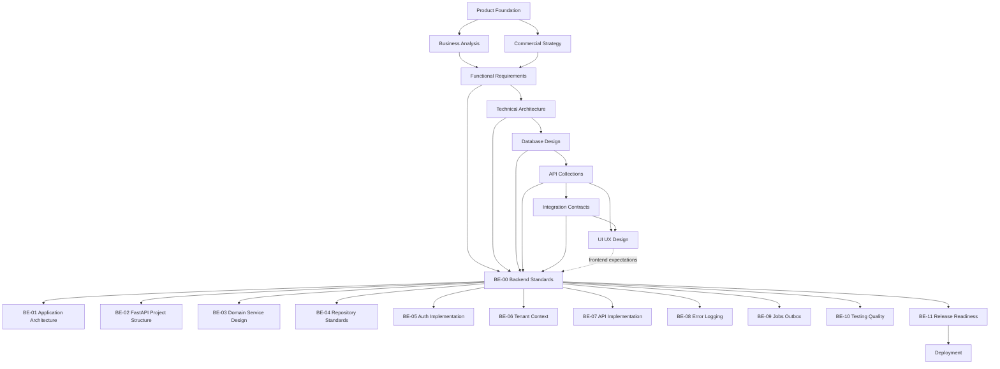

# Backend Engineering Documentation

> Backend implementation standards, service design, data access, security enforcement, observability, testing, and release readiness for Digitize by OreeOn Technologies Pvt. Ltd.


# 1. Purpose

This folder defines the backend engineering documentation baseline for the Digitize platform.

The backend documentation translates approved product, functional, architecture, database, API, integration, and UI/UX documentation into implementation guidance for the backend application.

This folder exists to ensure that backend implementation remains consistent, secure, tenant-aware, testable, observable, and aligned with the approved enterprise documentation baseline.

---

# 2. Backend Documentation Objectives

The objectives of this folder are to:

- Define backend engineering standards.
- Establish application structure and module boundaries.
- Define service, repository, validation, transaction, and error-handling patterns.
- Define backend implementation rules for authentication, authorization, tenant context, API behavior, logging, background jobs, and release readiness.
- Prevent duplication of API, database, integration, and UI/UX documentation.
- Support consistent implementation across backend modules.
- Provide a reviewable baseline before backend source code is created or expanded.

---

# 3. Intended Audience

This documentation is intended for:

- Backend Engineers
- Software Architects
- API Architects
- Integration Architects
- Database Engineers
- DevOps Engineers
- Security Engineers
- QA Engineers
- Automation Engineers
- Frontend Engineers
- Mobile Engineers
- Technical Leads
- Engineering Managers
- Implementation Partners
- Support and Operations Teams

---

# 4. Scope

This folder covers backend engineering documentation for:

- Backend application architecture.
- FastAPI project structure.
- Domain service design.
- Repository and data access standards.
- Authentication and authorization implementation.
- Tenant context enforcement.
- API implementation standards.
- Validation, error handling, and logging.
- Background jobs and event outbox behavior.
- Backend testing and quality standards.
- Backend release readiness.

---

# 5. Out of Scope

This folder does not define:

- Business requirements.
- Functional requirements.
- Database schema definitions.
- API endpoint catalog ownership.
- Postman collection execution details.
- Integration provider contracts.
- UI layouts, wireframes, or screen designs.
- Infrastructure deployment topology.
- Kubernetes configuration.
- CI/CD pipeline implementation.
- Production operations runbooks.
- Source code.

Those artifacts are owned by their respective documentation folders.

---

# 6. Backend Engineering Principles

All backend engineering documents follow these principles:

- API Contract First
- Secure by Default
- Tenant Isolation by Design
- Domain-Service Oriented
- Explicit Transaction Boundaries
- Centralized Validation Rules
- Server-Side Authorization Enforcement
- Provider-Neutral Integration Adapters
- Idempotent Retry-Safe Commands
- Observable by Default
- Testable by Design
- Migration Safe
- Backward Compatible
- Minimal Duplication
- Framework-Isolated Domain Rules

---

# 7. Relationship with API Collections

API Collections define what backend APIs exist, how they are called, what payloads they accept, what responses they return, and what errors they expose.

Backend Engineering defines how those approved API contracts are implemented inside the backend application.

This folder does not redefine API endpoint catalogs. Instead, it describes controller patterns, validation boundaries, service invocation rules, authorization enforcement, transaction handling, error mapping, and test expectations required to implement approved API contracts.

---

# 8. Relationship with Integration Contracts

Integration Contracts define how systems exchange data, recover from failures, authenticate, authorize, retry, reconcile, and operate across trust boundaries.

Backend Engineering defines the backend implementation responsibilities that support those contracts.

Examples include:

- Propagating `X-Correlation-ID` and `X-Request-ID`.
- Enforcing tenant context headers.
- Publishing outbox events after committed transactions.
- Retrying provider interactions according to approved rules.
- Writing integration-safe logs and audit entries.
- Handling dead-letter and reconciliation workflows without leaking provider details into domain services.

---

# 9. Relationship with Database Design

Database Design defines persistence structure, schema ownership, tenancy partitioning, audit data, event tables, reporting data, migration rules, and database operations.

Backend Engineering defines how backend code reads from and writes to that database model.

This folder does not redefine table schemas. It defines repository usage, transaction rules, migration coordination, query ownership, tenant filtering, data validation, and persistence error handling.

---

# 10. Relationship with UI/UX Design

UI/UX Design defines user journeys, screen behavior, interaction states, validation presentation, accessibility rules, and frontend experience expectations.

Backend Engineering supports UI/UX by implementing:

- Stable API behavior.
- Predictable error responses.
- Permission-aware workflows.
- Tenant-aware data boundaries.
- Efficient list, search, filter, and detail APIs.
- State transitions that match approved user flows.
- Audit and support visibility for user-facing operations.

---

# 11. Folder Position in the Documentation Hierarchy

```text
01_Product_Foundation/
02_Commercial_Strategy/
03_Business_Analysis/
04_Functional_Requirements/
05_Technical_Architecture/
06_Database_Design/
07_API_Collections/
08_Integration_Contracts/
09_UI_UX_Design/
10_Backend_Engineering/
11_Deployment/
12_Testing/
13_Operations/
14_Release_Management/
15_Release_Notes/
16_Development_Readiness/
99_Decision_Records/
```

Backend Engineering sits after UI/UX Design in the repository sequence and before Deployment.

This position ensures backend implementation guidance is based on approved business, architecture, data, API, and integration decisions while also supporting UI/UX as a collaborating consumer of backend behavior.

---

# 12. Source Documents

| Source Area | Source Documents | Usage |
|---|---|---|
| Product Foundation | PF-01 to PF-05 | Product terminology, hierarchy, domain model, and roadmap alignment |
| Commercial Strategy | CS-01 to CS-04 | Subscription, licensing, billing, invoice, discount, and commercial policy behavior |
| Business Analysis | BA-01 to BA-10 | Business requirements, process flows, rules, personas, journeys, and traceability |
| Functional Requirements | FR-01 to FR-21 | Module behavior, validation rules, workflow expectations, and non-functional requirements |
| Technical Architecture | TA-00 to TA-10 | Application architecture, security, deployment, observability, platform, and integration standards |
| Database Design | DB-00 to DB-22 | Schema, tenancy model, migrations, performance, audit, reporting, and event data design |
| API Collections | API-00 to API-26, approved API test artifacts, and approved Postman collections | Endpoint contracts, payloads, errors, access control, workflows, mocks, and readiness |
| Integration Contracts | IC-00 to IC-17 | Client, provider, event, file, report, error, retry, security, observability, and release contracts |
| UI/UX Design | UI-00, UX-01 to UX-05 | Screen behavior, user flows, validation presentation, and frontend consumption expectations |

When an approved source identifier is unavailable, backend documents shall reference the consolidated mapping file: [BE-TRACEABILITY_MAPPINGS.md](BE-TRACEABILITY_MAPPINGS.md) and avoid inventing source identifiers.

---

# 13. Folder Structure

```text
10_Backend_Engineering/
├── README.md
├── BE-00_Backend_Engineering_Standards.md
├── BE-01_Backend_Application_Architecture.md
├── BE-02_FastAPI_Project_Structure.md
├── BE-03_Domain_Service_Design.md
├── BE-04_Repository_Data_Access_Standards.md
├── BE-05_Authentication_Authorization_Implementation.md
├── BE-06_Tenant_Context_Implementation.md
├── BE-07_API_Implementation_Standards.md
├── BE-08_Error_Handling_Logging_Standards.md
├── BE-09_Background_Jobs_Outbox_Implementation.md
├── BE-10_Testing_Quality_Standards.md
└── BE-11_Backend_Release_Readiness_Checklist.md
```

---

# 14. Document Register

| Document ID | Document Name | Status | Purpose |
|---|---|---|---|
| README | Backend Engineering Documentation | Review Draft | Defines the folder purpose, scope, structure, document register, dependencies, and governance |
| BE-00 | Backend Engineering Standards | Frozen | Defines common backend implementation standards inherited by BE-01 through BE-11 |
| BE-01 | Backend Application Architecture | Design Draft | Defines backend layers, module boundaries, dependency rules, request flow, and runtime responsibilities |
| BE-02 | FastAPI Project Structure | Design Draft | Defines project layout, package naming, routing, dependency injection, typed configuration, environment handling, startup and shutdown lifecycle, and application bootstrap conventions |
| BE-03 | Domain Service Design | Design Draft | Defines application-service orchestration, transaction boundaries, command/query responsibilities, and business-rule execution |
| BE-04 | Repository Data Access Standards | Design Draft | Defines repository contracts, SQLAlchemy session usage, tenant filtering, locking, query ownership, persistence errors, transaction participation, ORM coordination, and migration compatibility |
| BE-05 | Authentication Authorization Implementation | Design Draft | Defines authentication rules for JWT validation, issuer, audience, expiry, key rotation, session behavior, revocation, and service identity; and authorization rules for roles, permissions, scope, ownership, tenant access, entitlement, resource state, and server-side enforcement |
| BE-06 | Tenant Context Implementation | Design Draft | Defines organization, facility, and site context resolution, inheritance, resource ownership validation, repository-level tenant filters, cross-tenant denial, background-job tenant context, cache-key scoping, event and outbox tenant metadata, administrative overrides, and tenant-isolation testing |
| BE-07 | API Implementation Standards | Design Draft | Defines controller, schema, payload, pagination, filtering, sorting, idempotency, and response implementation rules |
| BE-08 | Error Handling Logging Standards | Design Draft | Defines exception mapping, structured logging, correlation ID, request ID, metrics, traces, audit-event handoff, log redaction, support diagnostics, error reporting, and health-readiness diagnostic conventions |
| BE-09 | Background Jobs Outbox Implementation | Design Draft | Defines async jobs, outbox publication, consumer behavior, retries, dead-letter handling, reconciliation, and provider adapter boundaries |
| BE-10 | Testing Quality Standards | Design Draft | Defines unit, integration, API, contract, security, tenant isolation, regression, and release quality checks |
| BE-11 | Backend Release Readiness Checklist | Design Draft | Defines backend readiness controls before deployment, release, and operational handover |

---

# 15. Document Boundaries

| Concern | Owning Document Area |
|---|---|
| Product terms and hierarchy | Product Foundation |
| Commercial policies | Commercial Strategy |
| Business rules | Business Analysis and Functional Requirements |
| System architecture | Technical Architecture |
| Database schema | Database Design |
| API endpoint catalog | API Collections |
| Runtime integration behavior | Integration Contracts |
| Screen and interaction behavior | UI/UX Design |
| Backend implementation standards | Backend Engineering |
| Infrastructure and deployment | Deployment |
| Release communication | Release Notes |

---

# 16. Document Dependencies



---

# 17. Recommended Generation Order

Backend documents should be generated and reviewed in the following order:

| Order | Document | Reason |
|---:|---|---|
| 1 | README.md | Establishes folder scope and structure |
| 2 | BE-00_Backend_Engineering_Standards.md | Establishes common backend standards |
| 3 | BE-01_Backend_Application_Architecture.md | Defines backend layers and module boundaries |
| 4 | BE-02_FastAPI_Project_Structure.md | Defines project layout, typed configuration, environment handling, lifecycle, and application bootstrap conventions |
| 5 | BE-03_Domain_Service_Design.md | Defines business logic, command/query responsibilities, and transaction orchestration standards |
| 6 | BE-04_Repository_Data_Access_Standards.md | Defines persistence, SQLAlchemy session use, transaction participation, locking, tenant filtering, and migration compatibility rules |
| 7 | BE-05_Authentication_Authorization_Implementation.md | Defines authentication and authorization enforcement implementation |
| 8 | BE-06_Tenant_Context_Implementation.md | Defines tenant context resolution, propagation, enforcement, override, cache, event, job, and testing behavior |
| 9 | BE-07_API_Implementation_Standards.md | Defines endpoint implementation rules |
| 10 | BE-08_Error_Handling_Logging_Standards.md | Defines error mapping, logging, metrics, traces, redaction, health diagnostics, and support behavior |
| 11 | BE-09_Background_Jobs_Outbox_Implementation.md | Defines async jobs, outbox publication, consumer behavior, retry, dead-letter, and reconciliation behavior |
| 12 | BE-10_Testing_Quality_Standards.md | Defines backend test coverage and quality controls |
| 13 | BE-11_Backend_Release_Readiness_Checklist.md | Defines backend readiness before deployment |

---

# 18. Governance

Backend Engineering documentation follows these governance rules:

- `BE-00` governs `BE-01` through `BE-11`.
- Backend documents shall not redefine approved business requirements, API contracts, database schema, integration contracts, or UI/UX decisions.
- Backend documents shall reference approved upstream source documents where applicable.
- Backend documents shall define implementation responsibilities, boundaries, standards, and acceptance criteria.
- Backend source code shall not be treated as the authority over approved documentation.
- Any backend implementation conflict with approved documentation shall be resolved through document review or a decision record.
- Provider secrets, credentials, private keys, and production configuration values shall not be documented in this folder.
- Backend documents shall remain provider neutral unless a provider has been approved elsewhere.

---

# 19. Status Definitions

| Status | Meaning |
|---|---|
| Planned | Document is listed but not yet created |
| Design Draft | Document has been generated and is ready for review |
| Review Draft | Document has completed initial review and may be used for downstream alignment |
| Frozen | Document is approved and forms part of the official implementation baseline |
| Superseded | Document has been replaced by a newer approved version |

---

# 20. Entry Criteria

Backend Engineering documents may be generated when:

- Product Foundation documents are available.
- Business Analysis documents are available.
- Functional Requirements documents are available.
- Technical Architecture documents are available.
- Database Design documents are available.
- API Collection documents are available.
- Integration Contract documents are available.
- UI/UX inputs are reviewed where approved screen behavior creates backend expectations.

Backend Engineering is not blocked by completed UI/UX documentation. UI/UX is a collaborating consumer and source of frontend-specific expectations, while backend engineering is primarily derived from Functional Requirements, Technical Architecture, Database Design, API Collections, and Integration Contracts.

---

# 21. Exit Criteria

This folder is ready to support backend implementation when:

- `BE-00` is reviewed.
- BE-01 through BE-11 are generated.
- Backend implementation responsibilities are traceable to approved upstream documents.
- No backend document contradicts API, database, integration, or UI/UX documentation.
- Security, tenant isolation, error handling, logging, testing, and release readiness are documented.
- Transaction boundaries are documented.
- Tenant enforcement is defined across all backend layers.
- Authorization checkpoints are defined.
- Error-to-API mapping is complete.
- Logging and sensitive-data redaction rules are defined.
- Background-job ownership and retries are defined.
- Outbox publication and consumer behavior are defined.
- Configuration and secret-handling rules are defined.
- Migration compatibility rules are defined.
- Minimum backend test categories and release gates are defined.
- No unresolved critical security or tenant-isolation decisions remain.
- Any source mapping gaps are clearly marked and approved for later resolution.

---

# 22. Freeze Rule

`BE-00` shall be finalized before BE-01 through BE-11 are frozen.

After `BE-00` is frozen:

- Common backend standards shall not be redefined in downstream backend documents.
- Downstream backend documents shall describe only document-specific implementation behavior.
- Any change to common backend standards shall be reviewed through the documentation governance process.
- Material backend design changes shall be captured in the decision records folder.

---

# 23. Summary

The Backend Engineering folder provides the implementation bridge between approved product documentation and backend source code.

It ensures that the backend application is built consistently across modules, respects tenant and security boundaries, implements approved APIs correctly, supports integration contracts, produces observable behavior, and is ready for reliable deployment.
