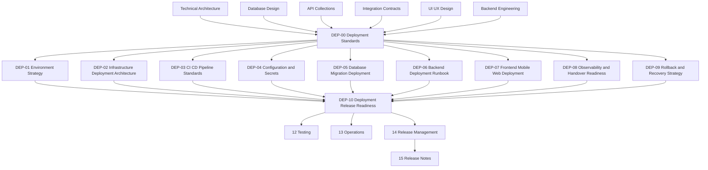

# <!--
# FROZEN: FREEZE-2026-07-26-sample-release
# Freeze date (UTC): 2026-07-26
# Freeze owner: release-manager@example.com
# Do not edit without an unfreeze PR referencing this freeze ID.
# -->

# Deployment Documentation

> Deployment standards, environment strategy, release promotion, configuration, secrets, migration coordination, operational readiness, rollback, recovery, and deployment release readiness for Digitize by OreeOn Technologies Pvt. Ltd.

---

# 1. Purpose

This folder defines the Deployment documentation baseline for the Digitize platform.

Deployment documentation describes how approved application, database, API, integration, UI/UX, and backend artifacts are promoted through controlled environments and prepared for reliable release.

This folder exists to ensure deployment activity is governed, repeatable, secure, observable, reversible where possible, and aligned with approved architecture and release-readiness controls.

Deployment defines how approved artifacts are packaged, configured, promoted, verified, rolled back, and handed over.

---

# 2. Deployment Documentation Objectives

The objectives of this folder are to:

- Define deployment governance standards.
- Define environment strategy.
- Define infrastructure deployment responsibilities.
- Define CI/CD pipeline standards.
- Define configuration and secret-management responsibilities.
- Define database migration deployment coordination.
- Define backend, frontend, mobile, and web deployment handoff expectations.
- Define observability and operational readiness requirements.
- Define rollback and recovery expectations.
- Define deployment release-readiness controls.
- Prevent deployment documentation from redefining application, API, database, integration, UI/UX, backend, testing, operations, or release-note ownership.

---

# 3. Intended Audience

This documentation is intended for:

- DevOps Engineers
- Platform Engineers
- Backend Engineers
- Frontend Engineers
- Mobile Engineers
- Database Engineers
- Security Engineers
- QA Engineers
- Automation Engineers
- Release Managers
- Operations Teams
- Support Teams
- Solution Architects
- Technical Leads
- Implementation Partners

---

# 4. Scope

This folder covers deployment documentation for:

- Deployment governance.
- Environment strategy.
- Infrastructure deployment architecture alignment.
- CI/CD standards.
- Configuration and secret handling.
- Database migration deployment.
- Backend deployment runbooks.
- Frontend, mobile, and web deployment coordination.
- Observability and operational readiness.
- Rollback and recovery strategy.
- Deployment release readiness.

---

# 5. Out of Scope

This folder does not define:

- Product terminology.
- Commercial pricing rules.
- Business requirements.
- Functional requirements.
- Database schema definitions.
- API endpoint catalogues.
- Postman collections.
- Integration provider contracts.
- UI layouts, wireframes, or screen designs.
- Backend business logic.
- Source code.
- Enterprise test strategy or test execution governance.
- Production operations, incident management, support workflows, and maintenance procedures.
- Release-note communication content.

Those artifacts are owned by their respective documentation folders.

---

# 6. Deployment Principles

All Deployment documents follow these principles:

- Secure by Default
- Environment Isolation
- Repeatable Promotion
- Configuration Outside Code
- Secrets Never in Documentation or Source Control
- Migration Safe
- Observable Before Release
- Rollback Aware
- Tenant Isolation Preserved
- Contract Compatible
- Least Privilege
- Evidence Based
- Release Gate Controlled
- Operations Ready

---

# 7. Relationship with Technical Architecture

Technical Architecture defines deployment and DevOps architecture direction, environment assumptions, observability direction, security architecture, and production-readiness expectations.

Deployment documentation defines how those approved architecture decisions are operationalized during environment setup, promotion, migration, deployment, readiness checks, rollback, and handover.

Deployment documentation shall not introduce infrastructure architecture that contradicts Technical Architecture.

---

# 8. Relationship with Backend Engineering

Backend Engineering defines implementation standards, backend release readiness, migration compatibility, configuration expectations, background jobs, outbox behavior, observability, and testing expectations.

Deployment documentation defines how backend build artifacts, runtime configuration, database migrations, worker processes, outbox processors, health checks, readiness checks, rollback considerations, and release gates are handled during deployment.

Deployment documentation shall not redefine backend business logic or backend source structure.

---

# 9. Relationship with Database Design

Database Design defines schema ownership, migration strategy, backup, recovery, performance, monitoring, security, and database lifecycle governance.

Deployment documentation defines how approved database migrations are sequenced, validated, deployed, monitored, and coordinated with application releases.

Deployment documentation shall not redefine database schemas or migration policy ownership.

---

# 10. Relationship with API, Integration, and UI/UX

API Collections define approved API contracts, error behavior, access control, state workflows, mocks, OpenAPI governance, and consumer readiness.

Integration Contracts define external and internal integration behavior, retries, outbox, webhooks, provider boundaries, security, observability, testing, and release readiness.

UI/UX Design defines user-facing behavior, screen flows, states, and interaction expectations.

Deployment documentation ensures deployment does not break approved API contracts, integration contracts, or user-facing behavior.

---

# 11. Folder Position in the Documentation Hierarchy

```text
01_Product_Foundation/
02_Commercial_Strategy/
03_Business_Analysis/
04_Functional_Requirements/
05_Technical_Architecture/
06_Database_Design/
07_API_Collections/
08_Integration_Contracts/
09_UI_UX_Design/
10_Backend_Engineering/
11_Deployment/
12_Testing/
13_Operations/
14_Release_Management/
15_Release_Notes/
16_Development_Readiness/
99_Decision_Records/
```

Deployment sits after Backend Engineering and before Testing, Operations, Release Management, and Release Notes.

This position ensures deployment guidance is based on approved architecture, data, API, integration, UI/UX, backend, and backend release-readiness decisions.

Deployment standards subsequently provide deployment-related inputs and readiness requirements to Testing, Operations, and Release Management.

Testing defines broader test governance and release-quality evidence.

Operations defines production support, monitoring operations, incident handling, maintenance, and operational runbooks.

Release Management defines release scope, release calendar, version assignment, Go / No-Go decision, rollout, known-risk acceptance, and release closure.

Release Notes defines release communication and version-specific change records.

Backend testing guidance can still come from:

- `BE-10_Testing_Quality_Standards.md`
- `BE-11_Backend_Release_Readiness_Checklist.md`

---

# 12. Source Documents

| Source Area | Source Documents | Usage |
|---|---|---|
| Product Foundation | PF-01 to PF-05 | Product hierarchy and platform terminology |
| Commercial Strategy | CS-01 to CS-04 | Commercial release and subscription-impact awareness |
| Business Analysis | BA-01 to BA-10 | Business process and release-impact awareness |
| Functional Requirements | FR-01 to FR-21 | Functional behavior and user-impact awareness |
| Technical Architecture | TA-00 to TA-10 | Deployment, DevOps, security, observability, and operations architecture |
| Database Design | DB-00 to DB-22 | Migration, backup, recovery, monitoring, security, and lifecycle alignment |
| API Collections | API-00 to API-26, approved API test artifacts, and approved Postman collections | API readiness, contract compatibility, mocks, OpenAPI, and consumer readiness |
| Integration Contracts | IC-00 to IC-17 | Integration readiness, outbox, retry, provider, webhook, security, observability, and release readiness |
| UI/UX Design | UI-00 and UX-01 to UX-05 | User-facing release impact and frontend readiness |
| Backend Engineering | BE-00 to BE-11 | Backend runtime, configuration, migration, observability, testing, and release readiness |

When an approved source identifier is unavailable, deployment documents shall use `[TBD — Source mapping pending — see BE traceability mappings](docs/10_Backend_Engineering/BE-TRACEABILITY_MAPPINGS.md)`.

---

# 13. Folder Structure

```text
11_Deployment/
├── README.md
├── DEP-00_Deployment_Standards.md
├── DEP-01_Environment_Strategy.md
├── DEP-02_Infrastructure_Deployment_Architecture.md
├── DEP-03_CI_CD_Pipeline_Standards.md
├── DEP-04_Configuration_Secrets_Management.md
├── DEP-05_Database_Migration_Deployment.md
├── DEP-06_Backend_Deployment_Runbook.md
├── DEP-07_Frontend_Mobile_Web_Deployment.md
├── DEP-08_Observability_Operational_Handover_Readiness.md
├── DEP-09_Rollback_Recovery_Strategy.md
└── DEP-10_Deployment_Release_Readiness_Checklist.md
```

---

# 14. Document Register

| Document ID | Document Name | Status | Purpose |
|---|---|---|---|
| README | Deployment Documentation | Review Draft | Defines the folder purpose, scope, structure, document register, dependencies, and governance |
| DEP-00 | Deployment Standards | Review Draft | Defines common deployment standards inherited by DEP-01 through DEP-10 |
| DEP-01 | Environment Strategy | Design Draft | Defines local, development, test, staging, production, sandbox, and controlled environment promotion strategy |
| DEP-02 | Infrastructure Deployment Architecture | Design Draft | Defines how approved infrastructure architecture is represented and operationalized for deployment, including deployment units, compute responsibilities, network boundaries, storage dependencies, ingress, runtime placement, and hosting responsibilities, without redefining topology or selecting unapproved providers |
| DEP-03 | CI/CD Pipeline Standards | Design Draft | Defines build, validation, test, artifact, approval, promotion, and deployment pipeline standards |
| DEP-04 | Configuration Secrets Management | Design Draft | Defines runtime configuration, typed settings, environment variables, secret references, rotation, access, and environment override controls |
| DEP-05 | Database Migration Deployment | Design Draft | Defines migration deployment sequencing, expand-and-contract rollout, backfill coordination, rollback limitations, and database readiness controls |
| DEP-06 | Backend Deployment Runbook | Design Draft | Defines the controlled backend deployment procedure, artifact verification, migration coordination, process startup, worker and outbox-processor activation, health and readiness verification, smoke testing, rollback initiation, and deployment handover |
| DEP-07 | Frontend Mobile Web Deployment | Design Draft | Defines deployment and release coordination for web applications, Flutter mobile applications, frontend assets, runtime configuration, version compatibility, hosted web promotion, application-store submission, staged rollout, forced-upgrade policy alignment, and user-facing release handover |
| DEP-08 | Observability and Operational Handover Readiness | Design Draft | Defines deployment-time observability requirements, health and readiness validation, required metrics, logs, traces, dashboards, alerts, support diagnostics, and evidence required before operational handover |
| DEP-09 | Rollback Recovery Strategy | Design Draft | Defines application rollback, configuration rollback, infrastructure rollback, database roll-forward, database restore, feature-flag mitigation, provider rollback, mobile release limitations, tenant-specific recovery, and full-platform recovery strategy |
| DEP-10 | Deployment Release Readiness Checklist | Design Draft | Defines deployment readiness gates, approvals, evidence, Go / No-Go controls, and post-deployment verification |

`DEP-07` shall distinguish web deployment, mobile build signing, application-store submission and approval, staged rollout, mobile/API compatibility, mandatory versus optional upgrades, remote configuration, and frontend asset cache invalidation.

`DEP-09` shall distinguish mitigation, rollback, roll-forward, restore, provider recovery, tenant-specific recovery, mobile-release limitations, and full-platform recovery. Database rollback shall be treated as conditional and strategy-dependent.

---

# 15. Document Boundaries

| Concern | Owning Document Area |
|---|---|
| Product terms and hierarchy | Product Foundation |
| Commercial policy | Commercial Strategy |
| Business and functional behavior | Business Analysis and Functional Requirements |
| Architecture direction | Technical Architecture |
| Database schema and migration policy | Database Design |
| API contracts | API Collections |
| Integration contracts | Integration Contracts |
| UI behavior | UI/UX Design |
| Backend implementation behavior | Backend Engineering |
| Deployment execution governance | Deployment |
| Enterprise test strategy and test execution governance | Testing |
| Production operations, incidents, support, and maintenance | Operations |
| Release scope, schedule, decision, rollout, and closure | Release Management |
| Release communication | Release Notes |

---

# 16. Deployment and Operations Boundary

Deployment documents own the controls required to prepare, execute, verify, roll back, and hand over a release.

Operations documents own continuous production operation after deployment handover is accepted.

Deployment documents may define:

- Required deployment-time logs, metrics, traces, dashboards, and alerts.
- Health, readiness, and smoke-test verification.
- Deployment-time diagnostics.
- Handover evidence.
- Rollback and recovery initiation criteria.

Deployment documents shall not redefine:

- Incident-management procedures.
- On-call responsibilities.
- Production support workflows.
- Routine maintenance procedures.
- Long-term monitoring operations.
- Operational escalation matrices.
- Detailed production recovery runbooks.

These are owned by `13_Operations/`.

---

# 17. Document Dependencies



---

# 18. Recommended Generation Order

Deployment documents should be generated and reviewed in the following order:

| Order | Document | Reason |
|---:|---|---|
| 1 | README.md | Establishes folder scope and structure |
| 2 | DEP-00_Deployment_Standards.md | Establishes common deployment standards |
| 3 | DEP-01_Environment_Strategy.md | Defines environments and promotion strategy |
| 4 | DEP-02_Infrastructure_Deployment_Architecture.md | Defines deployment architecture alignment |
| 5 | DEP-03_CI_CD_Pipeline_Standards.md | Defines build, validation, artifact, approval, and promotion controls |
| 6 | DEP-04_Configuration_Secrets_Management.md | Defines runtime configuration and secret handling |
| 7 | DEP-05_Database_Migration_Deployment.md | Defines migration deployment coordination |
| 8 | DEP-06_Backend_Deployment_Runbook.md | Defines backend deployment runbook behavior |
| 9 | DEP-07_Frontend_Mobile_Web_Deployment.md | Defines frontend, mobile, and web deployment behavior |
| 10 | DEP-08_Observability_Operational_Handover_Readiness.md | Defines deployment-time observability and operational handover readiness |
| 11 | DEP-09_Rollback_Recovery_Strategy.md | Defines rollback and recovery strategy |
| 12 | DEP-10_Deployment_Release_Readiness_Checklist.md | Defines final readiness gates |

---

# 19. Governance

Deployment documentation follows these governance rules:

- `DEP-00` governs `DEP-01` through `DEP-10`.
- Deployment documents shall not redefine approved product, business, functional, API, database, integration, UI/UX, or backend behavior.
- Deployment documents shall reference approved upstream documents where applicable.
- Deployment documents shall define deployment responsibilities, boundaries, standards, evidence, and readiness gates.
- Secrets, credentials, private keys, production tokens, and provider credentials shall not be documented in this folder.
- Deployment documents shall remain provider neutral unless a provider has been approved by upstream architecture decisions.
- `DEP-02` shall operationalize approved infrastructure architecture. It shall not independently design or replace infrastructure architecture owned by Technical Architecture.
- `DEP-06` ends when deployment verification and operational handover are completed. Continuous backend operation is owned by Operations.
- Database rollback shall not be assumed to be safe or available. Roll-forward, compatibility restoration, compensating changes, or controlled restore shall be selected based on the approved migration and data-recovery strategy.
- Material deployment architecture changes shall be captured in decision records.

---

# 20. Status Definitions

| Status | Meaning |
|---|---|
| Planned | Document is listed but not yet created |
| Design Draft | Document has been generated and is ready for review |
| Review Draft | Document has completed initial review and may be used for downstream alignment |
| Frozen | Document is approved and forms part of the official deployment baseline |
| Superseded | Document has been replaced by a newer approved version |

---

# 21. Entry Criteria

Deployment documents may be generated when:

- Applicable Technical Architecture documents are at least Review Draft.
- Applicable Database Design documents are at least Review Draft.
- Applicable API Collection contracts are available.
- Applicable Integration Contracts are available.
- UI/UX release surfaces are identified where user-facing deployment is involved.
- Applicable Backend Engineering documents are at least Review Draft.
- Backend packaging, configuration, migration, health, worker, and release-readiness expectations are identifiable.
- Approved baseline decisions are referenced from `99_Decision_Records/`, including PostgreSQL, SQLAlchemy/Alembic, Redis, Celery, Kubernetes-compatible containers, Vault, GitHub Actions, OpenTelemetry/Prometheus/Grafana, and S3-compatible object storage.

---

# 22. Exit Criteria

This folder is ready to support deployment execution when:

- `DEP-00` is reviewed.
- DEP-01 through DEP-10 are generated.
- Environment strategy is defined.
- Artifact identity and versioning rules are defined.
- Environment promotion paths and approval gates are defined.
- Infrastructure deployment responsibilities are defined.
- CI/CD standards are defined.
- Configuration and secret-handling rules are defined.
- Database migration deployment controls are defined.
- Backend, web, and mobile deployment handoff expectations are defined.
- Mobile and web release paths are distinguished.
- Observability and operational readiness controls are defined.
- Deployment evidence-retention expectations are defined.
- Rollback and recovery strategy is defined.
- Deployment release-readiness checklist is defined.
- Operational handover criteria are defined.
- No deployment document contradicts approved upstream governance.
- No unresolved critical security, migration, tenant-isolation, or data-loss deployment decisions remain.

---

# 23. Freeze Rule

`DEP-00` shall be reviewed before DEP-01 through DEP-10 move to Review Draft.

`DEP-00` shall be frozen before DEP-01 through DEP-10 are frozen.

After `DEP-00` is frozen:

- Common deployment standards shall not be duplicated in downstream deployment documents.
- Downstream deployment documents shall describe only document-specific deployment behavior.
- Changes to common deployment standards shall require review.
- Material deployment architecture changes shall require a decision record.

---

# 24. Summary

The Deployment folder provides the controlled release and runtime-promotion bridge between approved implementation documentation and deployable product operation.

It ensures Digitize deployments are secure, repeatable, environment-aware, migration-safe, observable, reversible where possible, evidence-based, and ready for operational handover and release communication.
