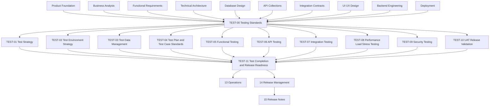

# Testing Documentation

> Testing governance, verification strategy, test environments, test data, test planning, functional testing, API testing, integration testing, performance testing, security testing, UAT, and release-readiness evidence for Digitize by OreeOn Technologies Pvt. Ltd.
> Testing governance, verification strategy, test environments, test data, test planning, functional testing, API testing, integration testing, performance testing, security testing, UAT, and release-readiness evidence for Digitize by OrieOn Technologies Pvt. Ltd.
---

# 1. Purpose

This folder defines the Testing documentation baseline for the Digitize platform.

Testing documentation defines how the platform is verified before release. It consumes approved product, business, functional, architecture, database, API, integration, UI/UX, backend, and deployment documentation, then converts that source material into test strategy, test plans, test cases, evidence, defects, UAT validation, and release-quality recommendations.

Testing does not redefine deployment, architecture, backend behavior, database schema, API contracts, integration contracts, or UI/UX design.

---

# 2. Testing Documentation Objectives

The objectives of this folder are to:

- Define testing governance standards.
- Define testing strategy and quality objectives.
- Define test environment expectations.
- Define test data governance.
- Define test planning and test case standards.
- Define functional, regression, smoke, sanity, and exploratory testing.
- Define REST API, OpenAPI, contract, and Postman testing governance.
- Define integration, provider, webhook, event, queue, and outbox testing.
- Define performance, load, stress, endurance, and scalability testing.
- Define security testing and penetration-readiness expectations.
- Define UAT and business release validation.
- Define test completion, quality metrics, Go / No-Go recommendation, and release-readiness evidence.
- Prevent Testing documents from redefining upstream ownership.

---

# 3. Intended Audience

This documentation is intended for:

- QA Engineers
- Test Automation Engineers
- Manual Test Engineers
- API Test Engineers
- Performance Test Engineers
- Security Testers
- UAT Coordinators
- Product Owners
- Business Analysts
- Backend Engineers
- Frontend Engineers
- Mobile Engineers
- DevOps Engineers
- Operations Teams
- Release Managers
- Solution Architects
- Implementation Partners

---

# 4. Scope

This folder covers:

- Testing standards.
- Test strategy.
- Test environments.
- Test data management.
- Test plans and test case standards.
- Functional testing.
- API testing.
- Integration testing.
- Performance, load, and stress testing.
- Security testing.
- UAT and release validation.
- Test completion and release-readiness evidence.

---

# 5. Out of Scope

This folder does not define:

- Product terminology.
- Commercial policy.
- Business requirements.
- Functional requirements.
- Technical architecture.
- Database schema definitions.
- API endpoint catalogues.
- Integration contracts.
- UI layouts, wireframes, or screen designs.
- Backend implementation behavior.
- Deployment execution procedures.
- Production operations and incident management.
- Release-note communication content.

Those artifacts are owned by their respective documentation folders.

---

# 6. Testing Principles

All Testing documents follow these principles:

- Risk Based
- Requirements Traceable
- Evidence Driven
- Automation Where Valuable
- Human Judgment Where Needed
- Contract Aware
- Tenant Isolation Verified
- Security Conscious
- Data Safe
- Environment Aware
- Defect Linked
- Release Gate Aligned
- Non-Duplicative

---

# 7. Folder Position in the Documentation Hierarchy

```text
01_Product_Foundation/
02_Commercial_Strategy/
03_Business_Analysis/
04_Functional_Requirements/
05_Technical_Architecture/
06_Database_Design/
07_API_Collections/
08_Integration_Contracts/
09_UI_UX_Design/
10_Backend_Engineering/
11_Deployment/
12_Testing/
13_Operations/
14_Release_Management/
15_Release_Notes/
16_Development_Readiness/
99_Decision_Records/
```

Testing sits after Deployment and before Operations, Release Management, and Release Notes.

This position ensures testing guidance is based on approved product, business, functional, architecture, database, API, integration, UI/UX, backend, and deployment decisions.

Testing provides release-quality evidence, test completion status, known risks, and Go / No-Go recommendations to Operations and Release Management.

---

# 8. Source Documents

| Source Area | Source Documents | Usage |
|---|---|---|
| Product Foundation | PF-01 to PF-05 | Product terminology, product hierarchy, platform context |
| Commercial Strategy | CS-01 to CS-04 | Billing, subscription, payment, invoice, license, and release-impact awareness |
| Business Analysis | BA-01 to BA-10 | Process flows, actors, business rules, journeys, assumptions, traceability |
| Functional Requirements | FR-01 to FR-21 | Functional behavior, validation rules, workflows, notifications, reports, audit |
| Technical Architecture | TA-00 to TA-10 | Architecture constraints, security, observability, integration, deployment, operations |
| Database Design | DB-00 to DB-22 | Data model, tenancy, migration, audit, reporting, backup, recovery, performance |
| API Collections | API-00 to API-26 and approved API test artifacts | API contracts, mocks, OpenAPI, Postman, access control, errors, states |
| Integration Contracts | IC-00 to IC-17 | Provider, webhook, outbox, event, file, report, retry, idempotency, release readiness |
| UI/UX Design | UI-00 and UX-01 to UX-05 | Screen flows, UI states, validation presentation, user-facing acceptance |
| Backend Engineering | BE-00 to BE-11 | Backend testing standards, runtime behavior, release readiness, implementation risk |
| Deployment | DEP-00 to DEP-10 | Environment readiness, deployment evidence, handover, release-readiness gates |

When an approved source identifier is unavailable, Testing documents shall use `[TBD — Source mapping pending — see BE traceability mappings](docs/10_Backend_Engineering/BE-TRACEABILITY_MAPPINGS.md)`.

---

# 9. Folder Structure

```text
12_Testing/
├── README.md
├── TEST-00_Testing_Standards.md
├── TEST-01_Test_Strategy.md
├── TEST-02_Test_Environment_Strategy.md
├── TEST-03_Test_Data_Management.md
├── TEST-04_Test_Plan_and_Test_Case_Standards.md
├── TEST-05_Functional_Testing.md
├── TEST-06_API_Testing.md
├── TEST-07_Integration_Testing.md
├── TEST-08_Performance_Load_Stress_Testing.md
├── TEST-09_Security_Testing.md
├── TEST-10_UAT_Release_Validation.md
├── TEST-11_Test_Completion_and_Release_Readiness.md
├── TEST-12_Engineering_Quality_QA_Readiness_Review_2026-11-02.md
└── TEST-13_EQ011_digitize_test_Migration_Authorization.md
```

---

# 10. Document Register

| Document ID | Document Name | Status | Purpose |
|---|---|---|---|
| README | Testing Documentation | Review Draft | Defines folder purpose, scope, structure, dependencies, boundaries, generation order, and governance |
| TEST-00 | Testing Standards | Frozen (provisional) | Defines common testing standards inherited by TEST-01 through TEST-11 |
| TEST-01 | Test Strategy | Frozen (provisional) | Defines testing philosophy, lifecycle, quality objectives, test levels, and risk model |
| TEST-02 | Test Environment Strategy | Frozen (provisional) | Defines test environments, isolation, readiness, mapping, dependencies, and constraints |
| TEST-03 | Test Data Management | Frozen (provisional) | Defines synthetic data, masking, refresh, retention, cleanup, and tenant-safe data use |
| TEST-04 | Test Plan and Test Case Standards | Frozen (provisional) | Defines test planning, test case format, traceability, evidence, and defect linkage |
| TEST-05 | Functional Testing | Frozen (provisional) | Defines functional, regression, smoke, sanity, and exploratory testing |
| TEST-06 | API Testing | Frozen (provisional) | Defines REST API, contract, OpenAPI, Postman, error, auth, and tenant API testing |
| TEST-07 | Integration Testing | Frozen (provisional) | Defines provider, webhook, event, queue, outbox, file, report, and E2E integration testing |
| TEST-08 | Performance Load Stress Testing | Frozen (provisional) | Defines performance, load, stress, endurance, scalability, capacity, and bottleneck testing |
| TEST-09 | Security Testing | Frozen (provisional) | Defines authentication, authorization, tenant isolation, OWASP, vulnerability, and penetration-readiness testing |
| TEST-10 | UAT Release Validation | Frozen (provisional) | Defines user acceptance testing, business validation, sign-off, and release-scope acceptance |
| TEST-11 | Test Completion and Release Readiness | Frozen (provisional) | Defines test completion report, quality metrics, known risks, Go / No-Go recommendation, and release-readiness evidence |
| TEST-12 | Engineering Quality QA Readiness Review (2026-11-02) | Working findings register | Cross-repo engineering quality / messaging / QA readiness findings; not a release Go / No-Go |
| TEST-13 | EQ-011 digitize_test Migration Authorization | Proposal — awaiting authorization | Read-only assessed plan to upgrade local `digitize_test` for EQ-011 live verification; do not apply without approval |

---

# 11. Document Boundaries

| Concern | Owning Document Area |
|---|---|
| Product terminology and hierarchy | Product Foundation |
| Commercial policy | Commercial Strategy |
| Business process and rules | Business Analysis |
| Functional requirements | Functional Requirements |
| Architecture direction | Technical Architecture |
| Database schema and lifecycle | Database Design |
| API contracts | API Collections |
| Integration contracts | Integration Contracts |
| UI behavior and design | UI/UX Design |
| Backend implementation behavior | Backend Engineering |
| Deployment execution and handover | Deployment |
| Test strategy, evidence, defects, UAT, and release-quality recommendation | Testing |
| Production support and incidents | Operations |
| Release scope, schedule, decision, rollout, and closure | Release Management |
| Release communication | Release Notes |

---

# 12. Document Dependencies



---

# 13. Recommended Generation Order

| Order | Document | Reason |
|---:|---|---|
| 1 | README.md | Establishes folder scope and structure |
| 2 | TEST-00_Testing_Standards.md | Establishes common testing standards |
| 3 | TEST-01_Test_Strategy.md | Defines testing philosophy and lifecycle |
| 4 | TEST-02_Test_Environment_Strategy.md | Defines test environment readiness and mapping |
| 5 | TEST-03_Test_Data_Management.md | Defines test data safety and tenant-aware data use |
| 6 | TEST-04_Test_Plan_and_Test_Case_Standards.md | Defines traceable test planning and evidence standards |
| 7 | TEST-05_Functional_Testing.md | Defines functional and regression testing |
| 8 | TEST-06_API_Testing.md | Defines API and contract testing |
| 9 | TEST-07_Integration_Testing.md | Defines integration and E2E testing |
| 10 | TEST-08_Performance_Load_Stress_Testing.md | Defines non-functional performance testing |
| 11 | TEST-09_Security_Testing.md | Defines security testing and penetration-readiness |
| 12 | TEST-10_UAT_Release_Validation.md | Defines business acceptance validation |
| 13 | TEST-11_Test_Completion_and_Release_Readiness.md | Defines completion report and release-quality recommendation |

---

# 14. Governance

Testing documentation follows these governance rules:

- `TEST-00` governs `TEST-01` through `TEST-11`.
- Testing documents shall not redefine approved product, business, functional, architecture, database, API, integration, UI/UX, backend, or deployment behavior.
- Testing documents shall verify approved behavior through traceable tests and evidence.
- Test evidence shall identify release, environment, data scope, result, defect linkage, and approval status where applicable.
- Test data shall preserve tenant isolation and shall not expose production data without approved masking and access controls.
- Security testing shall not document exploitable secrets or sensitive attack details beyond approved access.
- Unresolved source mappings shall use `[TBD — Source mapping pending — see BE traceability mappings](docs/10_Backend_Engineering/BE-TRACEABILITY_MAPPINGS.md)`.

---

# 15. Entry Criteria

Testing documents may be generated when:

- Applicable Functional Requirements are available.
- Applicable Technical Architecture documents are available.
- Applicable Database Design documents are available.
- Applicable API Collections are available.
- Applicable Integration Contracts are available.
- Applicable UI/UX documents are available where user-facing behavior is tested.
- Applicable Backend Engineering documents are available.
- Applicable Deployment documents are available for environment and release-readiness alignment.

---

# 16. Exit Criteria

This folder is ready to support release testing when:

- `TEST-00` is reviewed.
- TEST-01 through TEST-11 are generated.
- Test strategy is defined.
- Test environments are defined.
- Test data governance is defined.
- Test plan and test case standards are defined.
- Functional, API, integration, performance, security, and UAT testing expectations are defined.
- Test completion and release-readiness evidence requirements are defined.
- No Testing document contradicts approved upstream governance.

---

# 17. Freeze Rule

`TEST-00` shall be reviewed before TEST-01 through TEST-11 move to Review Draft.

`TEST-00` shall be frozen before TEST-01 through TEST-11 are frozen.

After `TEST-00` is frozen:

- Common testing standards shall not be duplicated in downstream testing documents.
- Downstream testing documents shall describe only document-specific testing behavior.
- Changes to common testing standards shall require review.

---

# 18. Summary

The Testing folder provides the verification and release-quality evidence layer for Digitize.

It ensures the platform is tested against approved requirements, contracts, architecture, implementation, and deployment readiness before Operations and Release Management receive release-quality inputs.
