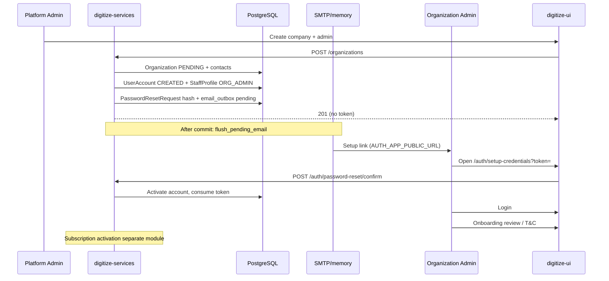

# TEST-12 Engineering Quality and QA Readiness Review (2026-11-02)

**Document ID:** TEST-12  
**Folder:** `12_Testing`  
**Status:** Findings register (not a release Go / No-Go)  
**Date:** 2026-11-02  
**Scope:** `digitize-services`, `digitize-ui`, `digitize-infrastructure` (read-only infra)  
**API inventory:** 228 numbered operations per [`architecture/API_CONTRACT_REGISTRY.md`](../architecture/API_CONTRACT_REGISTRY.md) and `digitize-services/app/api/contracts/catalog.py` — not renumbered in this review.  
**Feature tracker:** [DEV-19](../16_Development_Readiness/DEV-19_Feature_Completion_Tracker.md)  
**EQ-011 migration authorization (proposal):** [TEST-13](TEST-13_EQ011_digitize_test_Migration_Authorization.md) — live EQ-011 remains **not** integration-verified.

**Repository state at review start**

| Repository | Branch | Working tree |
| --- | --- | --- |
| digitize-services | `release/qa-smoke-20261016` | Large in-flight feature set (attendance, communications API-10, billing, support, encryption migrations). Pre-existing uncommitted changes preserved; this review added targeted fixes only. |
| digitize-ui | `release/20261019` | Broad UI/feature work (facility ops, push, support, walk-in). Pre-existing changes preserved. |
| digitize-infrastructure | `main` | QA Terraform and secret-module updates uncommitted; not applied or modified by this review. |

---

## A. Executive summary

### Confirmed defects (addressed in this review)

| ID | Summary | Fix |
| --- | --- | --- |
| EQ-001 | Organization admin could be committed without credentials when `PASSWORD_PEPPER` was missing (`issue_account_credentials` returned silently). | Raise `InternalError` when pepper is below `MIN_PEPPER_LENGTH`; regression test added. |
| EQ-002 | Setup-link / password-reset confirm showed **Invalid credentials** instead of link-specific copy (Flutter mapped 401 through login error path). | Pass through `DigitizeApiException` on confirm; `AuthFailure.fromPasswordRecoveryException`. |
| EQ-003 | Password policy validation from confirm API often collapsed to **Authentication failed** (`Exception(message)` not parsed). | Parse `Exception: …` bodies in `AuthFailure.fromLoginException` / recovery mapper. |
| EQ-004 | Org create mapped ambiguous failures to **Company code already exists** via string heuristics. | Removed heuristic branch; conflicts use `isConflict` + `_conflictFieldErrors` only. |
| EQ-005 | Onboarding review load errors displayed raw `toString()` of exceptions. | Use `_messageFor` for `ErrorState` details. |

### Security / data-integrity risks (documented, not all fixed)

- **Silent credential skip (EQ-001)** was a production misconfiguration risk; now fails closed on provisioning.
- **Password-reset timing side channel:** valid users trigger post-commit SMTP work; invalid users do not — same HTTP 202/401 bodies but different backend work (monitoring-only mitigation).
- **Audit event metadata** on password reset may differ for unknown vs known identifiers (insider visibility if audit logs are broadly readable).
- **PII encryption flags** remain off in QA Terraform by design; enabling without migrations 040–047 is fail-closed at startup (`digitize-services/docs/encryption-readiness.md`).

### Architectural concerns

- **Dual email stacks:** identity credential mail (outbox + `flush_pending_email` on HTTP session commit) vs API-10 `QueuedMessage` worker — intentional but requires separate QA verification for each path.
- **SMS for API-10 notifications:** adapter supports `memory` only; `SMS_PROVIDER=none` in QA ECS — no live SNS/Pinpoint path in code.
- **Terraform env drift:** `RATE_LIMIT_BACKEND`, `RATE_LIMIT_KEY_PREFIX`, `TRUSTED_PROXY_CIDRS` set in QA task env but ignored by Pydantic `extra="ignore"` in `Settings`.
- **Large modules:** `subscription/routes.py`, `organization/service.py` mix orchestration and rules — acceptable for gate delivery but harder to test in isolation.

### UX consistency

- Org create success toast still does not mention admin setup email (documented improvement, not changed — product copy decision).
- Feature-specific error mappers (`invoice_api_errors`, `masterdata_error`, checkout) coexist with inline `error.message`; no single Flutter facade (by design today).

### QA readiness (external messaging)

| Channel | Code readiness | QA ECS / infra | Blocker |
| --- | --- | --- | --- |
| Email (credential + API-10 SMTP) | Implemented | SMTP → SES endpoint configured; secrets in SM | SES domain/sandbox verification, SMTP user in `digitize/qa/application`, ECS egress to `:587` |
| SMS OTP (customer registration, attendance) | Partial (`memory`; no SNS) | Not configured | Product + provider decision; India DLT/registration if using commercial SMS |
| WhatsApp | Cloud API adapter + `memory` | Not configured | Meta Business account, templates, webhooks |
| FCM push | HTTP v1 adapter | Not configured | Firebase project, service account, Flutter `firebase_options`, APNs for iOS |

---

## B. Findings register

| ID | Sev | Repo / location | Evidence | Impact | Recommended fix | Fixed? | Tests |
| --- | --- | --- | --- | --- | --- | --- | --- |
| EQ-001 | High | `identity/provisioning.py` | Early `return` when pepper empty | Org admin without setup token/email | Fail closed (`InternalError`) | Yes | `test_issue_account_credentials_requires_pepper` |
| EQ-002 | Med | Flutter auth datasource + controller | `_mapAuthError` 401 → `AuthException` | Wrong setup-link UX | Recovery-specific mapping | Yes | `auth_contract_test` password recovery case |
| EQ-003 | Med | `auth_controller.dart` | Default branch on `Exception(message)` | Policy errors hidden | Parse exception message | Yes | `auth_contract_test` |
| EQ-004 | Med | `organization_form_controller.dart` | `msg.contains('Validation')` | Wrong field errors | Remove heuristic | Yes | Manual / existing org form tests |
| EQ-005 | Low | `organization_onboarding_review_page.dart` | `_error.toString()` | Raw exception in UI | `_messageFor` | Yes | — |
| EQ-006 | Med | `communication/mobile_channel_delivery.py` | SMS only `memory` | No production SMS | Implement SNS or document deferral | No | `test_mobile_channel_delivery.py` (memory) |
| EQ-007 | Low | `settings.py` | `FCM_SERVER_KEY` unused | Config confusion | Deprecate in docs or wire | No | — |
| EQ-008 | Low | QA `main.tf` vs `Settings` | Ignored env keys | False sense of rate-limit/proxy config | Remove or implement in app | No | — |
| EQ-009 | Med | Org create UX | Success toast vs staff create | Admin may not expect email | Add success copy | No | — |
| EQ-010 | Low | `core/models/api_error.dart` | Unused | Dead code | Remove or wire | No | — |
| EQ-011 | Med | Onboarding E2E | **Test added** (`test_eq011_onboarding_auth_e2e.py`); live run needs `DIGITIZE_API_TEST=1` + migrated `digitize_test` (authorize **036→071** per [TEST-13](TEST-13_EQ011_digitize_test_Migration_Authorization.md); minimum column from 043) | Regression gap closed in code; **not** integration-verified | Authorize `digitize_test` upgrade then run opt-in live suite | No | `tests/organization/test_eq011_onboarding_auth_e2e.py` |
| EQ-012 | Info | Password reset | Different audit payloads | Insider enumeration | Restrict audit read RBAC | No | `test_password_reset_non_enumerating` (HTTP only) |

---

## C. Validation and messaging matrix (selected workflows)

Convention: backend authoritative; Flutter mirrors in `lib/core/validation/` where noted. HTTP envelope per API-00 (`DigitizeApiException` / `ErrorCode`).

### Login

| Aspect | Backend | Frontend | Code / status | User message |
| --- | --- | --- | --- | --- |
| Invalid credentials | `AuthenticationFailed` 401 | Maps to invalid credentials | `AUTHENTICATION_FAILED` | Invalid credentials |
| Validation | `ValidationFailed` 422 | Field/body from envelope | `VALIDATION_FAILED` | Server message |
| Rate limit | `RateLimitError` 429 | Retryable | `RATE_LIMIT_EXCEEDED` | Too many attempts… |
| Success | 200 + cookies | Session stored | — | — |

Tests: `tests/authentication/test_auth_api.py`, `auth_contract_test.dart`.

### Password reset (unauthenticated)

| Aspect | Backend | Frontend |
| --- | --- | --- |
| Request | 202 identical body whether user exists | Same message; no enumeration |
| Confirm invalid token | 401 `Authentication failed.` | **This link is invalid, expired, or already used.** (after EQ-002) |
| Confirm policy | 422 joined violations | Validation message from API (after EQ-003) |

Tests: `test_password_reset_non_enumerating_and_confirm`, `auth_contract_test`.

### Organization create + admin provisioning

| Aspect | Backend | Frontend |
| --- | --- | --- |
| Validation | 422 field details | `organization_form_controller` normalizes snake_case |
| Conflict | 409 + message / fields | `_conflictFieldErrors` |
| Success | 201 org + admin in response (no tokens) | Toast: company created (no email mention — EQ-009) |
| Credential email | Outbox row + post-commit SMTP/memory | Not shown in API response (correct) |
| Pepper missing | 500 `InternalError` rolls back transaction (after EQ-001) | Generic failure |

Tests: `test_organization_facility_site.py`, `test_credential_provisioning.py`.

### Organization onboarding (T&C, PA review)

| Step | Backend state | Notes |
| --- | --- | --- |
| Create | `business_status=PENDING`, onboarding meta `draft` / `awaiting_review` | Legal identity required at create |
| Accept T&C | `OrganizationService.accept_onboarding` | May toast legal-identity gap |
| PA approve | Governance routes | Platform Admin governance-only |
| Subscription / activation | Separate subscription lifecycle | Not conflated with T&C in service helpers |

Tests: `tests/organization/test_onboarding_review.py`.

### Customer registration phone OTP

| Aspect | Backend | QA |
| --- | --- | --- |
| Required | `CUSTOMER_REGISTRATION_PHONE_VERIFICATION_REQUIRED` true in staging/production | QA default false |
| Delivery | Uses mobile OTP infrastructure + `SMS_PROVIDER` | QA: `none` — OTP generation works in tests with `memory` |

Tests: `tests/customer/test_registration_phone_otp.py`, migration 052 tests.

---

## D. Onboarding sequence (actual)

**Distinctions preserved:** org creation vs email delivery (outbox `delivery_status` tracks send failures); setup tokens never in JSON responses; bootstrap requires pepper explicitly; org path now matches fail-closed pepper policy (EQ-001).

**Recovery:** staff credential reset and platform bootstrap reuse `issue_account_credentials` / `queue_recovery_email` with same outbox pattern.

---

## E. QA integration matrix

### Email

| Item | Detail |
| --- | --- |
| **Implementation** | `EMAIL_PROVIDER` → `resolved_email_provider()` defaults QA to `smtp`; identity flush + API-10 `SmtpNotificationDeliveryProvider` |
| **QA Terraform evidence** | `EMAIL_PROVIDER=smtp`, `SMTP_HOST=email-smtp.ap-south-1.amazonaws.com`, `EMAIL_FROM`, TLS; `SMTP_USERNAME`/`SMTP_PASSWORD` in `digitize/qa/application` JSON |
| **Missing** | SES production access / verified identity; bounce/complaint handling ops runbooks |
| **DNS** | SPF/DKIM/DMARC for sending domain (operator console, not in repo) |
| **IAM** | No `ses:SendEmail` on task role — SMTP credentials only |
| **Verification** | 1) Populate SM secret 2) Scale ECS 3) Create org with admin in QA 4) Confirm outbox `SENT` and message received at designated test inbox only |
| **Templates** | `credential_setup`, `password_reset`, API-10 template service |

### SMS OTP

| Item | Detail |
| --- | --- |
| **Implementation** | Customer registration OTP, attendance OTP modules; `infrastructure/sms/service.py`; notification SMS adapter **memory only** |
| **QA config** | `SMS_PROVIDER` unset → `none` in QA |
| **India considerations** | TRAI/DLT sender ID, template registration, numeric sender constraints — **requires business decision before AWS SNS/Pinpoint or local aggregator** |
| **User actions** | Choose provider; register sender/templates; set `SMS_PROVIDER` + credentials; extend adapter if not SNS |
| **Verification** | Sandbox numbers only; use `memory` provider in automated tests (already) |

### WhatsApp

| Item | Detail |
| --- | --- |
| **Implementation** | `WhatsAppNotificationDeliveryProvider`, `WHATSAPP_CLOUD_API_*`, financial template name |
| **QA config** | Not in ECS task definition |
| **User actions** | Meta Business Portfolio, phone number, Cloud API token, approved templates, webhook URL + verify token on API |
| **Verification** | Meta test recipients; `tests/infrastructure/test_whatsapp_delivery.py` (mocked) |

### FCM push

| Item | Detail |
| --- | --- |
| **Backend** | `PushNotificationDeliveryProvider`, `FCM_PROJECT_ID`, `FCM_SERVICE_ACCOUNT_FILE` / `GOOGLE_APPLICATION_CREDENTIALS`, device tokens in communication module |
| **Flutter** | `lib/core/firebase/*`, `features/push_notifications/`; `firebase_options.dart` placeholder until `FIREBASE_CONFIGURED=true` |
| **QA config** | Not injected in Terraform |
| **User actions** | Firebase project; Android/iOS apps; download service account JSON to SM (never commit); APNs key for iOS; set `PUSH_PROVIDER=fcm` on ECS |
| **Verification** | Register device token via API; send test notification to QA device |

### Configuration matrix (abbreviated)

| Setting | Purpose | Dev | QA | Prod-like | Secret | Source |
| --- | --- | --- | --- | --- | --- | --- |
| `PASSWORD_PEPPER` | Hashing + tokens | .env | SM application | SM | Yes | SM / .env |
| `AUTH_APP_PUBLIC_URL` | Setup/reset links | localhost | `https://qa.digitizeplatform.in` | Public web URL | No | Terraform / .env |
| `EMAIL_*` / `SMTP_*` | Mail | memory/smtp | smtp + SM | smtp + SM | SMTP pass | TF + SM |
| `SMS_PROVIDER` | SMS | memory/none | none (default) | TBD | Provider keys | Env |
| `WHATSAPP_*` | WhatsApp | memory | unset | TBD | Token | Env/SM |
| `PUSH_PROVIDER` / `FCM_*` | Push | memory/none | unset | TBD | SA JSON | Env/SM |
| `JWT_*` | Auth | .env | SM | SM | Yes | SM |
| `KMS_*` / `BLIND_INDEX_*` | PII crypto | local keys | TF modules | required | Yes | TF + SM |

---

## F. Action list

### 1. Confirmed code defects

- EQ-001 … EQ-005: **fixed in working tree** (see section B).

### 2. UX / validation improvements

- EQ-009: Org create success message should mention admin setup email (align with staff create).
- Centralize more Flutter API errors behind small mappers (optional; avoid mechanical replacement).

### 3. Missing automated tests

- EQ-011: **Implemented** — `tests/organization/test_eq011_onboarding_auth_e2e.py` (org create → memory mailbox setup link → `password-reset/confirm` → login → PENDING tenant boundaries). Execute with `DIGITIZE_API_TEST=1 DB_NAME=digitize_test` after integration DB migrations (incl. 043+).
- EQ-006: Contract tests when SMS provider is chosen.
- Flutter widget test for onboarding review load error copy (EQ-005).

### 4. User / operator actions (provider consoles)

- SES: verify domain, SMTP credentials in `digitize/qa/application`, test recipient policy.
- ECS: scale QA service, confirm egress to SMTP.
- Firebase + FCM service account for push QA.
- WhatsApp Business + templates if product requires.
- SMS: provider + India compliance if OTP required in QA.

### 5. Product decisions requiring approval

- Live SMS provider and scope (registration OTP only vs campaigns vs attendance).
- WhatsApp scope (utility templates vs marketing).
- Whether QA should enable `CUSTOMER_REGISTRATION_PHONE_VERIFICATION_REQUIRED`.
- PII encryption enablement schedule (migrations 040–047).

### 6. Deployment / production blockers

- Uncommitted migration SQL 031–071 not run in this review (authorization required).
- `BILLING_REFUNDS_REPORTING_ENABLED` not enabled (per mission constraints).
- Notification worker process for API-10 (`scripts/run_notification_worker.py`) must run in QA for queued campaigns — separate from HTTP email flush.

---

## DRY / SOLID audit (evidence-based highlights)

**DRY — acceptable duplication**

- Separate password validation: backend `password_policy.py` + Flutter `password_validator.dart` (documented DEC-08 parity).
- Two email delivery paths (identity vs communication) — different lifecycles; do not merge without product sign-off.

**DRY — improvement candidates**

- Repeated `if (error is DigitizeApiException) return error.message` across features → optional shared `userMessageFor(DigitizeApiException)` (low priority).
- Facility/org authorization checks duplicated between routes and services — consistent pattern but repeated `require_permission` blocks.

**SOLID**

- **SRP:** Routes thin in newer modules (communication, billing services extracted); legacy fat routes remain in subscription.
- **DIP:** Notification delivery via `get_notification_delivery_provider()`; storage via `STORAGE_PROVIDER` — good.
- **Risk:** `request.app.state.settings` passed into identity provisioning from HTTP layer — testable but couples to Starlette request in org create.

**Design patterns in use (justified):** Outbox (email), repository per module, Riverpod DI in Flutter, envelope parsing (`api_envelope.dart`).

---

## Tests executed in this review

| Command | Result |
| --- | --- |
| `pytest tests/api/test_contract_registry.py tests/identity/test_credential_provisioning.py tests/authentication/test_auth_api.py tests/organization/test_onboarding_review.py -q` | **38 passed**, 19 skipped |
| `pytest tests/identity/test_credential_provisioning.py -q` | **6 passed** (includes new pepper test) |
| `pytest tests/communication/ tests/infrastructure/test_email_delivery.py tests/infrastructure/test_whatsapp_delivery.py -q` | **61 passed** |
| `flutter test test/features/authentication/auth_contract_test.dart` | **5 passed** |

No database migrations, no live SMS/email/WhatsApp/push, no Terraform apply, no git commit/push, no changes to AWS resources.

---

## Code changes made (this review)

| File | Change |
| --- | --- |
| `app/modules/identity/provisioning.py` | Fail closed on missing/short `PASSWORD_PEPPER` |
| `tests/identity/test_credential_provisioning.py` | Regression test |
| `lib/features/authentication/data/datasources/api_auth_remote_datasource.dart` | Confirm reset preserves API exception |
| `lib/features/authentication/presentation/controllers/auth_controller.dart` | `fromPasswordRecoveryException`, exception message parsing |
| `lib/features/organization/application/form/organization_form_controller.dart` | Remove misleading conflict heuristic |
| `lib/features/organization/presentation/pages/organization_onboarding_review_page.dart` | Safe error details |
| `test/features/authentication/auth_contract_test.dart` | Password recovery mapping test |

---

## Explicit compliance statement

This review did **not**: run database migrations; create/drop/truncate databases; modify business data; send real customer messages; create provider accounts; change AWS/Terraform/DNS/IAM; deploy; commit; or push. Existing uncommitted work in all three repositories was preserved aside from the targeted fixes above.
