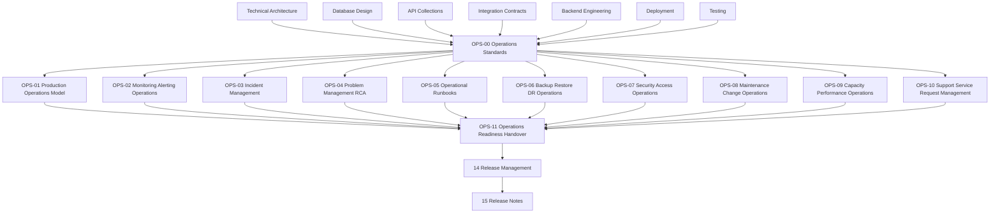

# Operations Documentation

> Production operations, operational support, monitoring operations, incident management, problem management, runbooks, backup and recovery operations, access operations, maintenance, capacity management, support workflows, and operational readiness for Digitize by OreeOn Technologies Pvt. Ltd.

---

# 1. Purpose

This folder defines the Operations documentation baseline for the Digitize platform.

Operations documentation defines how the production platform is supported after deployment handover is accepted. It consumes approved architecture, database, API, integration, UI/UX, backend, deployment, and testing documentation, then defines the production operating model, monitoring operations, incident handling, maintenance, recovery coordination, support workflows, and ongoing service management.

Operations does not redefine product requirements, architecture, backend implementation, deployment execution, testing governance, or release-note communication.

---

# 2. Operations Documentation Objectives

The objectives of this folder are to:

- Define operations governance standards.
- Define the production operations model.
- Define monitoring and alerting operations.
- Define incident management and escalation.
- Define problem management and root-cause analysis.
- Define operational runbook standards.
- Define backup, restore, and disaster-recovery operations.
- Define security and access operations.
- Define maintenance and operational change handling.
- Define capacity and performance operations.
- Define support and service request management.
- Define operational readiness and handover acceptance.
- Prevent Operations documents from redefining upstream ownership.

---

# 3. Intended Audience

This documentation is intended for:

- Operations Teams
- Support Engineers
- Site Reliability Engineers
- DevOps Engineers
- Platform Engineers
- Backend Engineers
- Database Engineers
- Security Engineers
- QA Engineers
- Release Managers
- Product Owners
- Business Stakeholders
- Implementation Partners
- Solution Architects
- Technical Leads

---

# 4. Scope

This folder covers:

- Operations standards.
- Production operations model.
- Monitoring and alerting operations.
- Incident management.
- Problem management and RCA.
- Operational runbooks.
- Backup, restore, and disaster-recovery operations.
- Security and access operations.
- Maintenance and change operations.
- Capacity and performance operations.
- Support and service request management.
- Operational readiness and handover.

---

# 5. Out of Scope

This folder does not define:

- Product terminology.
- Commercial policy.
- Business requirements.
- Functional requirements.
- Technical architecture.
- Database schema definitions.
- API endpoint catalogues.
- Integration contracts.
- UI layouts, wireframes, or screen designs.
- Backend implementation behavior.
- Deployment execution procedures.
- Test strategy or test execution governance.
- Release-note communication content.

Those artifacts are owned by their respective documentation folders.

---

# 6. Operations Principles

All Operations documents follow these principles:

- Production Stability First
- Customer Impact Aware
- Secure by Default
- Least Privilege
- Observable by Default
- Evidence Based
- Tenant Isolation Preserved
- Incident Ready
- Runbook Driven
- Recovery Aware
- Change Controlled
- Supportable and Auditable
- Non-Duplicative

---

# 7. Folder Position in the Documentation Hierarchy

```text
01_Product_Foundation/
02_Commercial_Strategy/
03_Business_Analysis/
04_Functional_Requirements/
05_Technical_Architecture/
06_Database_Design/
07_API_Collections/
08_Integration_Contracts/
09_UI_UX_Design/
10_Backend_Engineering/
11_Deployment/
12_Testing/
13_Operations/
14_Release_Management/
15_Release_Notes/
16_Development_Readiness/
99_Decision_Records/
```

Operations sits after Testing and before Release Management and Release Notes.

This position ensures Operations receives approved architecture, implementation, deployment, and release-quality evidence before defining continuous production support and service management.

Operations provides production support context, incident status, known operational risks, and support-readiness inputs to Release Management.

---

# 8. Source Documents

| Source Area | Source Documents | Usage |
|---|---|---|
| Product Foundation | PF-01 to PF-05 | Product terminology, hierarchy, tenant model, roadmap context |
| Commercial Strategy | CS-01 to CS-04 | Subscription, billing, payment, invoice, license, and customer-impact awareness |
| Business Analysis | BA-01 to BA-10 | Business process, operational impact, actors, journeys, and assumptions |
| Functional Requirements | FR-01 to FR-21 | Functional behavior, critical flows, reports, audit, notifications, and compliance |
| Technical Architecture | TA-00 to TA-10 | Operations architecture, observability, security, scalability, deployment, and recovery direction |
| Database Design | DB-00 to DB-22 | Backup, restore, monitoring, recovery, performance, audit, retention, and lifecycle governance |
| API Collections | API-00 to API-26 | API behavior, errors, states, access control, and support diagnostics |
| Integration Contracts | IC-00 to IC-17 | Provider, webhook, event, outbox, file, report, retry, reconciliation, and failure behavior |
| UI/UX Design | UI-00 and UX-01 to UX-05 | User-facing states, support-visible behavior, and customer-impact interpretation |
| Backend Engineering | BE-00 to BE-11 | Runtime behavior, logs, metrics, workers, outbox, configuration, and release readiness |
| Deployment | DEP-00 to DEP-10 | Deployment evidence, operational handover, rollback initiation, and release readiness |
| Testing | TEST-00 to TEST-11 | Test completion, known risks, quality evidence, and Go / No-Go recommendation |

When an approved source identifier is unavailable, Operations documents shall use `[TBD — Source mapping pending — see BE traceability mappings](docs/10_Backend_Engineering/BE-TRACEABILITY_MAPPINGS.md)`.

---

# 9. Folder Structure

```text
13_Operations/
├── README.md
├── OPS-00_Operations_Standards.md
├── OPS-01_Production_Operations_Model.md
├── OPS-02_Monitoring_Alerting_Operations.md
├── OPS-03_Incident_Management.md
├── OPS-04_Problem_Management_RCA.md
├── OPS-05_Operational_Runbooks.md
├── OPS-06_Backup_Restore_DR_Operations.md
├── OPS-07_Security_Access_Operations.md
├── OPS-08_Maintenance_Change_Operations.md
├── OPS-09_Capacity_Performance_Operations.md
├── OPS-10_Support_Service_Request_Management.md
└── OPS-11_Operations_Readiness_Handover.md
```

---

# 10. Document Register

| Document ID | Document Name | Status | Purpose |
|---|---|---|---|
| README | Operations Documentation | Review Draft | Defines folder purpose, scope, structure, dependencies, boundaries, generation order, and governance |
| OPS-00 | Operations Standards | Design Draft | Defines common operations standards inherited by OPS-01 through OPS-11 |
| OPS-01 | Production Operations Model | Design Draft | Defines production operating model, ownership, roles, support hours, service model, and operational responsibilities |
| OPS-02 | Monitoring Alerting Operations | Design Draft | Defines production monitoring, alert response, dashboards, alert ownership, thresholds, and alert review |
| OPS-03 | Incident Management | Design Draft | Defines incident classification, severity, triage, escalation, communication, resolution, and evidence |
| OPS-04 | Problem Management RCA | Design Draft | Defines recurring issue management, root-cause analysis, corrective actions, prevention, and review |
| OPS-05 | Operational Runbooks | Design Draft | Defines runbook standards for recurring operations, diagnostics, checks, maintenance, and safe execution |
| OPS-06 | Backup Restore DR Operations | Design Draft | Defines backup validation, restore coordination, disaster-recovery operations, evidence, and recovery exercises |
| OPS-07 | Security Access Operations | Design Draft | Defines access reviews, privileged access, credential operations, audit support, and security operational controls |
| OPS-08 | Maintenance Change Operations | Design Draft | Defines routine maintenance, operational change windows, approvals, risk review, and maintenance evidence |
| OPS-09 | Capacity Performance Operations | Design Draft | Defines capacity monitoring, performance trend review, scaling triggers, bottleneck handling, and service health |
| OPS-10 | Support Service Request Management | Design Draft | Defines support intake, triage, service requests, customer-impact handling, SLA awareness, and support evidence |
| OPS-11 | Operations Readiness Handover | Design Draft | Defines operational readiness, deployment handover acceptance, release support readiness, and operations sign-off |

---

# 11. Document Boundaries

| Concern | Owning Document Area |
|---|---|
| Product terminology and hierarchy | Product Foundation |
| Commercial policy | Commercial Strategy |
| Business process and rules | Business Analysis |
| Functional requirements | Functional Requirements |
| Architecture direction | Technical Architecture |
| Database schema and lifecycle | Database Design |
| API contracts | API Collections |
| Integration contracts | Integration Contracts |
| UI behavior and design | UI/UX Design |
| Backend implementation behavior | Backend Engineering |
| Deployment execution and rollback initiation | Deployment |
| Test strategy, evidence, UAT, and release-quality recommendation | Testing |
| Continuous production support, incidents, maintenance, runbooks, and operational service management | Operations |
| Release scope, schedule, decision, rollout, and closure | Release Management |
| Release communication | Release Notes |

---

# 12. Deployment, Testing, and Operations Boundary

Deployment owns the controls required to prepare, execute, verify, roll back, and hand over a release.

Testing owns quality strategy, test execution evidence, UAT validation, defect linkage, and release-quality recommendation.

Operations owns continuous production operation after deployment handover is accepted.

Operations may consume:

- Deployment evidence.
- Handover evidence.
- Known deployment risks.
- Test completion reports.
- Known defects.
- UAT status.
- Release-quality recommendations.

Operations shall not redefine deployment execution or test governance.

---

# 13. Document Dependencies



---

# 14. Recommended Generation Order

| Order | Document | Reason |
|---:|---|---|
| 1 | README.md | Establishes folder scope and structure |
| 2 | OPS-00_Operations_Standards.md | Establishes common operations standards |
| 3 | OPS-01_Production_Operations_Model.md | Defines production operating model and ownership |
| 4 | OPS-02_Monitoring_Alerting_Operations.md | Defines monitoring and alert operations |
| 5 | OPS-03_Incident_Management.md | Defines incident handling and escalation |
| 6 | OPS-04_Problem_Management_RCA.md | Defines RCA and corrective action governance |
| 7 | OPS-05_Operational_Runbooks.md | Defines repeatable operational runbook standards |
| 8 | OPS-06_Backup_Restore_DR_Operations.md | Defines recovery operations and validation |
| 9 | OPS-07_Security_Access_Operations.md | Defines operational security and access controls |
| 10 | OPS-08_Maintenance_Change_Operations.md | Defines maintenance and operational change controls |
| 11 | OPS-09_Capacity_Performance_Operations.md | Defines capacity and performance operations |
| 12 | OPS-10_Support_Service_Request_Management.md | Defines support workflows and service request management |
| 13 | OPS-11_Operations_Readiness_Handover.md | Defines operational readiness and handover acceptance |

---

# 15. Governance

Operations documentation follows these governance rules:

- `OPS-00` governs `OPS-01` through `OPS-11`.
- Operations documents shall not redefine approved product, business, functional, architecture, database, API, integration, UI/UX, backend, deployment, or testing behavior.
- Operations documents shall focus on continuous production operation after handover.
- Operations runbooks shall be safe, repeatable, auditable, and access-controlled.
- Incident and support documentation shall protect customer data and tenant isolation.
- Security-sensitive operational details shall be restricted to approved access.
- Unresolved source mappings shall use `[TBD — Source mapping pending — see BE traceability mappings](docs/10_Backend_Engineering/BE-TRACEABILITY_MAPPINGS.md)`.

---

# 16. Entry Criteria

Operations documents may be generated when:

- Applicable Technical Architecture documents are available.
- Applicable Database Design documents are available.
- Applicable API Collections are available.
- Applicable Integration Contracts are available.
- Applicable Backend Engineering documents are available.
- Applicable Deployment handover and readiness expectations are available.
- Applicable Testing completion and known-risk expectations are available.

---

# 17. Exit Criteria

This folder is ready to support Operations when:

- `OPS-00` is reviewed.
- OPS-01 through OPS-11 are generated.
- Production operating model is defined.
- Monitoring and alerting operations are defined.
- Incident and problem management are defined.
- Operational runbook standards are defined.
- Backup, restore, and DR operations are defined.
- Security and access operations are defined.
- Maintenance and change operations are defined.
- Capacity and performance operations are defined.
- Support and service request management are defined.
- Operations readiness and handover acceptance are defined.
- No Operations document contradicts approved upstream governance.

---

# 18. Freeze Rule

`OPS-00` shall be reviewed before OPS-01 through OPS-11 move to Review Draft.

`OPS-00` shall be frozen before OPS-01 through OPS-11 are frozen.

After `OPS-00` is frozen:

- Common operations standards shall not be duplicated in downstream operations documents.
- Downstream operations documents shall describe only document-specific operations behavior.
- Changes to common operations standards shall require review.

---

# 19. Summary

The Operations folder provides the continuous production support and service-management layer for Digitize.

It ensures production operation is observable, supportable, secure, auditable, incident-ready, recovery-aware, and aligned with approved deployment and testing handover evidence.
