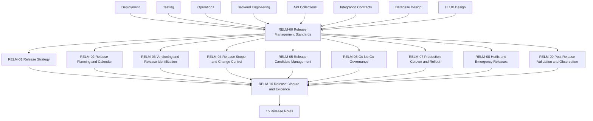

# Release Management Documentation

> Release strategy, planning, calendar, versioning, release scope, release candidates, Go / No-Go governance, cutover, rollout, hotfixes, post-release validation, closure, and release evidence for Digitize by OreeOn Technologies Pvt. Ltd.

---

# 1. Purpose

This folder defines the Release Management documentation baseline for the Digitize platform.

Release Management owns the governance decision layer between Operations and Release Notes. It determines whether a release should proceed, when it should proceed, for whom it should proceed, under what controls it should proceed, and how the release is closed after rollout.

Release Management consumes Deployment readiness, Testing evidence, Operations readiness, Product and Business scope, and technical release inputs. It does not execute deployment, perform testing, operate production support, or write release-note communication.

---

# 2. Release Management Objectives

The objectives of this folder are to:

- Define release-management governance standards.
- Define release strategy, cadence, and lifecycle.
- Define release planning and calendar ownership.
- Define versioning and release identification.
- Define release scope and change control.
- Define release candidate governance.
- Define Go / No-Go governance.
- Define production cutover and staged rollout coordination.
- Define hotfix and emergency-release governance.
- Define post-release validation and observation.
- Define release closure and evidence packaging.
- Prevent Release Management from redefining Deployment, Testing, Operations, or Release Notes ownership.

---

# 3. Intended Audience

This documentation is intended for:

- Release Managers
- Product Owners
- Business Stakeholders
- DevOps Engineers
- Operations Teams
- QA Engineers
- Backend Engineers
- Frontend Engineers
- Mobile Engineers
- Database Engineers
- Security Engineers
- Support Teams
- Solution Architects
- Technical Leads
- Implementation Partners

---

# 4. Scope

This folder covers:

- Release strategy.
- Release lifecycle.
- Release calendar.
- Versioning and release identification.
- Release scope and change control.
- Release candidate creation and promotion eligibility.
- Go / No-Go meetings and decisions.
- Waiver and known-risk acceptance.
- Cutover and staged rollout coordination.
- Feature activation governance.
- Hotfix and emergency-release governance.
- Release postponement or cancellation.
- Post-release validation and observation.
- Release closure and evidence package.

---

# 5. Out of Scope

This folder does not define:

- Product requirements.
- Technical architecture.
- Database schema definitions.
- API endpoint catalogues.
- Integration contracts.
- UI layouts or screen designs.
- Backend implementation behavior.
- Build and deployment execution.
- Test execution and quality recommendation ownership.
- Continuous production support and incident handling.
- Release-note communication content.

Those artifacts are owned by their respective documentation folders.

---

# 6. Release Management Principles

All Release Management documents follow these principles:

- Decision Ownership Is Explicit
- Release Scope Is Controlled
- Versioning Is Traceable
- Release Candidates Are Governed
- Evidence Based Go / No-Go
- Known Risks Are Accepted Explicitly
- Rollout Is Coordinated
- Hotfixes Are Controlled
- Customer Impact Is Considered
- Tenant Impact Is Considered
- Release Closure Is Required
- Non-Duplicative

---

# 7. Folder Position in the Documentation Hierarchy

```text
01_Product_Foundation/
02_Commercial_Strategy/
03_Business_Analysis/
04_Functional_Requirements/
05_Technical_Architecture/
06_Database_Design/
07_API_Collections/
08_Integration_Contracts/
09_UI_UX_Design/
10_Backend_Engineering/
11_Deployment/
12_Testing/
13_Operations/
14_Release_Management/
15_Release_Notes/
16_Development_Readiness/
99_Decision_Records/
```

Release Management sits after Operations and before Release Notes.

Deployment defines how the approved build is deployed.

Testing defines whether the product has been verified.

Operations defines whether the deployed product can be supported and operated.

Release Management defines whether the release should proceed, when, for whom, and under what controls.

Release Notes defines what changed in the released version.

---

# 8. Source Documents

| Source Area | Source Documents | Usage |
|---|---|---|
| Product Foundation | PF-01 to PF-05 | Product terminology, hierarchy, roadmap, and release context |
| Commercial Strategy | CS-01 to CS-04 | Commercial, subscription, billing, license, and customer-impact awareness |
| Business Analysis | BA-01 to BA-10 | Business flows, actors, operational impact, and stakeholder expectations |
| Functional Requirements | FR-01 to FR-21 | Release-scope behavior and business capability changes |
| Technical Architecture | TA-00 to TA-10 | Architecture readiness, technical risk, deployment, observability, and operations alignment |
| Database Design | DB-00 to DB-22 | Migration, backup, restore, recovery, data-impact, and lifecycle awareness |
| API Collections | API-00 to API-26 | API release readiness, compatibility, and consumer-impact awareness |
| Integration Contracts | IC-00 to IC-17 | Provider, webhook, event, outbox, file, report, and release-readiness awareness |
| UI/UX Design | UI-00 and UX-01 to UX-05 | User-facing changes, rollout impact, and release communication inputs |
| Backend Engineering | BE-00 to BE-11 | Backend release readiness and implementation-risk awareness |
| Deployment | DEP-00 to DEP-10 | Deployment readiness, release artifact, cutover, rollout, observation, and evidence inputs |
| Testing | TEST-00 to TEST-11 | Test completion, quality recommendation, known defects, UAT, and release-quality evidence |
| Operations | OPS-00 to OPS-11 | Operations readiness, support readiness, known operational risks, and handover acceptance |

When an approved source identifier is unavailable, Release Management documents shall use `[TBD — Source mapping pending — see BE traceability mappings](docs/10_Backend_Engineering/BE-TRACEABILITY_MAPPINGS.md)`.

---

# 9. Folder Structure

```text
14_Release_Management/
├── README.md
├── RELM-00_Release_Management_Standards.md
├── RELM-01_Release_Strategy.md
├── RELM-02_Release_Planning_and_Calendar.md
├── RELM-03_Versioning_and_Release_Identification.md
├── RELM-04_Release_Scope_and_Change_Control.md
├── RELM-05_Release_Candidate_Management.md
├── RELM-06_Go_No_Go_Governance.md
├── RELM-07_Production_Cutover_and_Rollout.md
├── RELM-08_Hotfix_and_Emergency_Releases.md
├── RELM-09_Post_Release_Validation_and_Observation.md
└── RELM-10_Release_Closure_and_Evidence.md
```

---

# 10. Document Register

| Document ID | Document Name | Status | Purpose |
|---|---|---|---|
| README | Release Management Documentation | Review Draft | Defines folder purpose, scope, structure, dependencies, boundaries, generation order, and governance |
| RELM-00 | Release Management Standards | Design Draft | Defines common release-management standards inherited by RELM-01 through RELM-10 |
| RELM-01 | Release Strategy | Design Draft | Defines release types, cadence, lifecycle, and release model |
| RELM-02 | Release Planning and Calendar | Design Draft | Defines release calendar, milestones, ownership, scheduling, and change-freeze coordination |
| RELM-03 | Versioning and Release Identification | Design Draft | Defines semantic versioning, build numbers, release IDs, release candidates, and compatibility identifiers |
| RELM-04 | Release Scope and Change Control | Design Draft | Defines release scope, inclusion, exclusion, freeze, approval, postponement, and cancellation controls |
| RELM-05 | Release Candidate Management | Design Draft | Defines release candidate creation, replacement, validation, promotion eligibility, and evidence |
| RELM-06 | Go No-Go Governance | Design Draft | Defines Go / No-Go inputs, attendees, decisions, waivers, known-risk acceptance, and approval authority |
| RELM-07 | Production Cutover and Rollout | Design Draft | Defines cutover sequencing, staged rollout, activation, communication coordination, and rollout decisions |
| RELM-08 | Hotfix and Emergency Releases | Design Draft | Defines hotfix, emergency release, expedited approval, risk handling, retrospective, and closure |
| RELM-09 | Post Release Validation and Observation | Design Draft | Defines post-release observation, validation, incident linkage, rollout continuation, and stabilization |
| RELM-10 | Release Closure and Evidence | Design Draft | Defines release closure, evidence package, residual risks, metrics, and handoff to Release Notes |

---

# 11. Document Boundaries

| Concern | Owning Document Area |
|---|---|
| Build and deployment execution | Deployment |
| Test execution and quality recommendation | Testing |
| Production support and incident handling | Operations |
| Release scope, schedule, decision, rollout, and closure | Release Management |
| Release communication and change summary | Release Notes |

---

# 12. Document Dependencies



---

# 13. Recommended Generation Order

| Order | Document | Reason |
|---:|---|---|
| 1 | README.md | Establishes folder scope and structure |
| 2 | RELM-00_Release_Management_Standards.md | Establishes common release-management standards |
| 3 | RELM-01_Release_Strategy.md | Defines release model and lifecycle |
| 4 | RELM-02_Release_Planning_and_Calendar.md | Defines scheduling and calendar governance |
| 5 | RELM-03_Versioning_and_Release_Identification.md | Defines release IDs and compatibility identifiers |
| 6 | RELM-04_Release_Scope_and_Change_Control.md | Defines scope control and change inclusion governance |
| 7 | RELM-05_Release_Candidate_Management.md | Defines release candidate creation and promotion eligibility |
| 8 | RELM-06_Go_No_Go_Governance.md | Defines release decision authority and waiver handling |
| 9 | RELM-07_Production_Cutover_and_Rollout.md | Defines cutover, rollout, and activation coordination |
| 10 | RELM-08_Hotfix_and_Emergency_Releases.md | Defines expedited release governance |
| 11 | RELM-09_Post_Release_Validation_and_Observation.md | Defines stabilization and observation governance |
| 12 | RELM-10_Release_Closure_and_Evidence.md | Defines final release evidence and Release Notes handoff |

---

# 14. Governance

Release Management documentation follows these governance rules:

- `RELM-00` governs `RELM-01` through `RELM-10`.
- Release Management owns release scope, schedule, version assignment, release candidate governance, Go / No-Go, rollout decisions, hotfix governance, known-risk acceptance, and release closure.
- Release Management shall not redefine deployment execution, testing execution, production support, or release-note communication.
- Release decisions shall be evidence-based and traceable to approved source documents.
- Waivers and known-risk acceptance shall identify owner, scope, risk, approval, and expiry where applicable.
- Unresolved source mappings shall use `[TBD — Source mapping pending — see BE traceability mappings](docs/10_Backend_Engineering/BE-TRACEABILITY_MAPPINGS.md)`.

---

# 15. Entry Criteria

Release Management documents may be generated when:

- Deployment readiness inputs are available or identifiable.
- Testing completion and quality recommendation inputs are available or identifiable.
- Operations readiness and handover inputs are available or identifiable.
- Release scope and product ownership are identifiable.
- Versioning and release identification expectations are identifiable or marked pending.

---

# 16. Exit Criteria

This folder is ready to support release governance when:

- `RELM-00` is reviewed.
- RELM-01 through RELM-10 are generated.
- Release strategy is defined.
- Release calendar governance is defined.
- Versioning and release identification are defined.
- Release scope and change control are defined.
- Release candidate governance is defined.
- Go / No-Go governance is defined.
- Cutover and rollout governance are defined.
- Hotfix and emergency-release governance is defined.
- Post-release observation and closure are defined.
- Release Notes handoff is defined.

---

# 17. Freeze Rule

`RELM-00` shall be reviewed before RELM-01 through RELM-10 move to Review Draft.

`RELM-00` shall be frozen before RELM-01 through RELM-10 are frozen.

After `RELM-00` is frozen:

- Common release-management standards shall not be duplicated in downstream release-management documents.
- Downstream release-management documents shall describe only document-specific release governance behavior.
- Changes to common release-management standards shall require review.

---

# 18. Summary

The Release Management folder provides the release decision and governance layer for Digitize.

It ensures releases proceed only with approved scope, versioning, readiness evidence, risk acceptance, rollout controls, and closure evidence before Release Notes communicates what changed.
