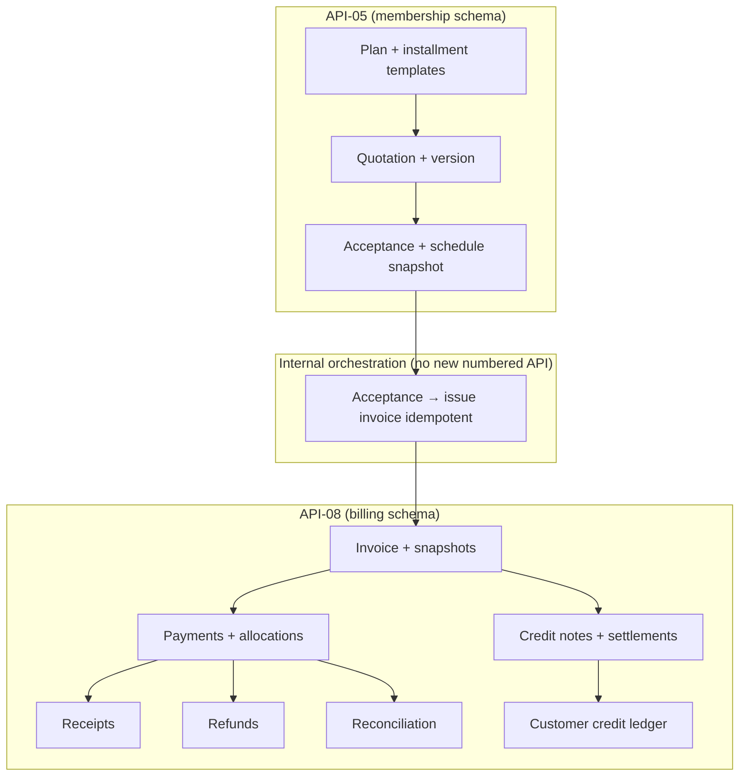
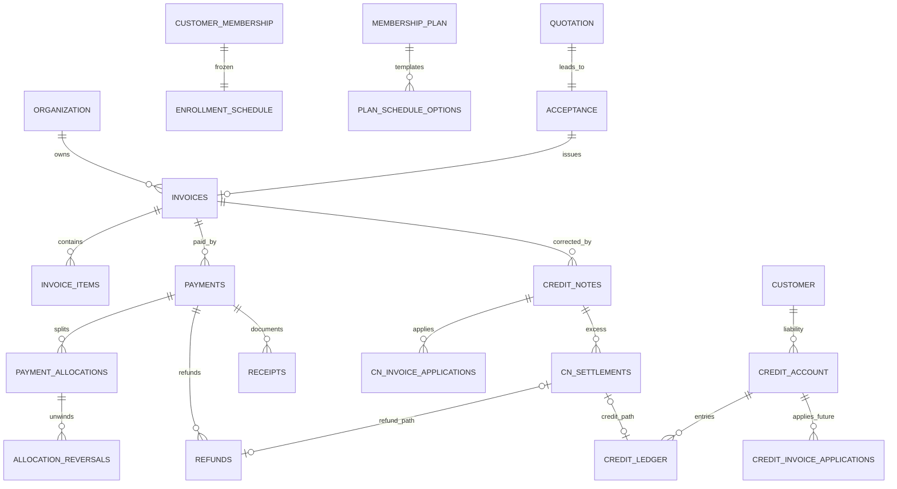

# API-08 Facility Billing — Consolidated Financial Architecture and Technical Design

**Document type:** Authoritative consolidated technical specification (implementation-ready for **approval review only**)  
**Date:** 2026-11-06 (gap closure addendum same date)  
**Status:** **DEVELOPMENT READINESS GATE — IMPLEMENTATION AUTHORIZATION STILL REQUIRED PER MIGRATION**  
**Sources consolidated:**  
- [API08_FACILITY_BILLING_TECHNICAL_DESIGN_AND_MIGRATION_AUTHORIZATION_2026-11-04.md](./API08_FACILITY_BILLING_TECHNICAL_DESIGN_AND_MIGRATION_AUTHORIZATION_2026-11-04.md)  
- [API08_U7_U9_CUSTOMER_CREDIT_AND_REFUND_ALLOCATION_TECHNICAL_DESIGN_2026-11-06.md](./API08_U7_U9_CUSTOMER_CREDIT_AND_REFUND_ALLOCATION_TECHNICAL_DESIGN_2026-11-06.md)

**Baseline verified:** Repository inspection + read-only `digitize` PostgreSQL (2026-11-06). **No tests executed. No writes.**

---

## 1. Executive summary

Digitize **API-08** today implements membership invoices, full-total offline SUCCESS payments, payment-scoped refunds, history, outstanding statements, and revenue aliasing. Physical **`billing.*`** has five tables; credit notes, allocations, receipts, customer credit, and reconciliation **do not exist** in code or database.

This document consolidates approved product rules (quotation-first enrollment, plan-controlled installments, org-wide customer credit from CN excess only, excess **cash** refunded not walleted, non-membership full-pay-only) with a **single proposed financial architecture**: immutable allocations, append-only reversals, hybrid CN + liability ledger, separate CN-application vs credit-application tables, and migration sequence **073–081**.

**T1–T6** are resolved at technical-design level (T1 product-approved). **Remaining:** INR tax rounding legality, formal API contract for payment `amount`, permission seed authorization.

**Readiness (post gap closure):** **READY WITH EXPLICITLY DEFERRED FEATURES** — core implementation may begin after **migration 073+074 authorization** and **L2/L3 contract sign-off for quotation-first path**; see §29.

---

## 2. Review scope and restrictions

| Permitted | Done |
|-----------|------|
| Read-only repo + `digitize` metadata | Yes |
| Single new report (this file) | Yes |
| Source code / migration / DB / contract / Flutter / RBAC / flags / DEV-* changes | **No** |
| DB-writing tests | **Not run** |

---

## 3. Source evidence and repository baseline

### 3.1 Alembic and PostgreSQL (verified 2026-11-06)

| Item | Value |
|------|--------|
| Alembic head | `072_platform_terms_document` |
| Physical `billing.*` | `sellers`, `invoices`, `invoice_items`, `payments`, `refunds` |
| Billing DDL migrations | `063_facility_billing_membership`, `069_billing_refunds` |

### 3.2 Key backend paths (verified)

| Area | Path |
|------|------|
| Invoice | `app/modules/billing/invoice_service.py` |
| Payment | `app/modules/billing/payment_service.py` |
| Refund | `app/modules/billing/refund_service.py` |
| Balance | `app/modules/billing/invoice_balance.py`, `repository.py` |
| Activation | `app/modules/billing/membership_invoice_validation.py` |
| Revenue | `app/modules/reportsandanalytics/queries.py` (`aggregate_customer_revenue`) |
| Refund flag | `app/modules/reportsandanalytics/rules.py` — `BILLING_REFUNDS_REPORTING_ENABLED = False` |
| Permissions (live) | `billing.invoice.generate`, `billing.payment.offline.record`, `billing.refund.process` (`063`, `069` SQL) |
| API-05 create | `app/modules/membership/instance_service.py` (no invoice) |
| Registry | `app/api/contracts/api_registry.py`, `operation_tracking.py` (8 skeleton ops) |

### 3.3 ORM without physical table (verified)

`PaymentTransaction`, `Receipt`, `BillingSetting`, `BillingStatusHistory` — models under `app/modules/billing/models/`; **no migration twin**.

### 3.4 Documentation / trackers (read-only)

Master design 2026-11-04; U7/U9 2026-11-06; `docs/architecture/API-08_FACILITY_BILLING_DECISION_REGISTER.md`; DEV-19/21/23 **not modified** (status: API-08 Phase 1 live slice; gaps remain).

---

## 4. Existing implementation assessment

| Capability | Status | Evidence |
|------------|--------|----------|
| Membership invoice ISSUED immediately | **Verified live** | `create_membership_invoice` |
| Single line, tax 0 | **Verified live** | `invoice_service.py` |
| Offline pay = full invoice total SUCCESS | **Verified live** | `payment_service.py` ~138–141 |
| Outstanding = total − pay + refund | **Verified live** | `invoice_balance.py` |
| Refund cap per payment + idempotency | **Verified live** | `refund_service.py` |
| No allocations / installments / CN / credit | **Verified gap** | No tables/code |
| No quotation/acceptance | **Verified gap** | No API-05 entities |
| Cheque → immediate SUCCESS | **Verified gap vs product** | No PENDING path |
| Receipts | **Not implemented** | ORM only |
| Revenue SUCCESS `completed_at` | **Verified live** | `queries.py` |
| PG IV billing revenue | **Exists** | `test_billing_invoices_revenue_live_digitize.py` (not run here) |

---

## 5. Approved product decisions

Sections 2.1–2.14 of the review prompt are **frozen** in this specification. Highlights integrated into design:

- **API-05 / API-08 split** + orchestration idempotent on `acceptance_id`.  
- **Installments** plan-configured; one full invoice; schedule immutable.  
- **Partial pay** only membership + accepted schedule; **non-membership always full pay** (hard backend rule).  
- **Excess cash** over outstanding → **immediate refund**, never customer credit (distinct from CN excess).  
- **T1:** Org-wide customer credit from CN; traceable source CN and facilities.  
- **Allocations immutable**; reversals append-only.  
- Invoice/receipt numbering, tax-after-discount, reconciliation permission name approved (seed not authorized).

No contradictory alternatives proposed.

---

## 6. Architecture and ownership



**Rule:** API-05 never INSERT/UPDATE/DELETE on `billing.*`.

---

## 7. Financial domain model

| Domain object | Owner | Cash? | Reduces outstanding? |
|---------------|-------|-------|----------------------|
| Quotation | API-05 | No | No |
| Invoice | API-08 | No | N/A |
| Payment SUCCESS | API-08 | Yes (collection) | Yes (via allocation) |
| Payment PENDING (cheque) | API-08 | No | No |
| Allocation | API-08 | No | Yes |
| Allocation reversal | API-08 | No | Restores outstanding |
| Refund | API-08 | Yes (outflow) | Increases outstanding |
| CN application (same invoice) | API-08 | No | Yes |
| CN excess → refund | API-08 | Yes | N/A |
| CN excess → customer credit | API-08 | No (liability) | N/A until applied |
| Customer credit application | API-08 | No | Yes (target invoice) |
| Excess payment refund | API-08 | Yes | Must not allocate excess |

**Outstanding (proposed):**

```text
outstanding = invoice_total
            − Σ(effective_allocations)
            − Σ(cn_applied_to_this_invoice)
            − Σ(customer_credit_applied_to_this_invoice)
```

Effective allocations = allocations − reversals. **Verified current** code uses payments − refunds only (subset until F4/F7).

---

## 8. Entity relationship diagram



*(API-05 entities in `membership.*`; billing in `billing.*` — proposed.)*

---

## 9. Table-by-table schema specification

**Legend:** **[E]** existing physical · **[O]** ORM only · **[P]** proposed · **[E+]** extend existing

Monetary: `NUMERIC(18,2)` currency amounts; line unit `NUMERIC(18,4)` where needed. Currency: `CHAR(3)`.

### 9.1 Billing core (existing)

| Table | Label | Notes |
|-------|-------|-------|
| `billing.sellers` | **[E]** | Extend only if seller per facility needed |
| `billing.invoices` | **[E+]** | Add `acceptance_id`, `site_id`, `issued_at`, `number_sequence`, `code_snapshot JSONB`, `PARTIALLY_PAID`; nullable for legacy |
| `billing.invoice_items` | **[E+]** | Snapshots: discount, tax, charge_source, line totals |
| `billing.payments` | **[E+]** | PENDING path; optional `excess_refund_id`; keep authoritative cash row |
| `billing.refunds` | **[E+]** | Optional `credit_note_settlement_id`, `excess_payment_refund` flag |

### 9.2 API-05 (proposed — not `billing.*`)

| Table | Label | Purpose |
|-------|-------|---------|
| `membership.plan_payment_schedule_option` | **[P]** | ≤3 installment templates per plan |
| `membership.plan_payment_schedule_line` | **[P]** | sequence, amount, due rule |
| `membership.membership_quotation` | **[P]** | Offer versions |
| `membership.membership_quotation_acceptance` | **[P]** | Evidence, schedule option id, snapshot JSON |
| `membership.enrollment_installment_schedule` | **[P]** | Frozen lines per membership |

### 9.3 Payment allocation (proposed)

| Table | Label | PK | Key constraints |
|-------|-------|-----|-----------------|
| `billing.payment_allocations` | **[P]** | `allocation_id` | FK payment, invoice; `installment_sequence`; CHECK amount>0; **immutable amount** |
| `billing.payment_allocation_reversals` | **[P]** | `reversal_id` | FK allocation; FK refund and/or cn; UNIQUE(allocation_id, refund_id) when refund |

### 9.4 Receipts

| Table | Label | Notes |
|-------|-------|-------|
| `billing.receipts` | **[P]** (ORM **[O]** exists) | FK `payment_id`, `invoice_id`, `organization_id`, `facility_id`; `receipt_number`; payload JSONB; UNIQUE(org, receipt_number) |

**Transitional design:** Receipts **may reference `billing.payments` directly** in migration **079** without requiring `payment_transactions`. F6 adds instrument detail optionally FK `transaction_id`.

### 9.5 Credit notes and customer credit (proposed)

| Table | Label | Purpose |
|-------|-------|---------|
| `billing.credit_notes` | **[P]** | Header; immutable total at issue |
| `billing.credit_note_lines` | **[P]** | Optional line detail |
| `billing.credit_note_invoice_applications` | **[P]** | **T3:** CN applied to **originating** invoice outstanding |
| `billing.credit_note_settlements` | **[P]** | Excess slice: REFUND or CUSTOMER_CREDIT; mutual exclusivity CHECK |
| `billing.customer_credit_accounts` | **[P]** | UNIQUE(organization_id, customer_id, currency) |
| `billing.customer_credit_ledger_entries` | **[P]** | Append-only CREATE/APPLY/REVERSE/REFUND_SETTLE |
| `billing.customer_credit_invoice_applications` | **[P]** | **T3:** Wallet apply to **future** invoice; FK destination facility |

### 9.6 Configuration and reconciliation

| Table | Label |
|-------|-------|
| `billing.billing_settings` | **[P]** (ORM **[O]**) — counters, tax JSON |
| `billing.payment_reconciliation_events` | **[P]** |
| `billing.payment_transactions` | **[P]** (ORM **[O]**) — cheque/gateway metadata |

### 9.7 Idempotency pattern (all mutators)

`UNIQUE (organization_id, idempotency_key)` on financial documents (matches **verified** invoices/payments/refunds).

---

## 10. State machines and lifecycle

### 10.1 Invoice

| State | Allowed next |
|-------|----------------|
| DRAFT | ISSUED, CANCELLED |
| ISSUED | PARTIALLY_PAID, PAID, CANCELLED (guarded), unchanged snapshots |
| PARTIALLY_PAID | PAID |
| PAID | terminal (corrections via CN only) |
| CANCELLED | terminal |

**Prohibited:** UPDATE of financial columns when status ≥ ISSUED.

### 10.2 Payment / cheque

| Status | Outstanding impact |
|--------|-------------------|
| PENDING | None |
| SUCCESS | Allocation allowed |
| FAILED | None |
| REFUNDED (payment-level optional) | Legacy; prefer refund rows |

Cheque: PENDING → SUCCESS (clear) | FAILED (bounce + audit).

### 10.3 Credit note

DRAFT → ISSUED → (applications + settlements) → CLOSED; **T5:** corrective CN ISSUED referencing original (no mutate).

### 10.4 Customer credit ledger

Entries append-only; account status derived.

### 10.5 Reconciliation

OPEN → outcome enum; no invoice balance auto-change.

*(Full transition tables in implementation guide derived from above.)*

### 10.6 Financial invariants (enforcement)

| # | Invariant | DB | Service |
|---|-----------|-----|---------|
| 1 | No allocation > outstanding | CHECK partial | Txn + lock invoice |
| 2 | No non-membership partial pay | — | **Mandatory** validate invoice type |
| 3 | No membership partial without schedule | — | **Mandatory** |
| 4 | Pay ≤ outstanding (normal) | — | Txn |
| 5 | Excess cash → refund not credit | — | Split payment attempt |
| 6 | Σ CN apply ≤ CN total | CHECK | Txn |
| 7 | CN excess refund XOR credit | CHECK one FK | Txn |
| 8 | Credit org-scoped | FK | validate org |
| 9 | Credit apply ≤ available | — | Lock account |
| 10 | Available ≥ 0 | — | Ledger sum |
| 11 | Refund ≤ payment refundable | — | **Verified** pattern |
| 12 | Allocations immutable | no UPDATE | service |
| 13 | No destructive edit issued docs | — | policy |
| 14 | Corrections compensating | — | CN/reversal rows |
| 15 | Idempotent + concurrent safe | UNIQUE keys | FOR UPDATE |

---

## 11. T1–T6 technical decisions and rationale

### T1 — Cross-facility customer credit (**product approved**)

| Element | Design |
|---------|--------|
| Account | `customer_credit_accounts(organization_id, customer_id, currency)` UNIQUE |
| Lineage | Each CREATE ledger entry FK `credit_note_id`, `originating_facility_id` |
| Apply | `customer_credit_invoice_applications` records `destination_invoice_id`, `destination_facility_id` |
| Balance | Σ CREATE − APPLY − REFUND_SETTLE (+ REVERSE) per account |
| Concurrency | `SELECT … FOR UPDATE` on account row |
| Excluded | **Excess payment refunds** do not CREATE ledger (rule 2.6) |

### T2 — Refund across multiple payments (CN excess cash settlement)

**Evidence:** `RefundService` is **payment-scoped** (`payment_id` required); refundable = `payment.amount − Σ refunds` (**verified** `refund_service.py`).

**Recommendation:** **Waterfall on payments by descending `completed_at`** (most recent cash first) until CN excess refund total satisfied:

1. Load SUCCESS payments for invoice ordered by `completed_at DESC`.  
2. For each payment, refund `min(remaining_excess, payment_refundable)`.  
3. Each slice = separate `billing.refunds` row + idempotency key **`{cn_settlement_id}:{payment_id}`**.  
4. Partial failure: settlement row `SETTLEMENT_PARTIAL`; completed refunds retained; retry idempotent.  
5. **Rationale:** Aligns with existing API-08-013 contract (per-payment refund); avoids new multi-payment refund endpoint; deterministic and auditable.

**Alternative rejected:** Single proportional refund without payment linkage — breaks revenue/refund traceability.

### T3 — Application table separation

| Table | Event |
|-------|-------|
| `credit_note_invoice_applications` | CN reduces **same** invoice outstanding |
| `customer_credit_invoice_applications` | Liability reduces **another** invoice outstanding |

Separate FKs, reporting, and reversal rows. **No generic “application” table.**

### T4 — Invoice cancellation after credit applied

| Condition | Rule |
|-----------|------|
| ISSUED + CN apply or credit apply | **Block cancel** (same as SUCCESS payment today) |
| DRAFT | Cancel allowed (no CN required) |
| Reversal path | If product later allows: issue **corrective CN** + reverse credit apply via ledger REVERSE — **not** delete invoice |
| Audit | `FACILITY_INVOICE_CANCEL_BLOCKED` with reason |

Aligns with **verified** `cancel_invoice` rejecting paid invoices.

### T5 — Partial credit-note reversal

- Original CN **immutable**.  
- New **`credit_note_reversal`** or corrective CN type `CORRECTIVE` FK `original_credit_note_id`.  
- Reversal rows negate applications via compensating `credit_note_invoice_applications` (negative amount prohibited — use reversal table with positive amount and type REVERSE).  
- Ledger REVERSE entries for credit portion; refund reversals via new refund records (not DELETE).  
- Non-atomic downstream: settlement `FAILED` + reconciliation queue (**F8**).

### T6 — Permission codes (proposed, **not seeded**)

Convention: `billing.<area>.<verb>` (`063`, `069` pattern).

| Permission | Action | SoD |
|------------|--------|-----|
| `billing.invoice.generate` | **[existing]** issue/cancel draft path | — |
| `billing.payment.offline.record` | **[existing]** collect | — |
| `billing.refund.process` | **[existing]** cash refund | separate from CN approve |
| `billing.credit_note.issue` | Create/submit CN draft | ≠ approve |
| `billing.credit_note.approve` | Approve/issue CN | ≠ applier |
| `billing.customer_credit.apply` | Apply liability to invoice | ≠ CN approve optional |
| `billing.customer_credit.reverse` | Reverse application | elevated |
| `billing.reconciliation.manage` | **[approved name]** manual recon | — |

**Discount (future F3):** `billing.discount.apply`, `billing.discount.approve` — applier ≠ approver.

No new roles; Org Admin assigns via existing RBAC.

---

## 12. Customer credit wallet design

Org-scoped **liability ledger** (not stored-value wallet):

- **Create** only from CN settlement (never from overpayment).  
- **Apply** to eligible ISSUED invoice at any facility in org (T1).  
- **Display** available = ledger derivation; optional read model cache **not** source of truth.  
- **Traceability:** UI may show wallet-like balance; backend enforces ledger + applications.

---

## 13. Refund and allocation-reversal design

1. **Refund (cash):** extend `RefundService` — after refund insert, insert `payment_allocation_reversals` LIFO within payment’s allocations.  
2. **CN apply:** insert `credit_note_invoice_applications` only.  
3. **CN excess refund:** T2 waterfall refunds.  
4. **CN excess credit:** ledger CREATE + settlement row.  
5. **Excess payment:** record payment for allocatable portion only; **separate immediate excess refund** row(s); state `EXCESS_REFUND_PENDING` if offline refund fails.

Installment effective paid = Σ allocations − reversals per `installment_sequence`.

---

## 14. Transaction, idempotency and concurrency strategy

| Operation | Lock | Idempotency | Txn |
|-----------|------|-------------|-----|
| Acceptance → invoice | invoice issue key = `acceptance_id` | UNIQUE(org, key) | Single |
| Pay + allocate + receipt | invoice FOR UPDATE | payment org key | Single |
| CN issue + apply + settle | invoice FOR UPDATE | cn org key | Single |
| Credit apply | credit account FOR UPDATE | apply org key | Single |
| Refund + reversal | payment FOR UPDATE | refund org key | Single |
| Excess refund fail | payment + recon event | settlement key | Single + recon |

**Async SQLAlchemy:** same patterns as **verified** `get_payment_for_update`, `get_invoice_for_update`.

**Recovery:** OUTBOX optional for notifications only; financial state in PG with explicit status columns.

---

## 15. Database constraints and integrity

- FK ON DELETE RESTRICT for financial parents; SET NULL only where **verified** on invoice delete paths.  
- Partial unique indexes for open membership invoice (extend for PARTIALLY_PAID).  
- CHECK: settlement XOR refund/credit FK.  
- Index: `(organization_id, customer_id, currency)` on credit account.  
- Index: `(invoice_id)` on allocations, cn applications.

---

## 16. Permission and security matrix

| Action | Platform Admin | Org Admin | Billing staff (granted) | Other staff | Customer |
|--------|----------------|-----------|-------------------------|-------------|----------|
| Governance | Yes (no tenant money) | Org config | — | — | — |
| Quotation accept | No | Yes | If granted API-05 | — | If customer-recorded flow approved |
| Issue invoice | No | Yes | `billing.invoice.generate` | Denied | Denied |
| Collect pay | No | Yes | offline.record | Denied | Denied |
| Refund | No | Assign | `billing.refund.process` | Denied | Denied |
| CN approve | No | Assign | `billing.credit_note.approve` | Denied | Denied |
| Credit apply | No | Assign | `billing.customer_credit.apply` | Denied | Denied |
| Reconcile | No | Assign | `billing.reconciliation.manage` | Denied | Denied |

Backend enforcement on every route; UI visibility secondary.

---

## 17. API contract impact

| Capability | Collection | Contract |
|------------|------------|----------|
| Quotation/acceptance | API-05 | **New/changed** — separate approval |
| Issue invoice from acceptance | API-08-001 | **Breaking** gate on acceptance |
| Offline pay + amount | API-08-010 | **Additive field** — formal approval |
| Allocations | Internal | No new numbered op required |
| CN / credit apply | Skeleton 005/007 + new | **Approval** |
| Receipts | API-08-012 skeleton | **Approval** |
| Reconciliation | API-08-014 skeleton | **Approval** |
| Orchestration | Internal service | Document only |

**Do not** modify `api_registry.py` in this phase.

---

## 18. Flutter integration design

| Journey | Extend | New |
|---------|--------|-----|
| Plan installment admin | membership plan UI | schedule editor (≤3) |
| Screen B quotation | — | offer UI (not invoice layout) |
| Acceptance | customer membership section | staff/customer accept |
| Outstanding + custom amount | `facility_outstanding_statements_panel.dart` | installment breakdown |
| Receipts | history panel | receipt view/PDF trigger |
| CN workflow | — | approve/issue screens |
| Credit wallet | — | balance + apply at other facility |
| Reconciliation | — | staff recon UI |
| Reports | `company_reports_page.dart` | gross/net/installment/discount |

Repositories: extend `remote_facility_*`, `remote_customer_membership_repository.dart`; new CN/credit clients **proposed**.

---

## 19. Reporting and reconciliation design

| Metric | Source |
|--------|--------|
| Gross / discount / tax / net | Invoice line snapshots at issue |
| Collections | SUCCESS payments `completed_at` (**unchanged**) |
| Refunds | SUCCESS refunds when flag enabled |
| CN reduction | `credit_note_invoice_applications` |
| Credit issued | ledger CREATE |
| Credit applied | `customer_credit_invoice_applications` |
| Available credit | ledger derivation |
| Installment obligation | enrollment schedule |
| Installment collected | allocations by sequence |
| Outstanding | formula §7 |

**Never** count credit issuance or scheduled installments as cash.

**Reconciliation:** manual events; link payment/bank ref; no auto balance change.

---

## 20. Migration sequencing and compatibility

### 20.1 Revised order (assessment vs master doc)

| Rev | ID | Purpose | Depends |
|-----|-----|---------|---------|
| **073** | M0 | Quotation, acceptance, plan schedules, enrollment snapshot | membership base |
| **074** | M1 | `billing_settings`, numbering, PARTIALLY_PAID | 073 nullable FK |
| **075** | M2 | Facility service catalogue | M1 |
| **076** | M3 | Line snapshots, discount/tax | M1 |
| **077** | M4 | **Allocations** + partial pay rules + excess refund | M3, M0 schedule |
| **078** | M5 | **Payment transactions** + PENDING cheque | M4 (same release recommended) |
| **079** | M6 | **Receipts** (FK `payment_id`; optional FK transaction) | M4 SUCCESS payments |
| **080** | M7 | CN, settlements, customer credit, reversals | M4 |
| **081** | M8 | Reconciliation + permission seeds | M4 |

**Change from master:** **M5 (transactions) before M6 (receipts)** so cheque PENDING/SUCCESS instrument exists before receipt PDF needs instrument metadata; receipts still valid referencing **`payments` only** if M6 ships alone after M4.

**081 scope:** Reconciliation + `billing.reconciliation.manage` seed only (matches master F8).

### 20.2 Backfill

- Legacy invoices: null acceptance; `MFI-*` numbers preserved.  
- SUCCESS payments → one allocation row each (M4).  
- Missing invoice lines → reconstruct (M3).

### 20.3 Rollback

Forward-only numbering; downgrade blocked if receipts/CN issued.

### 20.4 Feature flags

**Proposed** `FACILITY_BILLING_QUOTATION_FIRST` (design only — **do not change existing flags**).

---

## 21. Test and verification matrix

| Area | Existing tests | Missing | PG? |
|------|----------------|---------|-----|
| Invoice | `test_facility_membership_billing.py` | acceptance gate | optional |
| Pay lock | `test_offline_payment_invoice_lock.py` | partial, excess refund | yes |
| Refund | `test_refund_service.py`, concurrency PG | reversal rows | yes |
| Balance | `test_invoice_balance.py` | CN/credit terms | no |
| Revenue IV | `test_billing_invoices_revenue_live_digitize.py` | CN/credit non-impact | yes |
| History/outstanding | `test_billing_history.py`, `test_outstanding_statements.py` | installments | no |
| CN/credit | — | all scenarios A–F U7 doc | yes |
| Auth | sparse | permission matrix | no |
| Flutter | controller tests | quotation, wallet | no |

**Verification status:** Existing tests **not run** in this review; presence **verified** by file inspection.

---

## 22. Open decisions and unresolved legal/accounting assumptions

| ID | Topic | Status |
|----|-------|--------|
| L1 | INR rounding / legal tax | **Unresolved** — per-line 2dp recommended |
| L2 | Formal OpenAPI for payment `amount` | **Requires contract approval** |
| L3 | Exact API-05 endpoint shapes for quotation | **Requires contract approval** |
| L4 | Customer-recorded acceptance channel security | **Proposed** — separate approval |
| L5 | Permission seed migration authorization | **NOT AUTHORIZED** |
| L6 | Enable `BILLING_REFUNDS_REPORTING_ENABLED` | **NOT AUTHORIZED** |

---

## 23. Implementation authorization checklist

| Migration | Schema | API | Flutter | Seed | Status |
|-----------|--------|-----|---------|------|--------|
| 073 | M0 | API-05/08 | Screen B | — | **NOT AUTHORIZED** |
| 074–081 | M1–M8 | per §17 | per §18 | M8 only | **NOT AUTHORIZED** |

Product rules in §5 **approved**; implementation **not authorized**.

---

## 24. Final readiness recommendation

| Criterion | Met? |
|-----------|------|
| All approved rules represented without contradiction | **Yes** (including excess→refund not credit; T1 org credit) |
| T1–T6 resolved technically | **Yes** |
| Schema + migration path coherent | **Yes** |
| Compatible with verified codebase | **Yes** |
| Ready for **single final approval review** | **Yes** |
| Ready to implement | **No** — awaits explicit authorization per migration |

**Gate (§24 superseded by §29):** See **Development readiness decision**.

---

## 25. T2 validation — credit-note excess refund waterfall

**Verdict:** **Compatible** with existing `RefundService` **provided** CN settlement is implemented as an **internal orchestrator** (not a single HTTP refund call) that invokes `RefundService.record` once per payment slice inside **one database transaction**, with **derived org-scoped idempotency keys** and a parent **`credit_note_settlements`** row linking all child `refund_id`s.

### 25.1 Checklist vs current code (`refund_service.py`, `repository.py`)

| # | Requirement | Current | Gap / action |
|---|-------------|---------|--------------|
| 1 | Only SUCCESS payments eligible | **Yes** — `payment.status != SUCCESS` rejected (L124–125) | None |
| 2 | Refundable capacity net of prior refunds | **Yes** — `remaining = payment.amount − sum(SUCCESS refunds)` (L126–135); **reversals not implemented** | M7: reversals affect **installment** totals, not payment.amount; refund cap unchanged |
| 3 | Total refunds ≤ CN excess | Not implemented | Orchestrator tracks `remaining_excess` across slices |
| 4 | No payment over-refunded | **Yes** — `refund_amount > remaining` rejected (L147–155) | None per slice |
| 5 | Multiple refunds → one CN settlement | Not implemented | Add `credit_note_settlement_id` FK on `billing.refunds` (**proposed**); settlement header |
| 6 | Idempotency per slice | **Yes** pattern — `uq_refunds_org_idempotency` | Use keys `{settlement_id}:payment:{payment_id}` (unique per org) |
| 7 | Partial failure without duplicate SUCCESS | **Partial** — only SUCCESS written today | Use settlement status `PARTIAL`; completed slices replay via idempotency; **extend** to INITIATED/FAILED for offline excess (smallest correction in M7/M4 orchestrator, not changing API-08-013 contract) |
| 8 | Pending/failed recoverable | **Schema yes** (`INITIATED`/`FAILED` in 069); **service always SUCCESS** | Excess-refund path should use INITIATED until staff confirms; recon (M8) |
| 9 | Concurrent safety | **Yes** — `get_payment_for_update` (L88); PG tests exist | Lock settlement row; process payments sequentially in txn |
| 10 | Tie-break on `completed_at` | N/A today | Order `completed_at DESC, payment_id DESC` (deterministic) |

### 25.2 Descending `completed_at` vs RefundService assumptions

- **Revenue:** Refunds deduct by refund `completed_at` when flag enabled — order of slice creation does **not** break aggregation.  
- **Outstanding:** Invoice outstanding uses Σ refunds on invoice (`repository.py` join) — order irrelevant.  
- **Financial semantics:** Waterfall refunds **most recently collected cash first** — compatible with payment-scoped refunds; no change to `RefundService` signature required.

### 25.3 Smallest safe correction (not a redesign)

1. **`CreditNoteSettlementService`** (internal): loop eligible payments; call existing `RefundService.record` with per-slice idempotency key.  
2. **Optional column** `billing.refunds.credit_note_settlement_id` (M7).  
3. **Allocation reversals** for CN-excess **cash** refunds: add in same transaction as refund when M7 ships (LIFO reversals on that payment’s allocations).  
4. **Do not** merge excess **overpayment** into this path — overpayment uses separate immediate excess refund (rule 2.6), never CN settlement.

**Excess payment rule:** Unchanged — immediate refund, never customer credit.

---

## 26. Migration dependency validation (073–081) — final

### 26.1 Can 077 use `billing.payments` before 078?

**Yes.** Verified:

- Allocations FK → `billing.payments.payment_id` (**physical**, 063).  
- `PaymentTransaction` ORM has **no table** — not required for allocations.  
- M4 (077) operates on SUCCESS payments; PENDING cheques (M5/078) **do not allocate** until SUCCESS.

**077 does not depend on 078.**

### 26.2 Receipts (079) — reference model

| Reference | Required? | Notes |
|-----------|-----------|--------|
| `billing.payments.payment_id` | **Yes (primary)** | Matches existing `Receipt` ORM; one receipt per SUCCESS payment |
| `billing.payment_transactions.transaction_id` | **Optional nullable** | Populate when M5 present (cheque instrument detail); PDF may use payment alone in Phase 1 |

**Single source of cash truth:** `billing.payments` — transactions are **instrument metadata**, not duplicate amounts.

### 26.3 Final recommended sequence (validated)

| Rev | Scope | Depends |
|-----|--------|---------|
| **073** | API-05 quotation, acceptance, plan schedules, enrollment snapshot | membership |
| **074** | `billing_settings`, numbering, `PARTIALLY_PAID`, invoice extensions | 073 (nullable acceptance FK) |
| **075** | Facility service catalogue | 074 |
| **076** | Line financial snapshots, discount/tax columns | 074 |
| **077** | `payment_allocations`, partial pay, excess **overpayment** refund, installment waterfall | 076, 073 schedule |
| **078** | `payment_transactions`, PENDING cheque on `payments` | 077 (same deploy train recommended) |
| **079** | `billing.receipts` — **FK `payment_id` NOT NULL**; optional FK `transaction_id` | 077 SUCCESS path; 078 optional |
| **080** | CN, settlements, customer credit, allocation reversals, T2 orchestrator | 077 |
| **081** | Reconciliation events + permission seed (`billing.reconciliation.manage`) | 077 |

**No reorder required** beyond keeping **078 before or with 079** if receipts display cheque instrument from transactions.

**Backfill (077):** For each historical SUCCESS payment on an invoice, insert one allocation row equal to `payment.amount` (idempotent script).

**Split option:** Combine 077+078 into one migration if deploy atomicity for cheque+allocate is required — optional, not mandatory.

---

## 27. L1–L6 implementation gates

| ID | Class | Affected | Can proceed without? | Must stay disabled | Approval | Next action |
|----|-------|----------|----------------------|--------------------|-----------|-------------|
| **L1** INR/legal tax rounding | **B** | M3 tax lines, API-08-004 | **Yes** for phases 0–2 (tax=0 snapshot) | Statutory tax rates; inclusive/exclusive calc | Product/finance | Implement M3 with `tax_amount=0` + snapshot columns; gate full tax engine on L1 sign-off |
| **L2** Payment `amount` API | **B** | Partial membership pay, excess split | **Yes** for full-pay legacy path behind flag | Custom amount on wire until OpenAPI approved | API contract board | Add optional field in approved contract; backend can implement behind feature flag |
| **L3** API-05 quotation endpoints | **A** for quotation-first enrollment | M0, orchestration, Screen B | **Yes** for **Slice 1** (074 numbering only) if legacy invoice path temporarily kept | Quotation-first as default until approved | API + product | Approve API-05 surface + acceptance payloads |
| **L4** Customer acceptance channel security | **B** | Customer-recorded acceptance | **Yes** for staff-recorded acceptance only in Phase 0 | Customer self-accept until threat model | Security/product | Document auth for customer channel; defer customer UI |
| **L5** Permission seed | **B** per migration | M7 CN, M8 recon, discount | **Yes** for dev using PLATFORM_ADMIN / ORG_ADMIN existing perms in tests | Production CN approve / recon without seed | PO + migration auth | Authorize seed in **080/081** only |
| **L6** Refund reporting flag | **C** | Net revenue report | **Yes** for all implementation | REV-2a net revenue in reports | PO | Enable flag in separate authorized change; no blocker to billing core |

**Not a whole-subsystem blocker:** L3 blocks **default** enrollment redesign only; L1/L2/L5/L6 are slice-specific.

---

## 28. Implementation execution plan (phases)

**Authorization:** Each phase requires explicit **migration + deploy** approval. Product rules already approved.

### Phase 0 — Foundation numbering and settings (M1 / 074)

| Item | Detail |
|------|--------|
| Objective | Org invoice/receipt counters, `PARTIALLY_PAID`, code snapshot |
| Backend | `billing_settings` model, `FacilityInvoiceService` numbering lock |
| Migration | **074** |
| API | Minor response fields; issue path still legacy OK |
| Flutter | None required |
| Permissions | Existing `billing.invoice.generate` |
| Tests | PG concurrent numbering; unit invoice status |
| Acceptance | New invoices get `INV-*` format; legacy unchanged |
| Deferred | Quotation gate (Phase 1) |

### Phase 1 — Quotation, acceptance, schedules (M0 / 073)

| Item | Detail |
|------|--------|
| Objective | Plan installment templates; quotation; acceptance; orchestrated issue |
| Backend | API-05 modules + internal `MembershipBillingOrchestration` |
| Migration | **073** |
| API | **L3 approval required** for new API-05 operations |
| Flutter | Screen B + plan admin |
| Tests | Replace `digitize_pg_workflows` acceptance path |
| Acceptance | No invoice without acceptance; idempotent on `acceptance_id` |
| Blocker | **L3** for production cutover |

### Phase 2 — Allocations and collection (M4 / 077 + optional 078)

| Item | Detail |
|------|--------|
| Objective | Installment waterfall; partial membership pay; full-pay non-membership; excess overpayment refund |
| Backend | `payment_service`, new `AllocationService`, `invoice_balance` extended |
| Migration | **077**, **078** (cheque PENDING) |
| API | **L2** for optional `amount` on wire |
| Flutter | Custom amount + installment display |
| Tests | Extend `test_offline_payment_invoice_lock.py`; PG partial pay |
| Acceptance | Rules 2.4–2.6 enforced server-side |
| Deferred | Receipts until Phase 3 |

### Phase 3 — Receipts (M6 / 079)

| Item | Detail |
|------|--------|
| Objective | One receipt per SUCCESS payment; org numbering |
| Backend | Receipt service; API-08-012 implementation |
| Migration | **079** — FK **`payment_id`** required |
| Flutter | Receipt view/download trigger |
| Acceptance | Partial receipt fields per product |

### Phase 4 — Snapshots, catalogue, discounts (M2/M3 / 075–076)

| Item | Detail |
|------|--------|
| Objective | Service charges; line snapshots; discount apply/approve |
| Migration | **075**, **076** |
| API | Skeleton 002–003 |
| Deferred | Full tax engine until **L1** |

### Phase 5 — Credit notes and customer credit (M7 / 080)

| Item | Detail |
|------|--------|
| Objective | CN, T2 waterfall, ledger, reversals |
| Backend | `CreditNoteSettlementService`, extend `RefundService` linkage |
| Migration | **080** + **L5** seed for CN permissions |
| API | Skeleton 005, 007 |
| Tests | U7 scenarios A–F |

### Phase 6 — Reconciliation and reporting polish (M8 / 081, L6)

| Item | Detail |
|------|--------|
| Objective | Manual recon; enable refund reporting when authorized |
| Migration | **081**; L6 code change separate |
| Deferred | Bank import, advanced discount reports |

### Smallest slice after authorization

**Phase 0 (074 only)** — numbering + settings + `PARTIALLY_PAID` CHECK **without** forcing quotation-first — delivers concurrency-safe invoice numbers and unblocks later migrations with **no L3 dependency**.

If quotation-first is mandatory day one, **Phase 1 (073)** is the first slice (**requires L3**).

---

## 29. Development readiness decision

**Decision: READY WITH EXPLICITLY DEFERRED FEATURES**

| Stream | Status |
|--------|--------|
| Core billing evolution | May begin after **explicit authorization of migration 074** (or 073 if quotation-first is day-one) |
| Deferred without blocking core | L6 reporting flag; L1 full tax; L4 customer channel; M8 reconciliation; advanced reports |
| Blockers for specific features | **L3** → quotation-first; **L2** → optional payment amount on contract; **L5** → CN/recon in prod |

**Not blocked:** Allocation design, refund waterfall (T2 validated), migration order 073–081, excess overpayment refund rule.

**Implementation authorization:** Still required **per migration** — this gate is **technical readiness**, not blanket approval to deploy.

---

## Appendix — Major operation transaction sheets (summary)

### Payment with possible excess

1. Authorize `billing.payment.offline.record`.  
2. Lock invoice; validate membership schedule vs full-pay rules.  
3. If amount > outstanding → reject; if amount > allocatable portion → allocate min, create excess refund obligation.  
4. Insert payment SUCCESS (or PENDING cheque).  
5. Insert allocation(s) installment waterfall.  
6. Insert receipt (M6).  
7. Audit; commit.

### CN ₹4k on ₹3k outstanding

1. Approve CN; apply ₹3k `credit_note_invoice_applications`.  
2. Settle ₹1k via T2 refunds **or** ledger CREATE — settlement CHECK XOR.  
3. Commit.

---

## Appendix — Files inspected (representative)

- `app/modules/billing/*` (services, models, repository, constants)  
- `app/modules/membership/instance_service.py`, `lifecycle_service.py`, `membership_invoice_validation.py`  
- `app/modules/reportsandanalytics/queries.py`, `rules.py`  
- `migrations/sql/063_facility_billing_membership.sql`, `069_billing_refunds.sql`  
- `migrations/versions/072_platform_terms_document.py`  
- Prior evidence docs (2026-11-04, 2026-11-06 U7/U9)  
- `tests/billing/*.py` (inventory only)  
- `digitize-ui/.../facility_outstanding_statements_panel.dart`, `customer_membership_section.dart`  
- DEV-19/21/23 (read-only)
