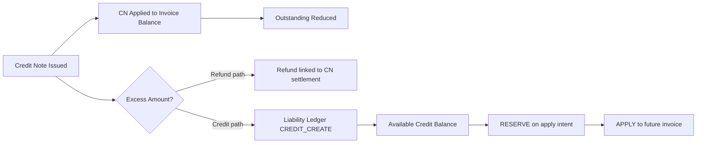
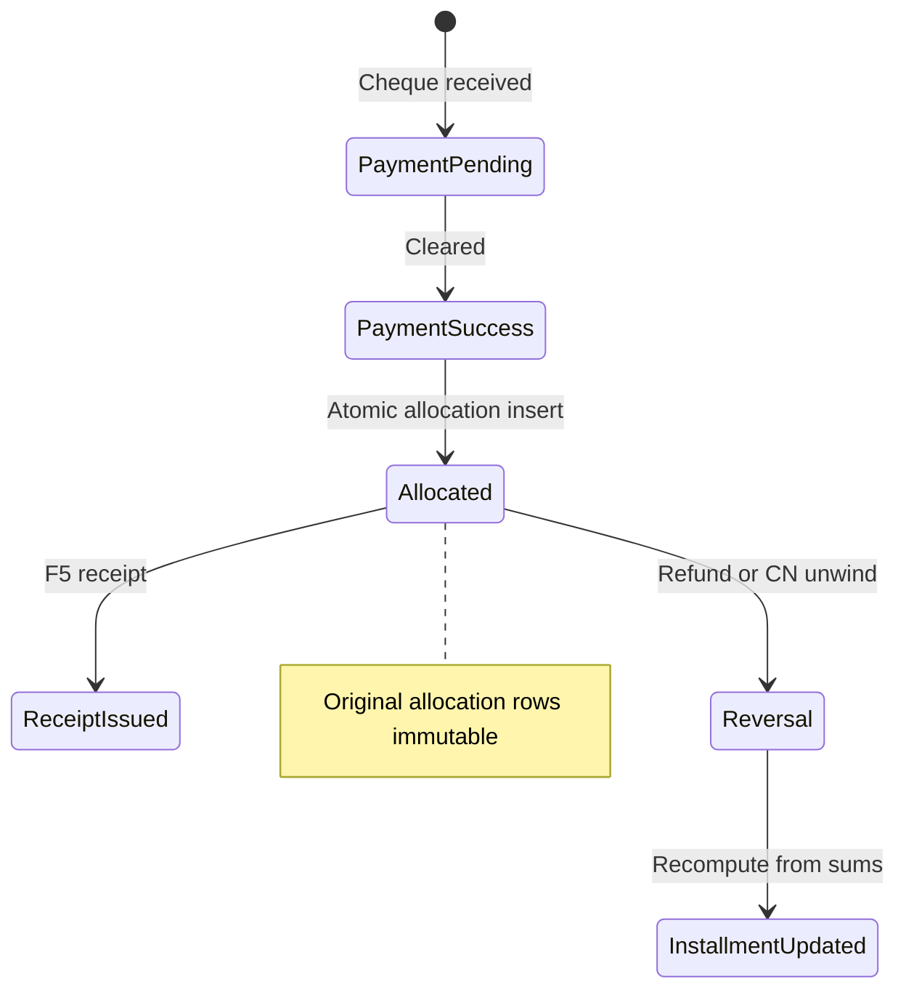
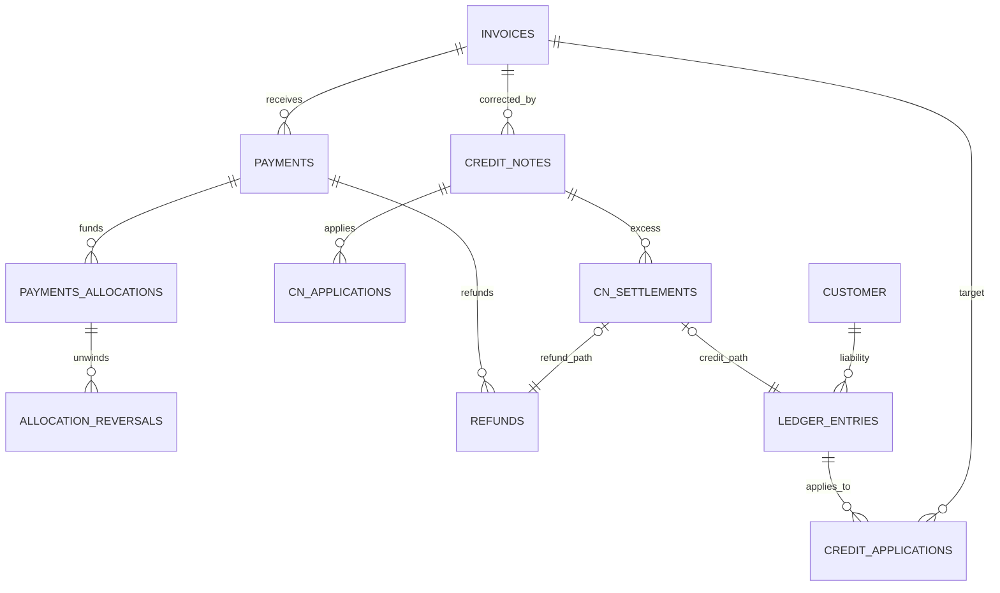

# API-08 — U7/U9 Customer Credit Accounting and Refund/Allocation Reversal Technical Design

**Document type:** Read-only technical investigation and design recommendation  
**Date:** 2026-11-06  
**Scope:** U7 (customer-credit liability) and U9 (refund / credit-note / allocation reversal)  
**Status:** **TECHNICAL DESIGN ONLY — NOT AUTHORIZED FOR IMPLEMENTATION**  
**Related:** [API08_FACILITY_BILLING_TECHNICAL_DESIGN_AND_MIGRATION_AUTHORIZATION_2026-11-04.md](./API08_FACILITY_BILLING_TECHNICAL_DESIGN_AND_MIGRATION_AUTHORIZATION_2026-11-04.md)

**Evidence basis:** Repository inspection (`digitize-services/app/modules/billing/*`, migrations 063/069, reporting rules); **no tests executed**; **no DDL/DML** on `digitize`.

---

## 1. Executive summary

Digitize facility billing **today** has **no** credit notes, **no** payment allocations, **no** customer-credit liability, and **no** allocation reversals. Outstanding balance is derived from **invoice total − SUCCESS payments + SUCCESS refunds** (`invoice_balance.py`, `BillingRepository` subqueries). Refunds are **payment-scoped**, idempotent, and capped per payment (`RefundService.record`).

**U7 recommendation:** Use **credit notes as the authoritative correction document** (Option B) plus an **append-only customer-credit liability ledger** (Option A subledger) for excess CN amounts not refunded in cash. Each excess rupee is settled **exactly once** via either `billing.refunds` (linked to CN settlement) or a **liability ledger CREDIT_CREATE** entry—not both.

**U9 recommendation:** Treat **payment allocations as immutable** facts; represent refunds and CN-driven unwinds as **explicit allocation reversal rows** referencing original `allocation_id`, coupled to **refund rows** or **CN application rows**. Installment `allocated_amount` on the accepted schedule snapshot is **recomputed from allocations minus reversals**, never by editing historical allocation rows.

This design preserves approved business rules, fits API-08 ownership, does **not** reuse SaaS `commercial.*` tables, and does **not** change existing revenue aggregation (`SUCCESS` payments / `completed_at`) or `BILLING_REFUNDS_REPORTING_ENABLED` behavior unless separately authorized.

---

## 2. Existing implementation findings

### 2.1 Physical schema (authoritative on `digitize`)

| Object | Role | Migration |
|--------|------|-----------|
| `billing.invoices` | Header; status CHECK without `PARTIALLY_PAID` | 063 |
| `billing.invoice_items` | Lines; no charge-source / snapshot columns | 063 |
| `billing.payments` | Attempt + SUCCESS combined; FK `invoice_id` | 063 |
| `billing.refunds` | SUCCESS refunds; FK `payment_id`; org idempotency | 069 |

**Not physical:** `PaymentTransaction`, `Receipt`, `BillingSetting`, `BillingStatusHistory` (ORM only).

**Not facility billing:** `commercial.billing_adjustment` → FK `commercial.invoice` (API-09 SaaS).

### 2.2 Services and behavior (implemented)

| Component | Behavior | Reference |
|-----------|----------|-----------|
| Outstanding | `total − Σ payments + Σ refunds` (SUCCESS only) | `invoice_balance.py`, `repository.py` `_outstanding_amount_expr` |
| Offline pay | Full `invoice.total_amount` as SUCCESS; row lock on invoice | `payment_service.py` |
| Refund | Lock payment; `remaining = payment.amount − Σ refunds`; idempotency org key | `refund_service.py` |
| Activation | Requires PAID invoice + SUCCESS payment; amount vs plan snapshot | `membership_invoice_validation.py` |
| Revenue | Σ SUCCESS payments by `completed_at`; refunds if flag enabled | `queries.py`, `rules.py` `BILLING_REFUNDS_REPORTING_ENABLED = False` |
| Audit | `record_audit_event` on refund | `AUDIT_REFUND_RECORDED` |

### 2.3 Missing for U7/U9 (approved future state)

- Credit notes, CN lines, CN application to invoice balance  
- Payment allocations and installment allocation  
- Allocation reversals  
- Customer-credit liability and application to future invoices  
- Permissions beyond `billing.refund.process` for CN authorize / credit apply (design-only names in master doc)

### 2.4 Tests constraining current behavior (not executed)

- `tests/billing/test_refund_service.py` — cap, partial refund, idempotency  
- `tests/billing/test_refund_concurrency_postgres.py` — concurrent refunds  
- `tests/billing/test_invoice_balance.py` — refund restores receivable  
- `tests/billing/test_offline_payment_invoice_lock.py` — concurrency, full pay semantics  

---

## 3. U7 approved business-rule summary

1. CN applies to **outstanding invoice balance** first.  
2. CN excess → **authorized refund** OR **customer-credit liability** (mutually exclusive per amount).  
3. Both settlement paths supported; credit applicable to **future eligible invoices** via authorized process.  
4. Traceable liability; **no wallet**; **no double settlement**; **immutable history**.

*(Frozen product decisions — not reopened in this document.)*

---

## 4. U7 design alternatives and recommendation

### 4.1 Option A — Dedicated immutable liability ledger

| Aspect | Assessment |
|--------|------------|
| Source of truth | Sum of ledger entries by customer/org/currency |
| Persistence | `customer_credit_ledger_entry` (append-only): CREATE, RESERVE, APPLY, RELEASE, REFUND_SETTLE, REVERSE |
| Pros | Strong audit; natural double-entry style; easy “available balance” query |
| Cons | Requires careful reservation concurrency; CN document still needed for invoice correction |

### 4.2 Option B — Credit note + settlement records only

| Aspect | Assessment |
|--------|------------|
| Source of truth | CN header/lines + `credit_note_settlement` rows |
| Pros | Aligns with “correction document” language |
| Cons | Available credit balance scattered; harder to prevent double spend without ledger |

### 4.3 Option C — Hybrid (recommended)

**Credit note** = authoritative **invoice correction** and **excess origin**.  
**Customer-credit liability account** + **immutable ledger** = authoritative **spendable liability** and concurrency control.



**Why preferable for Digitize:** Matches existing pattern (document + child rows like `invoices`/`payments`/`refunds`), reuses `RefundService` for cash outflow, adds minimal new concepts for reporting, and satisfies “no wallet” (ledger entries only move between OPEN/APPLIED/REFUNDED states on explicit authorization).

---

## 5. Customer-credit lifecycle (proposed)

| Phase | Event | Persistence (proposed) | Authorization |
|-------|--------|------------------------|---------------|
| 1 | CN issued (partial or full) | `billing.credit_notes`, `billing.credit_note_lines` | CN approve permission (future) |
| 2 | Apply to invoice | `billing.credit_note_applications` (`cn_id`, `invoice_id`, `amount_applied`) | Same |
| 3 | Excess settlement choice | **Exactly one** row per excess slice: either `billing.credit_note_settlement` → `refund_id` OR → `ledger_entry_id` | Refund: `billing.refund.process`; credit: CN/credit permission |
| 4 | Liability available | Ledger `entry_type=CREATE`, `amount`, `customer_id`, `organization_id`, `currency` | — |
| 5 | Apply to future invoice | `RESERVE` → `APPLY` ledger entries + `customer_credit_applications` (`target_invoice_id`, `amount`) | Credit apply permission |
| 6 | Partial apply | Multiple APPLY entries; balance = Σ CREATE − Σ APPLY − Σ REFUND_SETTLE | — |
| 7 | Correction | REVERSE entries referencing original entry; never DELETE | Authorized adjustment |

**Available balance (derived):**

```text
available(customer, org, currency) =
  Σ ledger(CREATE + REVERSE_CREATE)
  − Σ ledger(APPLY + RESERVE committed)
  − Σ ledger(REFUND_SETTLE)
```

Enforce **`available ≥ 0`** at apply time with row lock on `(organization_id, customer_id, currency)` summary row or `SELECT … FOR UPDATE` on latest ledger entry chain.

---

## 6. U7 accounting examples

**Setup:** Invoice ₹9,000; SUCCESS payments ₹6,000; outstanding **₹3,000** (before CN).

**Credit note:** ₹4,000 (authorized).

### 6.1 Step 1 — Apply CN to invoice (both choices)

| Record | Amount | Effect |
|--------|-------:|--------|
| `credit_notes.total_amount` | 4,000 | Document preserved |
| `credit_note_applications` | 3,000 | Outstanding → **₹0** |
| Excess | 1,000 | Requires settlement |

**Outstanding after application (proposed formula):**

```text
outstanding = invoice_total
            − net_cash_collected(allocations − reversals)
            − Σ cn_applied_to_invoice
```

Today’s code lacks CN term; **proposed extension** only.

### 6.2 Choice A — Refund excess ₹1,000

| Record | Notes |
|--------|--------|
| `credit_note_settlement` | `settlement_type=REFUND`, `amount=1,000`, FK `refund_id` |
| `billing.refunds` | New SUCCESS refund; **must** link to originating payment(s) per U9 (may require split across payments if multi-pay) |
| Liability ledger | **No** CREATE for ₹1,000 |

**Invariant:** `3,000 + 1,000 = 4,000` CN; ₹1,000 not also on ledger.

### 6.3 Choice B — Retain ₹1,000 as customer credit

| Record | Notes |
|--------|--------|
| `credit_note_settlement` | `settlement_type=CUSTOMER_CREDIT`, `amount=1,000` |
| `customer_credit_ledger_entry` | CREATE +1,000 |
| `billing.refunds` | **None** for this slice |

### 6.4 Applying ₹1,000 to a future invoice

1. Authorize apply to eligible **ISSUED** invoice (same org; facility policy — see §14).  
2. `RESERVE` 1,000 (optional hold) → `APPLY` 1,000 with `target_invoice_id`.  
3. Reduce target outstanding by 1,000 (CN application or credit-application entity—**credit application is not a new CN**).  
4. Ledger balance → 0 available.

**No wallet UI balance** — only ledger-derived available amount.

---

## 7. U9 approved business-rule summary

- Issued invoices immutable; corrections via CN/adjustments.  
- Partial CN supported; refunds authorized; allocations auditable.  
- No silent overwrite/delete of allocations; no double refund/credit/settlement.

*(Frozen — not reopened.)*

---

## 8. Payment allocation and reversal lifecycle (proposed)



**Entity relationships (proposed):**

| Entity | Immutable? | Purpose |
|--------|------------|---------|
| `billing.payments` | Status transitions only | Cash attempt/success |
| `billing.payment_allocations` | **Yes** (no UPDATE amount) | Links payment → invoice (+ installment_sequence) |
| `billing.payment_allocation_reversals` | Append-only | `allocation_id`, `amount`, `reason_code`, `refund_id` or `credit_note_id` |
| `billing.credit_notes` | Header frozen at issue | Invoice correction |
| `billing.refunds` | Append-only SUCCESS | Cash out; always FK `payment_id` |
| Ledger | Append-only | Customer credit |

**Distinguish events:**

| Event | Meaning |
|-------|---------|
| Invoice correction | CN/adjustment document |
| CN issuance | New CN row; does not move cash |
| CN application | Reduces invoice outstanding |
| Payment refund | Cash; triggers allocation reversal |
| Allocation reversal | Logical unwind of applied cash |
| Customer-credit creation | Ledger CREATE from CN excess |
| Customer-credit application | Ledger APPLY to another invoice |

---

## 9. Mandatory scenarios

### Scenario A — CN reduces outstanding only

| | ₹ |
|--|--:|
| Invoice | 9,000 |
| Payments | 6,000 |
| Outstanding | 3,000 |
| CN | 2,000 |

**Outcome:** `credit_note_applications` = 2,000; outstanding **₹1,000**; no refund; no ledger CREATE.

### Scenario B — CN exceeds outstanding

| | ₹ |
|--|--:|
| Outstanding before CN | 3,000 |
| CN | 4,000 |

**Outcome:** Apply 3,000 to invoice (outstanding 0); excess 1,000 → **either** refund settlement **or** ledger CREATE (1,000); CN header remains 4,000.

### Scenario C — Refund after successful payment

**Today:** `RefundService` inserts `billing.refunds`; **does not** adjust allocations (none exist).

**Proposed:**

1. Insert `refunds` row (payment locked).  
2. Insert `payment_allocation_reversals` for total refund amount, referencing allocation(s).  
3. Decrease effective allocated sum on installment schedule.  
4. Increase invoice outstanding by refund amount (consistent with current `invoice_balance` refund term).  
5. Original allocation row unchanged.

### Scenario D — Installment spill then partial refund

**Example schedule (unchanged amounts):** Inst1 4,500; Inst2 2,500; Inst3 2,000.

**Payment ₹3,000** allocates: Inst1 +3,000 (remaining Inst1 ₹1,500).

**Refund ₹500** on that payment:

| Item | Effect |
|------|--------|
| `refunds` | 500 |
| `allocation_reversals` | 500 against Inst1 allocation slice |
| Inst1 allocated | 3,000 − 500 = **2,500** effective |
| Inst1 remaining scheduled | 4,500 − 2,500 = **2,000** |
| Invoice outstanding | +500 (cash returned) |

If refund equals full payment amount, reverse **all** allocations from that payment in reverse installment order (design: LIFO on allocation rows for that `payment_id`).

### Scenario E — Multiple payments, partial refund

Payments: P1 ₹4,000, P2 ₹2,000 (total 6,000).

Refund request must specify **payment_id** (existing API) or future **allocation-aware** refund:

- **Refundable on P1** = P1.amount − Σ refunds(P1).  
- Cannot refund 3,000 from P1 if only 4,000 paid and 3,500 already refunded.  
- Cross-payment refund **not** allowed in Phase 1 without explicit multi-allocation refund document (recommend **stay payment-scoped**).

### Scenario F — Duplicate and concurrent requests

| Risk | Mitigation (proposed) |
|------|------------------------|
| Duplicate CN settlement | UNIQUE `(credit_note_id, settlement_type)` where status=ACTIVE for excess slice; idempotency key on settlement API |
| Duplicate refund | Existing `uq_refunds_org_idempotency` + payment row lock |
| Concurrent refund over balance | `get_payment_for_update` (existing) + check remaining |
| Double reversal | UNIQUE `(allocation_id, refund_id)` on reversals |
| Credit double spend | Lock customer credit account; RESERVE before APPLY |
| Outstanding drift | Single transaction: allocation/reversal + outstanding snapshot recompute |

---

## 10. Proposed entity/model relationships



*(Table names illustrative — **proposals only**.)*

---

## 11. Proposed physical schema changes (proposals only)

**Migration dependency:** F4 (`payment_allocations`) before F7; reversals ship with F7.

| Table | Key columns |
|-------|-------------|
| `billing.credit_notes` | `cn_id`, `organization_id`, `facility_id`, `invoice_id`, `total_amount`, `currency`, `status`, `authorized_by`, `idempotency_key` |
| `billing.credit_note_lines` | line snapshots |
| `billing.credit_note_applications` | `cn_id`, `invoice_id`, `amount_applied` |
| `billing.credit_note_settlements` | `cn_id`, `settlement_type`, `amount`, `refund_id` NULL, `ledger_entry_id` NULL, CHECK exactly one FK for excess |
| `billing.payment_allocations` | `allocation_id`, `payment_id`, `invoice_id`, `installment_sequence`, `amount` |
| `billing.payment_allocation_reversals` | `reversal_id`, `allocation_id`, `amount`, `refund_id`, `credit_note_id`, `created_at` |
| `billing.customer_credit_account` | `organization_id`, `customer_id`, `currency` UNIQUE |
| `billing.customer_credit_ledger_entry` | append-only entries |
| `billing.customer_credit_applications` | link APPLY to `invoice_id` |

**Do not** store mutable `available_balance` without ledger reconciliation job.

---

## 12. Transaction and concurrency strategy

| Operation | Boundary | Locking |
|-----------|----------|---------|
| Payment + allocation | Single DB transaction | `get_invoice_for_update` (existing pattern) |
| Refund + reversal | Single transaction | `get_payment_for_update` + allocation rows FOR UPDATE |
| CN issue + apply + settle | Single transaction | Invoice FOR UPDATE |
| Credit apply | Single transaction | Credit account FOR UPDATE |
| CN excess split | Constraint: sum(settlements) = excess | Deferred constraint check |

**Cheque PENDING:** No allocation until SUCCESS; refunds N/A until SUCCESS.

---

## 13. Idempotency and failure recovery

| Flow | Idempotency | Failure recovery |
|------|-------------|------------------|
| Refund | Org + key (existing) | INITIATED refund status (existing CHECK allows); retry SUCCESS |
| CN issue | Org + key | DRAFT CN row retry |
| CN settle excess | `(cn_id, settlement_kind, idempotency_key)` | Mark SETTLEMENT_PENDING; manual or job retry |
| Credit apply | Org + key | Release RESERVE on timeout |

State machine for CN settlement (when not atomic):

`ISSUED → APPLIED_TO_INVOICE → SETTLEMENT_PENDING → SETTLED | FAILED`

No external provider assumed.

---

## 14. Tenant isolation and authorization

| Scope | Rule |
|-------|------|
| Organization | All billing rows carry `organization_id` |
| Facility | CN/refund/payment: existing `require_facility_access` |
| Customer credit | **Recommend org-wide per customer** (same as customer master); applying credit to invoice still validates invoice facility access |
| Cross-facility credit apply | **Allowed within org** if PO confirms; alternative: restrict apply to same facility as originating CN — **technical trade-off (unresolved)** |

**Permissions (design only, not seeded):**

- CN authorize (future)  
- `billing.refund.process` — cash refunds (existing)  
- Customer credit apply (future)  

---

## 15. Audit and reporting impact

| Event | Audit action (proposed) |
|-------|-------------------------|
| CN issued/applied | `FACILITY_CREDIT_NOTE_*` |
| Excess settlement | Payload: refund_id or ledger_id |
| Allocation reversal | Link reversal_id, refund_id |
| Credit apply | Customer, invoice, amount |

**Reporting:**

| Metric | Treatment |
|--------|-----------|
| Collections | Unchanged: SUCCESS payments `completed_at` |
| Refunds | SUCCESS refunds `completed_at` when flag enabled |
| CN applied to invoice | Reduces outstanding; **not** cash collection |
| Customer credit CREATE | Not collection; liability report |
| Credit APPLY to invoice | Reduces outstanding; not new cash |

**Do not** count CN application as refund or collection.

---

## 16. Existing implementation compatibility

| Asset | Reuse? |
|-------|--------|
| `billing.refunds` | **Yes** — extend with optional `credit_note_settlement_id` FK |
| `RefundService` | **Yes** — add reversal + optional CN linkage in same transaction |
| `invoice_balance.py` | **Extend** — add `cn_applied_total` term; preserve refund term |
| `aggregate_customer_revenue` | **Do not change** basis without separate authorization |
| `billing.payments` | **Yes** — remain cash truth |
| `PaymentTransaction` ORM | Future F6; not required for U7/U9 core |
| `commercial.billing_adjustment` | **Do not reuse** |
| Installment snapshot (API-05) | **Read** allocated sums from billing reversals net |

---

## 17. Risks and unresolved technical questions

| ID | Question |
|----|----------|
| T1 | Cross-facility customer credit apply within org? |
| T2 | Refund spanning multiple payments when CN excess &gt; single payment refundable balance — split refund rows vs multi-payment refund document |
| T3 | CN application vs credit APPLY on future invoice — separate tables (recommended) vs unified “invoice credit” |
| T4 | Invoice cancelled after credit applied — reverse APPLY via ledger REVERSE; restore liability |
| T5 | Partial CN reversal (rare) — new CN or adjustment type |
| T6 | Permission codes for CN and credit apply (exact strings) |

**None of these reopen approved business rules.**

---

## 18. Recommended implementation dependencies and migration ordering

1. **F4** — `payment_allocations` + installment effective allocated sum view.  
2. **F7** — credit notes, applications, settlements, allocation reversals, customer credit ledger.  
3. **Service** — extend `RefundService` → `RefundSettlementService` orchestrator (internal, not new public API id without registry approval).  
4. **Reporting** — outstanding query update; discount/CN reports later.  
5. **Do not authorize F0** in this document.

---

## 19. Tests required before implementation

| Area | Tests |
|------|--------|
| CN apply only | Scenario A unit + PG |
| CN excess refund vs credit | Scenario B mutual exclusivity |
| Refund + reversal | Scenario C; installment D |
| Multi-payment | Scenario E caps |
| Concurrency | Scenario F; extend `test_refund_concurrency_postgres.py` |
| Credit double apply | Two concurrent APPLY; one fails |
| Revenue IV | Ensure CN/credit do not alter payment aggregation |
| Idempotency | Settlement retry |

---

## 20. Explicit implementation authorization status

| Item | Status |
|------|--------|
| U7 liability ledger + CN hybrid | **NOT AUTHORIZED** |
| U9 allocation reversals | **NOT AUTHORIZED** |
| Schema F4/F7 | **NOT AUTHORIZED** |
| API contract changes | **NOT AUTHORIZED** |
| This document | **DESIGN COMPLETE — READ ONLY** |

---

## Appendix — Critical technical questions (explicit answers)

### Customer credit

1. **Immutable ledger?** **Yes** — append-only entries (recommended).  
2. **Entries required?** CREATE (from CN excess), RESERVE/APPLY (to invoice), REFUND_SETTLE (if excess later refunded), REVERSE (corrections).  
3. **Available balance?** Derived from ledger sums (§5).  
4. **Scope?** `organization_id` + `customer_id` + `currency`.  
5. **Cross-facility?** Recommend **org-wide customer scope** with facility check on target invoice; document T1 for PO.  
6. **Concurrent use?** Row lock on credit account; RESERVE.  
7. **Partial apply?** Multiple APPLY entries ≤ available.  
8. **Invoice cancelled after apply?** REVERSE APPLY; restore available credit; do not delete history.

### Payment allocation and refunds

1. **Allocations immutable?** **Yes.**  
2. **Reversals separate?** **Yes**, FK to `allocation_id`.  
3. **Refundable amount?** `payment.amount − Σ SUCCESS refunds` (existing).  
4. **Reversible allocation?** `allocation.amount − Σ reversals for allocation`.  
5. **Installment recalc?** Sum allocations − reversals per installment sequence.  
6. **Revenue?** Refunds already in reporting when flag on; reversals do not duplicate.  
7. **Pending cheque?** No allocation/refund until SUCCESS.  
8. **Refund fails after auth?** INITIATED/FAILED refund row; no reversal.  
9. **Retry?** Idempotency key replays same refund (existing).

### Transaction design

Single PostgreSQL transaction per user operation; locks on payment, invoice, credit account; unique constraints in §9F; audit on commit; tenant checks on every path.

---

## Appendix — Files inspected

- `app/modules/billing/refund_service.py`, `payment_service.py`, `invoice_balance.py`, `repository.py`, `membership_invoice_validation.py`  
- `app/modules/billing/models/refunds.py`, `payments.py`, `invoices.py`  
- `migrations/sql/063_facility_billing_membership.sql`, `069_billing_refunds.sql`  
- `app/modules/reportsandanalytics/queries.py`, `rules.py`  
- `docs/.../API08_FACILITY_BILLING_TECHNICAL_DESIGN_AND_MIGRATION_AUTHORIZATION_2026-11-04.md`  
- Test modules listed in §2.4 (not executed)
