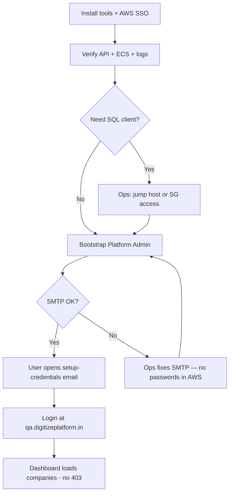

# QA: local workstation, AWS access, RDS, Platform Admin & password — end to end

**Date:** 2026-11-11  
**Audience:** Engineers onboarding to the shared **QA AWS environment** — laptop setup, connecting to RDS and other services, creating a Platform Admin, and setting or resetting passwords  
**Account:** `799201156295` · **Region:** `ap-south-1` (Mumbai)

**Related docs:**

- [QA_PLATFORM_ADMIN_ONBOARDING_KT.md](./QA_PLATFORM_ADMIN_ONBOARDING_KT.md) — topology, deploy, SES, mistakes  
- [BASIC_QA_TESTING_HANDOVER.md](./BASIC_QA_TESTING_HANDOVER.md) — functional test scenarios

---

## 0. What this guide means by “local setup”

| Meaning | In scope here? |
|--------|----------------|
| Configure **your laptop** with AWS CLI, repos, and access to the **existing** QA account | **Yes** |
| **Connect** to QA RDS, logs, secrets (with correct IAM), and public API/web | **Yes** |
| **Create** a Platform Admin and complete **password** setup end to end | **Yes** |
| Run **Terraform** to create or change VPC/ECS/RDS (platform ops) | **§4** — ops only |
| Run the backend **against localhost Postgres** pretending to be QA | **No** — QA data lives only in QA RDS |

QA RDS is **private** (`publicly_accessible = false`). Your laptop cannot open `5432` to RDS directly unless ops gives you a **jump host / VPN / SSM port forward** on an allowed security group. Application operations (bootstrap, migrations in CI) use **ECS tasks inside the VPC** instead.

### Credential policy (required)

| Rule | Detail |
|------|--------|
| **User login passwords** | Set **only** by the user in the QA web app (`setup-credentials` or forgot-password). **Do not** put staff or Platform Admin passwords in AWS (Secrets Manager, SSM, Parameter Store), tickets, chat, or git. |
| **Bootstrap** | Creates identity + RBAC and emails a **setup link** — **not** a password stored in AWS. |
| **Application / RDS secrets** | Platform **ops** maintain `digitize/qa/application` and RDS master credentials in AWS. Engineers do **not** copy secret values to laptops or documentation. |
| **SQL read-only checks** | If RBAC verification is needed, ask **ops/DBA** to run agreed queries — do not self-serve DB passwords from the console/CLI. |

---

## 1. End-to-end journey (summary)



| Phase | Outcome |
|-------|---------|
| §2–3 | Laptop can call AWS APIs and QA HTTPS endpoints |
| §5–6 | Optional: read-only / SQL access to RDS via approved path |
| §7–8 | New Platform Admin exists with RBAC |
| §9 | User password set in QA web UI (setup email or forgot-password) |
| §10 | Login and dashboard verified |

---

## 2. Laptop prerequisites

### 2.1 Install

| Tool | Purpose |
|------|---------|
| [AWS CLI v2](https://docs.aws.amazon.com/cli/latest/userguide/getting-started-install.html) | ECS, Secrets Manager, RDS describe, logs |
| **Git** | Clone `digitize-services`, `digitize-ui`, `digitize-infrastructure` |
| **Python 3.11+** | Bootstrap script local helpers (`bootstrap_qa_platform_admin.sh`) |
| **jq** (recommended) | Parse AWS JSON in shell |
| **PostgreSQL client** (`psql`) or **DBeaver** | Only if using jump host to RDS |
| **Terraform ≥ 1.16** | Only for platform ops applying `digitize-infrastructure` |

### 2.2 AWS access (every engineer)

1. Request SSO (or IAM) access to account **`799201156295`** from your org admin.
2. Configure a profile, for example:

   ```bash
   aws configure sso
   # SSO start URL, account 799201156295, role name per your org
   ```

3. Each session:

   ```bash
   aws sso login --profile digitize-qa
   export AWS_PROFILE=digitize-qa
   export AWS_REGION=ap-south-1
   ```

4. Confirm identity:

   ```bash
   aws sts get-caller-identity
   ```

### 2.3 Minimum IAM for day-to-day engineering

Your IAM role should allow (typical; exact policy names vary):

| Action | Why |
|--------|-----|
| `ecs:DescribeServices`, `ecs:DescribeTasks`, `ecs:RunTask` | Platform Admin bootstrap one-off tasks |
| `logs:GetLogEvents`, `logs:FilterLogEvents` | Read bootstrap / Alembic logs |
| `secretsmanager:DescribeSecret` (optional) | Confirm secret exists — **not** `GetSecretValue` for daily work |
| `rds:DescribeDBInstances` | Resolve endpoint hostname |
| Read-only EC2/SSM | If using port-forward bastion |

**GitHub Actions** uses OIDC roles — you do **not** put `AWS_ACCESS_KEY_ID` in repos. Deploy vars live in GitHub Environment **`qa`**.

### 2.4 Clone repositories

```bash
git clone <org>/digitize-services.git
git clone <org>/digitize-ui.git
git clone <org>/digitize-infrastructure.git
```

Local backend development uses **localhost** Postgres (`digitize` / `digitize_test`). That is separate from QA RDS — do not run `ENVIRONMENT=qa` on a laptop against QA RDS.

---

## 3. Verify connectivity (no RDS required)

Run these from your laptop after `aws sso login`.

### 3.1 Public API and web

```bash
curl -sS -o /dev/null -w "liveness HTTP %{http_code}\n" \
  https://qa-api.digitizeplatform.in/api/v1/health/liveness
```

Open `https://qa.digitizeplatform.in` in a browser (Flutter web).

### 3.2 ECS backend service

```bash
aws ecs describe-services \
  --region ap-south-1 \
  --cluster digitize-qa \
  --services digitize-qa-backend \
  --query 'services[0].{status:status,desired:desiredCount,running:runningCount,taskDef:taskDefinition}'
```

If **`desiredCount` is 0**, the stack may be cost-stopped. Ask ops to scale to **1** before PA testing:

```bash
aws ecs update-service \
  --region ap-south-1 \
  --cluster digitize-qa \
  --service digitize-qa-backend \
  --desired-count 1
```

(Use only with team approval — shared QA policy.)

### 3.3 RDS metadata (not SQL login yet)

```bash
aws rds describe-db-instances \
  --region ap-south-1 \
  --db-instance-identifier digitize-qa-postgres \
  --query 'DBInstances[0].{Endpoint:Endpoint.Address,Port:Endpoint.Port,DBName:DBName,Status:DBInstanceStatus}'
```

Expect database name **`digitize`**, port **5432**, status **available** (or **stopped** if ops stopped the instance).

### 3.4 Application secret (metadata)

Secret name: **`digitize/qa/application`** (keys listed in `digitize-infrastructure/README.md`). **Do not** read or export secret values on engineer laptops — ops owns rotation and validation.

### 3.5 CloudWatch logs

Log group: **`/digitize/qa/backend`**. After bootstrap, stream pattern: `backend/backend/<ecs-task-id>`.

---

## 4. Platform ops only — provision or refresh QA infrastructure locally with Terraform

Most engineers **do not** run this. Use when standing up QA or changing VPC/RDS/IAM.

### 4.1 Repos and state

```bash
cd digitize-infrastructure/environments/qa
terraform init    # backend per team (remote state or local)
terraform plan
# terraform apply   # only with ops approval
```

Also separate roots:

- `environments/qa-github-actions-oidc/` — backend deploy role  
- `environments/qa-github-actions-oidc-frontend/` — frontend deploy role  

### 4.2 After apply — manual steps (ops only, never in git)

1. Platform ops populate **`digitize/qa/application`** and RDS secrets using the team secure process (see `digitize-infrastructure/README.md`).
2. DNS: `terraform output cloudflare_dns_after_validation` and ACM validation outputs.
3. Scale ECS desired count when ready for testing.
4. Backend/image: push `release/**` to trigger `digitize-services` **Deploy QA** workflow (GHA owns task definition revisions).

Engineers **do not** edit AWS secrets for onboarding; request ops if SMTP or bootstrap prerequisites fail.

### 4.3 Contract check

```bash
cd digitize-infrastructure
./scripts/check_application_secret_contract.sh
```

---

## 5. Connect to QA RDS from your laptop

### 5.1 Network model

| Resource | QA identifier |
|----------|----------------|
| RDS instance | `digitize-qa-postgres` |
| Database | `digitize` |
| RDS SG | Allows **5432** from ECS service SG and from **additional** client SG(s) configured in Terraform (`additional_rds_ingress_security_group_ids`) |
| Master credentials | AWS-managed secret — ECS reads `username` / `password` into `DB_USER` / `DB_PASSWORD` |

ECS tasks receive:

- `DB_HOST`, `DB_PORT`, `DB_NAME` as plain environment variables  
- `DB_USER`, `DB_PASSWORD` from the RDS master secret ARN  

### 5.2 Approved ways to run SQL or DBeaver

**Option A — Jump host / bastion (recommended for humans)**  

1. Ops provisions an EC2 (or existing bastion) with ENI in a security group allowed on RDS (see Terraform comment on `sg-025be30ced8146e21` in `environments/qa/main.tf`).  
2. Connect via **SSM Session Manager** or SSH (team policy).  
3. From the bastion, or via **port forwarding** to your laptop:

   ```bash
   # Example pattern — replace instance id and host with ops runbook values
   aws ssm start-session \
     --target i-xxxxxxxx \
     --document-name AWS-StartPortForwardingSessionToRemoteHost \
     --parameters '{"host":["<rds-endpoint>"],"portNumber":["5432"],"localPortNumber":["15432"]}'
   ```

4. DBeaver/psql connection details (host, user, password, SSL) come **only** from the **ops/DBA secure runbook** — not from this doc or ad-hoc `get-secret-value` on engineer machines.

**Option B — No direct SQL (recommended for Platform Admin)**  

Use **ECS one-off tasks** (`bootstrap_qa_platform_admin.sh`, GHA Alembic). No RDS port on your laptop required.

**Not allowed without approval:** Opening RDS to `0.0.0.0/0`, storing connection strings in git, exporting Secrets Manager values to laptops, or `alembic upgrade` from a laptop against shared QA ([TEST-13](../../12_Testing/TEST-13_EQ011_digitize_test_Migration_Authorization.md)).

### 5.3 RDS hostname (metadata only)

You may read the **non-secret** endpoint hostname for troubleshooting:

```bash
aws rds describe-db-instances \
  --region ap-south-1 \
  --db-instance-identifier digitize-qa-postgres \
  --query 'DBInstances[0].Endpoint.Address' \
  --output text
```

Database name: **`digitize`**. For login parameters, use the ops runbook — do not paste credentials into tickets or docs.

### 5.4 Other QA services from the laptop

| Service | How you reach it |
|---------|------------------|
| **API** | HTTPS `qa-api.digitizeplatform.in` |
| **Web** | HTTPS `qa.digitizeplatform.in` |
| **SES SMTP** | Only from ECS (outbound 587); test via app email flows |
| **Secrets Manager** | Console metadata only — **ops** changes values |
| **ECR** | `aws ecr describe-images --repository-name digitize-qa-backend` |
| **S3 web bucket** | Deploy workflow only; bucket `digitize-qa-web-799201156295` |

---

## 6. Ensure QA is ready for identity operations

| Check | Command / action |
|-------|------------------|
| API up | Liveness **200** (§3.1) |
| ECS running | `runningCount >= 1` (§3.2) |
| RDS up | RDS status **available** (§3.3) |
| SMTP valid | Ops confirms mail path; bootstrap logs show successful email flush (no **535**) |
| Bootstrap prerequisites | Ops confirms application secret contract — bootstrap fails if misconfigured |
| `AUTH_APP_PUBLIC_URL` | `https://qa.digitizeplatform.in` (setup links) |

---

## 7. Create a Platform Admin (operator steps)

### 7.1 Run bootstrap

From your laptop (uses **ECS RunTask**, not local DB):

```bash
cd digitize-services
export AWS_PROFILE=digitize-qa
export AWS_REGION=ap-south-1

./scripts/bootstrap_qa_platform_admin.sh your.name@company.com
```

If a Platform Admin already exists:

```bash
./scripts/bootstrap_qa_platform_admin.sh your.name@company.com --confirm-additional
```

### 7.2 Confirm task success

- Script prints task JSON with **`exitCode": 0`**.  
- Fetch logs if needed:

  ```bash
  aws logs get-log-events \
    --region ap-south-1 \
    --log-group-name /digitize/qa/backend \
    --log-stream-name "backend/backend/<task-id>" \
    --query 'events[*].message' --output text
  ```

### 7.3 What bootstrap does in the product

1. Creates `identity.user_account` with your email as `login_identifier`.  
2. Ensures `PLATFORM_ADMIN` role and **syncs platform permissions** (`role_permission`).  
3. Assigns the role (**ACTIVE**).  
4. Queues **credential setup** email (`/auth/setup-credentials?token=...`) via SMTP after commit.

**Do not** insert users only in SQL — login may work while `GET /organizations` returns **403**.

---

## 8. Password and first login — end to end

### 8.1 Happy path (intended)

| Step | Who | Action |
|------|-----|--------|
| 1 | Operator | Complete §7 bootstrap |
| 2 | User | Check inbox for **Digitize credential setup** (spam folder too) |
| 3 | User | Open link → `https://qa.digitizeplatform.in/auth/setup-credentials?token=<token>` |
| 4 | User | Set password (policy enforced server-side) |
| 5 | User | Go to `https://qa.digitizeplatform.in`, sign in with email + password |
| 6 | User | **Platform Overview** / companies list loads without **Failed to load companies** |

Token is single-use and time-limited (`AUTH_TEMP_CREDENTIAL_TTL_SECONDS` on QA).

### 8.2 If email did not arrive

1. **Escalate to ops** — SMTP and application secrets are maintained in AWS by platform ops (you do not edit them).  
2. After ops confirms delivery, repeat bootstrap or wait for setup email.  
3. If the account already has correct RBAC but no password yet, user may use **Forgot password** on the QA web app once ops confirms SMTP works — still **does not** fix missing `role_permission`.  
4. **Do not** store a chosen password in AWS, share it in chat, or use operator CLI paths that load secrets onto laptops.

### 8.3 User-initiated password reset (after first login)

| Step | Action |
|------|--------|
| 1 | On login screen, use **Forgot password** |
| 2 | Enter registered email |
| 3 | Open email link → confirm reset (`POST /api/v1/auth/password-reset` / confirm per product UI) |
| 4 | Sign in with new password |

Same SMTP requirement as setup email.

### 8.4 Verify authorization (if dashboard 403)

Ask **ops/DBA** to run the following on QA RDS (or use API/login evidence only). Do not retrieve DB passwords to run this yourself unless ops explicitly assigned that role:

```sql
SELECT record_id, login_identifier, account_status
FROM identity.user_account
WHERE login_identifier = 'your.name@company.com';

SELECT COUNT(*) AS platform_admin_perm_links
FROM identity.role_permission rp
JOIN identity.role r ON r.record_id = rp.role_id
WHERE r.role_code = 'PLATFORM_ADMIN'
  AND r.role_scope = 'PLATFORM';

SELECT p.permission_code
FROM identity.permission p
JOIN identity.role_permission rp ON rp.permission_id = p.record_id
JOIN identity.role_assignment ra ON ra.role_id = rp.role_id
JOIN identity.user_account u ON u.record_id = ra.user_account_id
WHERE u.login_identifier = 'your.name@company.com'
  AND ra.assignment_status = 'ACTIVE'
ORDER BY 1;
```

Expect **`organization.list`** (and `perm_links > 0` on the role). If zero permissions, run bootstrap with a **new** email or execute DBA repair per migration `015_api02_read_permissions.sql` — not password reset alone.

### 8.5 Session cache

After RBAC repair, user must **log out and log in** so the client reloads permissions.

---

## 9. Checklist (printable)

**Workstation**

- [ ] AWS CLI v2 + `aws sso login`  
- [ ] `aws sts get-caller-identity` shows `799201156295`  
- [ ] Repos cloned  
- [ ] API liveness 200  
- [ ] ECS `digitize-qa-backend` running (if testing)  

**Platform Admin**

- [ ] `./scripts/bootstrap_qa_platform_admin.sh <email>` exit 0  
- [ ] SQL: `PLATFORM_ADMIN` assignment ACTIVE  
- [ ] SQL: role has `role_permission` rows  
- [ ] Setup email received; user set password in **web UI only**  
- [ ] Login + companies dashboard OK  

**Ops (first-time environment)**

- [ ] Terraform QA applied  
- [ ] Application secrets configured via secure ops process (not documented here)  
- [ ] Transactional email verified  
- [ ] DNS / TLS live  
- [ ] GHA deploy green on `release/**`  

---

## 10. Troubleshooting

| Symptom | Likely cause | Fix |
|---------|--------------|-----|
| `Unable to connect to RDS` on laptop | No tunnel / SG | §5.2 Option A; do not enable public RDS |
| Bootstrap task non-zero exit | Duplicate email, missing pepper, safety guard | Read CloudWatch log stream |
| No email | SMTP 535 or ECS scaled to 0 | Fix SMTP secret; scale ECS |
| Login OK, dashboard 403 | Empty `role_permission` | Bootstrap new user or DBA seed |
| Setup link expired | TTL elapsed | Re-bootstrap or ops-approved resend; user sets password in UI |
| `AccessDenied` on `RunTask` | IAM | Request ecs:RunTask on QA cluster |

---

## 11. Escalation

| Topic | Owner |
|-------|--------|
| AWS SSO, bastion, RDS SG | Organization / platform ops |
| Terraform, secrets, SES | `digitize-infrastructure` owners |
| Bootstrap, RBAC, API | `digitize-services` / identity |
| QA web login UX | `digitize-ui` |

---

## 12. Quick reference

```bash
export AWS_PROFILE=digitize-qa AWS_REGION=ap-south-1

curl -sS -o /dev/null -w "%{http_code}\n" \
  https://qa-api.digitizeplatform.in/api/v1/health/liveness

cd digitize-services && ./scripts/bootstrap_qa_platform_admin.sh pa@example.com
```

**URLs:** Web `https://qa.digitizeplatform.in` · API `https://qa-api.digitizeplatform.in/api/v1`  
**Bootstrap script:** `digitize-services/scripts/bootstrap_qa_platform_admin.sh`  
**App secret:** `digitize/qa/application`  
**RDS:** `digitize-qa-postgres` / DB `digitize`
