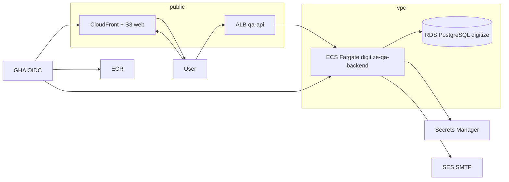

# QA environment operations — knowledge transfer

**Date:** 2026-11-11 (expanded)  
**Audience:** Engineers, platform ops, and QA leads — AWS access, deploy, secrets, email, and Platform Admin provisioning  
**Scope:** QA only (`ap-south-1`, AWS account **799201156295**)  
**Companion:** Functional test scope lives in [BASIC_QA_TESTING_HANDOVER.md](./BASIC_QA_TESTING_HANDOVER.md); this doc covers **how the QA stack is set up and operated**.

**Step-by-step E2E (laptop → RDS access → Platform Admin → password):** [QA_LOCAL_AWS_SETUP_PLATFORM_ADMIN_E2E.md](./QA_LOCAL_AWS_SETUP_PLATFORM_ADMIN_E2E.md)

---

## Document map

| You need to… | Start here |
|--------------|------------|
| Run a first QA test pass (scenarios, APIs, data policy) | [BASIC_QA_TESTING_HANDOVER.md](./BASIC_QA_TESTING_HANDOVER.md) |
| Full E2E: local AWS, RDS, PA, password | [QA_LOCAL_AWS_SETUP_PLATFORM_ADMIN_E2E.md](./QA_LOCAL_AWS_SETUP_PLATFORM_ADMIN_E2E.md) |
| Configure laptop + AWS CLI for QA | [§2 Workstation setup](#2-workstation-setup) |
| Understand VPC / ECS / RDS / secrets | [§3 AWS topology](#3-aws-topology) + [§4 Terraform](#4-terraform-and-ownership-split) |
| Deploy backend or frontend | [§7 Backend deploy](#7-backend-deploy-github-actions) · [§8 Frontend deploy](#8-frontend-deploy-github-actions) |
| Fix email (setup links, reports) | [§6 Email (SES / SMTP)](#6-email-ses--smtp) |
| Create a Platform Admin | [§10 Platform Admin onboarding](#10-platform-admin-onboarding) |
| Cutover / migration evidence | [QA_GHA_DEPLOYMENT_EXECUTION_2026-11-09.md](./QA_GHA_DEPLOYMENT_EXECUTION_2026-11-09.md) |

---

## 1. QA entry points

| Item | Value |
|------|--------|
| Web | `https://qa.digitizeplatform.in` |
| API | `https://qa-api.digitizeplatform.in/api/v1` |
| Health | `GET /api/v1/health/liveness` → expect **200** |
| AWS region | `ap-south-1` (Mumbai) |
| ECS cluster | `digitize-qa` |
| Backend service | `digitize-qa-backend` |
| ECR (backend) | `799201156295.dkr.ecr.ap-south-1.amazonaws.com/digitize-qa-backend` |
| Web static hosting | S3 `digitize-qa-web-799201156295`, CloudFront `EC7UZ5XYA9CNE` |
| App public URL (auth emails) | `https://qa.digitizeplatform.in` (`AUTH_APP_PUBLIC_URL` on QA) |
| Application secret | Secrets Manager `digitize/qa/application` |
| Backend logs | CloudWatch `/digitize/qa/backend` |
| RDS | Instance name pattern `digitize-qa-postgres`, database **`digitize`** (private; no public endpoint) |

**Repositories (typical clone set):**

| Repo | Role |
|------|------|
| `digitize-services` | FastAPI backend, Alembic, bootstrap scripts, `deploy-qa.yml` |
| `digitize-ui` | Flutter web, `deploy-qa.yml` |
| `digitize-infrastructure` | Terraform for QA VPC, RDS, ECS, secrets *containers*, OIDC deploy roles |

---

## 2. Workstation setup

### 2.1 Tools

| Tool | Version / notes |
|------|------------------|
| **AWS CLI v2** | Required for bootstrap, ops, optional debugging |
| **Git** | Access to GitHub org/repos |
| **Python 3** | Bootstrap script uses local `python3` for ECS override JSON |
| **Terraform** | Only if you apply `digitize-infrastructure` (ops) |
| **Flutter** | Only for local UI builds; QA web deploy is via GHA |

### 2.2 AWS CLI and account access

1. Obtain **SSO or IAM user** access to the Digitize QA account (`799201156295`) from your org admin.
2. Configure a named profile (example):

   ```bash
   aws configure sso   # or use team-standard profile name, e.g. digitize-qa
   ```

3. Verify:

   ```bash
   aws sts get-caller-identity --profile <your-qa-profile>
   export AWS_PROFILE=<your-qa-profile>   # for bootstrap script session
   aws ecs describe-services --region ap-south-1 \
     --cluster digitize-qa --services digitize-qa-backend \
     --query 'services[0].status'
   ```

**Bootstrap script IAM (human operator):** ability to run **`ecs:RunTask`**, **`ecs:DescribeTasks`**, **`ecs:DescribeServices`**, **`logs:GetLogEvents`** on QA backend resources. It does **not** need ECS Exec on the long-running service.

**GitHub Actions deploy IAM:** separate OIDC roles (`digitize-qa-github-backend-deploy`, `digitize-qa-github-frontend-deploy`). Developers do not use access keys in repos; workflows assume `AWS_ROLE_ARN` from the GitHub Environment **`qa`**.

### 2.3 GitHub

- Push rights on `digitize-services` / `digitize-ui` for `release/**` deploy branches (team policy).
- GitHub Environment **`qa`** variables (not in git): `AWS_ROLE_ARN`, and for UI `QA_WEB_BUCKET`, `QA_CLOUDFRONT_DISTRIBUTION_ID`.

### 2.4 Database access (optional, ops-led)

- Direct SQL is **not** required for Platform Admin onboarding.
- **Ops/DBA** hold connection details in a secure runbook — engineers do **not** export Secrets Manager values to laptops.

---

## 3. AWS topology

High-level QA layout (Terraform-managed unless noted):



| Layer | QA identifiers |
|-------|----------------|
| DNS | Cloudflare CNAMEs → CloudFront (web), ALB DNS (API); ACM certs in `ap-south-1` (API) and `us-east-1` (CloudFront) |
| Compute | ECS Fargate, cluster `digitize-qa`, service `digitize-qa-backend` |
| Data | RDS PostgreSQL, DB name `digitize`, schemas via Alembic |
| Secrets | `digitize/qa/application` JSON + separate blind-index / KMS resources per encryption readiness |
| Messaging | Amazon SES SMTP (`email-smtp.ap-south-1.amazonaws.com:587`, STARTTLS) |
| Payments | Razorpay Test Mode keys in application secret; task env `RAZORPAY_MODE=live` selects real adapter code path |

**Cost note:** QA is designed **on-demand** (e.g. ECS desired count / RDS stop windows). Coordinate with ops before long test windows — see [BASIC_QA_TESTING_HANDOVER.md §8](./BASIC_QA_TESTING_HANDOVER.md).

---

## 4. Terraform and ownership split

| Owns | Tool | Location |
|------|------|----------|
| VPC, subnets, security groups, ALB, RDS, ECR repo, ECS cluster/service *shell*, secret **resources**, KMS/blind-index modules, ACM | **Terraform** | `digitize-infrastructure/environments/qa/` |
| GitHub OIDC deploy roles | **Terraform** | `environments/qa-github-actions-oidc/`, `qa-github-actions-oidc-frontend/` |
| Running container **image**, task definition revisions, Alembic upgrade, ECS rollout | **GitHub Actions** | `digitize-services/.github/workflows/deploy-qa.yml` |
| Flutter web build, S3 sync, invalidation | **GitHub Actions** | `digitize-ui/.github/workflows/deploy-qa.yml` |

Terraform uses `lifecycle.ignore_changes` on ECS task `container_definitions` and service `task_definition` so GHA-owned deploys are not reverted by the next `terraform apply`.

**Useful Terraform outputs** (from `environments/qa/`):

- `application_secret_name` → `digitize/qa/application`
- `application_secret_json_keys` → required JSON keys list
- `alb_dns_name`, `cloudfront_domain_name`, `cloudflare_dns_after_validation` → DNS cutover
- `rds_endpoint` → private endpoint (ops)

Contract check script (infra repo):

```bash
cd digitize-infrastructure
./scripts/check_application_secret_contract.sh
```

---

## 5. Application secrets (`digitize/qa/application`)

Terraform creates the secret; **values are set only in AWS Console or CLI** — never in git or Terraform state content.

| JSON key | Injected into task as | Purpose |
|----------|------------------------|---------|
| `JWT_PRIVATE_KEY` / `JWT_PUBLIC_KEY` | same | API JWT signing |
| `PASSWORD_PEPPER` | same | Password hashing (required for bootstrap) |
| `SMTP_USERNAME` / `SMTP_PASSWORD` | same | **SES SMTP** credentials (not IAM API keys) |
| `RAZORPAY_KEY_ID` / `RAZORPAY_KEY_SECRET` / `RAZORPAY_WEBHOOK_SECRET` | same | Test mode payment sandbox |

**After any secret change:** roll ECS tasks — typically by running **backend GHA deploy** on `release/**` (or force new deployment per ops runbook) so tasks load the latest secret version.

**Encryption readiness (separate from application JSON):** organization DEK KMS and blind-index secrets are additional Terraform modules; see `digitize-infrastructure/README.md` and `digitize-services/docs/encryption-readiness.md`. PII flags stay off on QA until migrations/backfill are approved.

---

## 6. Email (SES / SMTP)

QA sends transactional mail (Platform Admin setup link, password reset, reports, etc.) via **SMTP to SES**.

| Setting | QA value |
|---------|----------|
| Host | `email-smtp.ap-south-1.amazonaws.com` |
| Port | `587` (STARTTLS) |
| From | `Digitize <noreply@digitizeplatform.in>` (verify domain/identity in SES) |
| Credentials | `SMTP_USERNAME` + `SMTP_PASSWORD` in `digitize/qa/application` |

**Provisioning checklist (platform ops only — not in git):**

1. Domain or address verified in **SES** (same region).
2. Application secret updated via team secure process (SMTP and related keys per `digitize-infrastructure/README.md`).
3. ECS tasks rolled; confirm no **`535 Authentication Credentials Invalid`** in logs when flushing outbox.
4. Send a test via bootstrap or password-reset flow.

Engineers who need mail for onboarding **escalate to ops** — they do not edit AWS secrets.

**Common failure:** Putting IAM access keys in SMTP fields → TCP/TLS succeeds, auth fails with **535**. Fix secrets, not application code.

If email is down, escalate to ops for SMTP — then user sets password in the web UI only. See [§12 Break-glass](#12-break-glass-email-down-rbac).

---

## 7. Backend deploy (GitHub Actions)

**Workflow:** `digitize-services/.github/workflows/deploy-qa.yml`  
**Trigger:** push to `release/**` (and `workflow_dispatch` if enabled).

**Pipeline (summary):**

1. Quality gate (tests, Alembic baseline check vs QA schema policy).
2. Build `linux/amd64` image → push to ECR with commit SHA tag + digest.
3. Register new ECS task definition pinned to image digest.
4. Run **Alembic upgrade** (one-off ECS task pattern).
5. Update `digitize-qa-backend` service; wait stable; **liveness** probe on public API.

**Branch discipline:** Use a dedicated release branch (e.g. `release/qa-smoke-20261016`); merge or cherry-pick intended commits, then push to trigger deploy.

**Verify after deploy:**

```bash
curl -sS -o /dev/null -w "%{http_code}\n" \
  https://qa-api.digitizeplatform.in/api/v1/health/liveness
```

```bash
aws ecs describe-services --region ap-south-1 \
  --cluster digitize-qa --services digitize-qa-backend \
  --query 'services[0].{taskDef:taskDefinition,running:runningCount,desired:desiredCount,rollout:deployments[0].rolloutState}'
```

**Do not** apply `alembic upgrade` against shared QA RDS from a laptop without TEST-13 / ops sign-off ([handover §7](./BASIC_QA_TESTING_HANDOVER.md)).

---

## 8. Frontend deploy (GitHub Actions)

**Workflow:** `digitize-ui/.github/workflows/deploy-qa.yml`  
**Trigger:** push to `release/**`.

**Build inputs (baked into web bundle):**

- `DIGITIZE_API_BASE_URL` = `https://qa-api.digitizeplatform.in`
- `QA_SITE_URL` = `https://qa.digitizeplatform.in`

**GitHub Environment `qa` variables:**

- `AWS_ROLE_ARN` = frontend OIDC role
- `QA_WEB_BUCKET` = `digitize-qa-web-799201156295`
- `QA_CLOUDFRONT_DISTRIBUTION_ID` = `EC7UZ5XYA9CNE`

Workflow syncs `build/web` to S3 and invalidates CloudFront. It does **not** start/stop ECS.

**Verify:** load `https://qa.digitizeplatform.in` and confirm network calls hit `qa-api.digitizeplatform.in` (browser devtools).

---

## 9. DNS and TLS (ops)

DNS is typically **Cloudflare** → AWS:

| Hostname | Target type | Notes |
|----------|-------------|--------|
| `qa.digitizeplatform.in` | CNAME → CloudFront | HTTPS at CloudFront |
| `qa-api.digitizeplatform.in` | CNAME → ALB DNS | Team often uses **DNS only** (grey cloud) so ALB sees client IPs |

ACM validation records and post-validation CNAME targets are in Terraform outputs `api_acm_validation_records`, `web_acm_validation_records`, `cloudflare_dns_after_validation`.

---

## 10. Platform Admin onboarding

### 10.1 What a Platform Admin is

- **Scope:** Platform governance (companies, onboarding, platform configuration). Not a tenant superuser inside one organization.
- **Login:** Email as `login_identifier`.
- **Authorization:** Database-driven: active `PLATFORM_ADMIN` role assignment **and** `role_permission` rows (e.g. `organization.list`). JWT `is_platform_admin` affects Flutter routing only; APIs reload permissions each request.

**Do not** create PA users with ad-hoc SQL (user row only).  
**Do** use `bootstrap_qa_platform_admin.sh` so role, permissions, and assignment stay consistent.

**Credential policy:** Platform Admin **login passwords** are set only by the user in the QA web UI (`setup-credentials` or forgot-password). **Do not** store user passwords in AWS Secrets Manager/SSM, tickets, or docs. Application secrets (JWT, SMTP, pepper) are **ops-maintained** — engineers bootstrap via ECS; they do not copy secret values to laptops.

### 10.2 Create a Platform Admin

```bash
cd digitize-services
export AWS_PROFILE=<your-qa-profile>   # if not default
./scripts/bootstrap_qa_platform_admin.sh new-pa@yourcompany.com
```

Additional PA when one already exists:

```bash
./scripts/bootstrap_qa_platform_admin.sh new-pa@yourcompany.com --confirm-additional
```

**Mechanism:** One-off Fargate task from the **current** `digitize-qa-backend` task definition runs CLI `bootstrap-platform-admin` inside the same image/secrets/DB as production QA.

**Success checks:**

- Container exit code **0** in script output.
- CloudWatch: `/digitize/qa/backend`, stream `backend/backend/<task-id>`.

### 10.3 RBAC verification (SQL)

```sql
SELECT record_id, login_identifier, account_status, user_type
FROM identity.user_account
WHERE login_identifier = 'new-pa@yourcompany.com';

SELECT r.role_code, ra.assignment_status
FROM identity.role_assignment ra
JOIN identity.role r ON r.record_id = ra.role_id
WHERE ra.user_account_id = '<user_record_id>';

SELECT COUNT(*) AS perm_links
FROM identity.role_permission rp
JOIN identity.role r ON r.record_id = rp.role_id
WHERE r.role_code = 'PLATFORM_ADMIN'
  AND r.role_scope = 'PLATFORM'
  AND r.organization_id IS NULL;

SELECT DISTINCT p.permission_code
FROM identity.permission p
JOIN identity.role_permission rp ON rp.permission_id = p.record_id
JOIN identity.role_assignment ra ON ra.role_id = rp.role_id
WHERE ra.user_account_id = '<user_record_id>'
  AND ra.assignment_status = 'ACTIVE'
  AND p.is_active IS TRUE
ORDER BY 1;
```

**Expect:** `PLATFORM_ADMIN` / `ACTIVE`, `perm_links` **> 0**, including **`organization.list`**.

### 10.4 User journey (intended)

| Step | Action |
|------|--------|
| 1 | Receives **credential setup** email |
| 2 | Opens `https://qa.digitizeplatform.in/auth/setup-credentials?token=...` |
| 3 | Sets password |
| 4 | Signs in; **Platform Overview** loads companies (no `403 AUTHORIZATION_DENIED`) |

Forgot password is not the first-login path; it does not repair missing `role_permission` data.

### 10.5 Other QA roles

Organization Admin, Facility Admin, and Support Agent are provisioned through product onboarding flows, not this bootstrap script. See [BASIC_QA_TESTING_HANDOVER.md §2](./BASIC_QA_TESTING_HANDOVER.md).

---

## 11. Other operational CLIs (pattern)

Bootstrap uses **ECS RunTask** with command override — the same pattern applies to other one-off tasks (e.g. Alembic in GHA). Prefer documented scripts and team approval; do not patch RDS identity tables by hand.

Script reference: `digitize-services/scripts/bootstrap_qa_platform_admin.sh`.

---

## 12. Break-glass (email down, RBAC)

**Preferred order:**

1. **Ops fixes SMTP / application secrets** in AWS (engineers do not edit), roll tasks, then resend setup email or bootstrap a new PA.
2. **Forgot password** on QA web — only after SMTP works; does not fix RBAC.
3. **Never** place user login passwords in AWS or shared channels — passwords are set only in the product UI.

**Dashboard `Failed to load companies` + `403` with working login:** usually empty **`PLATFORM_ADMIN` `role_permission`**. Repair via DBA runbook (migration `015`-style seeds) or **new bootstrap**; password reset alone will not fix it.

---

## 13. Common mistakes

| Mistake | Symptom | Fix |
|---------|---------|-----|
| IAM keys in SMTP fields | No mail; **535** in logs | SES SMTP user/pass in secret |
| Secret updated, tasks not rolled | Stale SMTP/JWT/Razorpay | GHA deploy or forced ECS rollout |
| Hand-created user in DB | Login OK; **403** on organizations | Bootstrap or `role_permission` repair |
| Forgot password instead of setup link | ACTIVE user; empty permissions | RBAC repair or new bootstrap |
| UI shows PA chrome but API 403 | Client bypass vs DB authz | Fix `role_permission`; re-login |
| Local Alembic on shared QA | Schema drift / outages | Use GHA migration path + ops sign-off |
| Deploy from `main` without release branch | No QA workflow run | Push to `release/**` per team branch |

---

## 14. Quick reference commands

```bash
# API health
curl -sS -o /dev/null -w "%{http_code}\n" \
  https://qa-api.digitizeplatform.in/api/v1/health/liveness

# AWS identity
aws sts get-caller-identity

# ECS service
aws ecs describe-services --region ap-south-1 \
  --cluster digitize-qa --services digitize-qa-backend

# First Platform Admin
./scripts/bootstrap_qa_platform_admin.sh pa@example.com

# Additional Platform Admin
./scripts/bootstrap_qa_platform_admin.sh pa2@example.com --confirm-additional
```

---

## 15. Escalation

| Topic | Contact |
|-------|---------|
| Bootstrap, RBAC, API 403 | Backend / identity (`digitize-services`) |
| SES, secrets, ECS, RDS, Terraform | Platform ops / `digitize-infrastructure` |
| QA web UX, API base URL in bundle | `digitize-ui` + frontend GHA |
| AWS account / SSO / GitHub Environments | Organization admin |

---

## Related evidence

- [QA_LOCAL_AWS_SETUP_PLATFORM_ADMIN_E2E.md](./QA_LOCAL_AWS_SETUP_PLATFORM_ADMIN_E2E.md) — workstation, RDS, PA, password E2E  
- [BASIC_QA_TESTING_HANDOVER.md](./BASIC_QA_TESTING_HANDOVER.md) — scenarios, modules, data policy  
- [QA_GHA_DEPLOYMENT_EXECUTION_2026-11-09.md](./QA_GHA_DEPLOYMENT_EXECUTION_2026-11-09.md) — cutover evidence  
- `digitize-infrastructure/README.md` — secrets contract, deploy ownership  
- `digitize-services/scripts/bootstrap_qa_platform_admin.sh` — Platform Admin automation  
- `migrations/sql/015_api02_read_permissions.sql` — `PLATFORM_ADMIN` read permission seeds  
